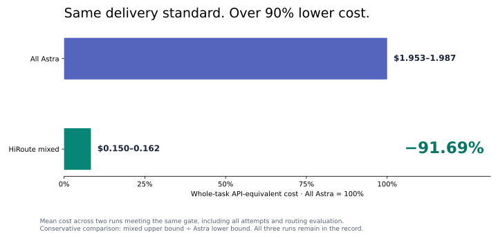
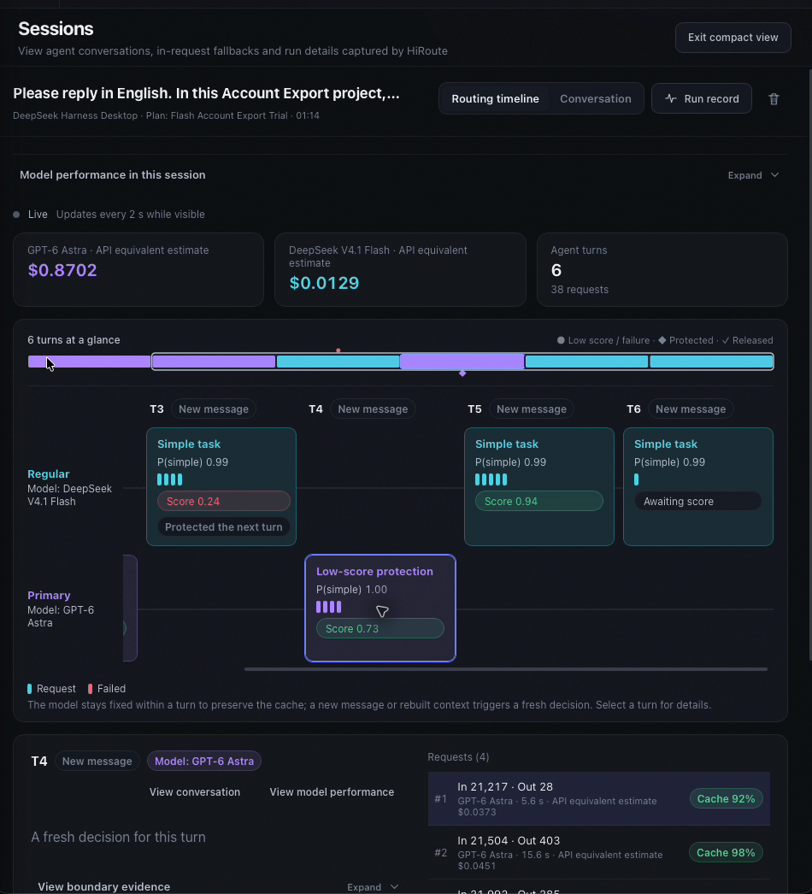
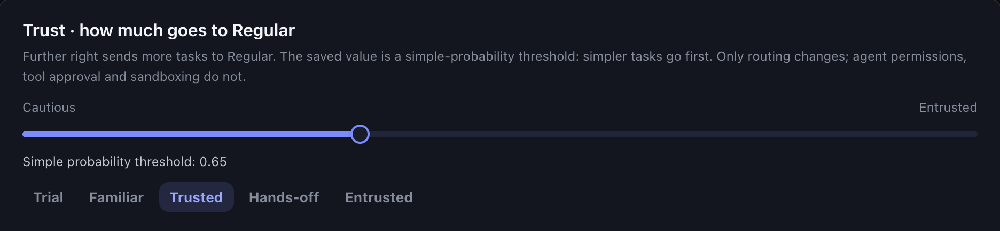
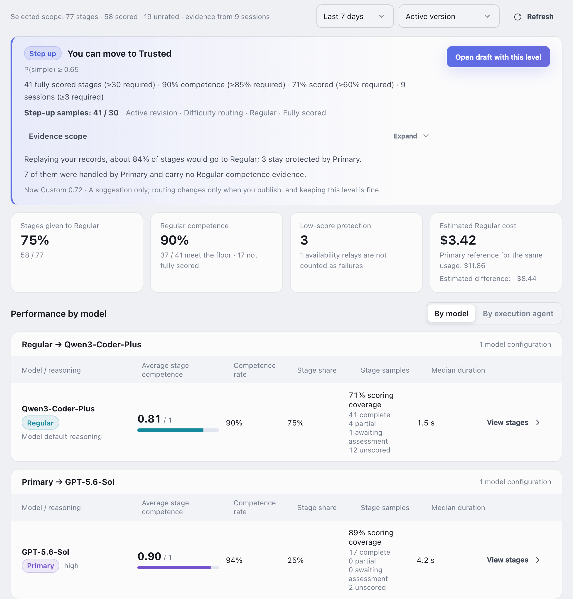

<p align="right"><a href="README.zh-CN.md">简体中文</a></p>

<p align="center">
  <a href="https://hiroute.ai/en/#tour"></a>
</p>

<p align="center">
  <strong>Pay for your strongest model only where the work needs it.</strong><br>
  Economical models handle routine turns; your primary model takes the complex work<br>
  and steps in when an economical model falls short.<br>
  Keep using Codex, Claude Code and other Agents with your subscriptions, APIs and local models.
</p>

<p align="center">
  <a href="https://hiroute.ai/en/download/">Download</a> ·
  <a href="#get-started">Quickstart</a> ·
  <a href="#real-world-cost-savings">Cost results</a> ·
  <a href="#how-well-does-the-routing-policy-work">Experiments</a> ·
  <a href="https://hiroute.ai/en/docs/">Documentation</a> ·
  <a href="CONTRIBUTING.md">Contributing</a>
</p>

<p align="center">
  <a href="https://github.com/higress-group/HiRoute/releases/latest"></a>
  <a href="LICENSE"></a>
  <a href="https://hiroute.ai/en/download/"></a>
</p>

## Real-world cost savings

In a real research and architecture-review task, Qwen 3.8 Flash did the research and GPT-6 Astra
made the critical decision. At the same acceptance standard, the task cost **about 90% less**
than running everything on Astra.

[](news/2026-10-04-astra-qwen.en.md)

<sub>API-equivalent estimates. [Full case study](news/2026-10-04-astra-qwen.en.md)</sub>

### Switching models keeps the savings

HiRoute changes models only at clear boundaries: a new user message, or context compaction and
rebuild. Tool calls within a turn stay on the same model. A switch misses the cache once, then
later calls hit it again, so cache loss does not eat into the savings.
[Switching Models Loses Cache, Not the Savings](https://hiroute.ai/en/news/routing-cache-cost/)

## Familiar Agents, more model choices

Keep working in **Codex, Claude Code, Qoder, Pi, OpenCode, Hermes or DeepSeek Harness**.
HiRoute runs locally and brings supported subscriptions, API connections and local models
into one place. For example, combine an economical API model with your Codex subscription,
or use a smaller and a stronger model from the same supported source.

| What you want | What HiRoute provides |
| --- | --- |
| **Spend less on your strongest model** | Route routine work to economical models and keep the primary model for complex stages and low-score protection. |
| **Keep your workflow** | Continue in your familiar Agent while models share the work within a session. |
| **Try a new model gradually** | Start at a trust level you choose, keep a familiar primary model as backup and adjust with evidence from your own tasks. |
| **Understand each decision** | Inspect the actual models, routing reasons, stage performance, usage and cost estimates. |

## One task, the right model for each stage

A difficulty-routing plan follows both the work ahead and what happened before:

- **Routine work:** use the economical group when the task meets your criteria.
- **Relevant failure:** when a stage scores below the competence floor and its problem still affects
  the work, low-score protection moves the next stage to your primary model.
- **Problem resolved or task changed:** reassess the current work and whether the old problem still matters.

**System One answers three questions: How demanding is the current work? How well did the
previous stage go? Does its problem still affect the current task?** HiRoute combines these
judgments with your plan to choose the executing model.

<p align="center">
  
</p>
<p align="center"><sub>A real session: after a Flash stage scores 0.24, the primary model takes the next turn under
low-score protection; once that turn scores 0.73, the work returns to Flash.</sub></p>

Keep asking follow-up questions or let your Agent advance a long task. HiRoute can reassess
at supported new-input and context-reconstruction boundaries; tool continuations normally
reuse the stage's decision. See [routing behavior and supported-client limits](apps/website/content/guides/model-routing.en.md).

[Explore routing modes](decision-extensions/README.md)

## Try new models with a primary model ready to help

Start from **New models** on Home. Instead of switching everything at once, HiRoute rolls a
new model out by task difficulty.

- **Trust sets a difficulty bar.** System One estimates how simple each turn is. Turns that
  clear the bar go to the new model; harder work stays with your primary model.
- **Open up gradually.** Move from Trial to Familiar, Trusted or Hands-off as the new model
  proves itself, and it takes on more of your work.
- **Primary still backs it up.** If a new-model stage scores below the competence floor and
  the problem still matters, low-score protection hands the next turn to your primary model.

<p align="center"></p>
<p align="center"><sub>Further right, more of the simpler work goes to the new model.</sub></p>

### Adjust with evidence from your own tasks

The session timeline shows which model actually ran and why. Model performance reports
bring together stage scores, the share handled by the regular group and available cost
estimates. When there is enough evidence, a report suggests a step up or step down; replay
the setting on your own records, inspect the changes and choose whether to publish.

<p align="center"></p>
<p align="center"><sub>A model performance report suggests a step up once the regular model clears the bar. Costs are API-equivalent estimates.</sub></p>

You can also tailor the judgment criteria to your own tasks and compare prompt changes
using the [published evaluation method](experiments/system-one-routing-paper/README.md).

## How well does the routing policy work?

Both approaches receive the same task context and complete routing policy. One selects
a model group directly; the other answers three questions and lets HiRoute combine the
answers. The comparison uses engineering workflows and mathematical dependency states.


| Scenario | Decision model | Full-policy direct selection | Three-question routing |
| --- | --- | ---: | ---: |
| Engineering | Jev 1.14 | 67.31% | **96.15%** |
| Engineering | OpenAI Decisions / gpt-6-luna | 50.00% | **91.35%** |
| Mathematical dependency states | Jev 1.14 | 54.86% | **100.00%** |
| Mathematical dependency states | OpenAI Decisions / gpt-6-luna | 65.97% | **88.89%** |

**Metric:** final group-selection accuracy, averaged equally across workflow families.
Engineering has 80 determinate cases across 26 workflows; mathematics has 40 across six.
This is a **post-hoc reviewed subset**, with the same exclusions applied to every model
and both formats after inspecting outputs. Original labels and full-population results
remain available. Jev calls ran on 28 October 2026 and OpenAI calls on 29 October; inputs
and policy match, but the calls were not contemporaneous.

The results measure conformance to the stated routing policy, not task completion or
realized savings. The OpenAI results come from the study's research adapter, not from
HiRoute's built-in OpenAI connection. Use the [study and cases](experiments/system-one-routing-paper/README.md)
to evaluate decision prompts against your own tasks.

[Comparison, exclusions and saved responses](experiments/system-one-routing-paper/supplements/decision-interface-transfer/README.md) ·
[Dataset construction and review](experiments/system-one-routing-paper/DATA-CARD.md)

## Get started

[**Download HiRoute**](https://hiroute.ai/en/download/) ·
[Installation guides](https://hiroute.ai/en/docs/) ·
[Latest release](https://github.com/higress-group/HiRoute/releases/latest)

HiRoute provides **macOS Desktop, Windows x64 Desktop, Linux Web UI, and CLI**.
The [download page](https://hiroute.ai/en/download/) lists published packages.

1. **Connect your models.** Add a supported subscription or API connection and choose an
   economical model plus a primary model.
2. **Set the division of work.** Connect a decision model in **Models → Decision models**,
   choose a trust level, then publish and map the plan to your Agent. Built-in connections
   support Bailian, OpenAI, OpenRouter Jev, TypeSafe and compatible endpoints without self-hosting Jev.
3. **Work as usual.** Continue in your Agent, then inspect model switches and execution
   reports in HiRoute.

<details>
<summary>Install on macOS, Windows or Linux</summary>

**macOS:** download the DMG, drag HiRoute into Applications, and follow the
[self-signed package instructions](docs/macos-installation.md) if macOS asks for approval.
Supports macOS 15+ on Apple silicon and Intel.

**Windows:** use the x64 Desktop installer. It installs for the
current user and includes the background service, WebView2 bootstrapper and CLI;
no Python or administrator privileges are required. See the
[Windows installation guide](https://hiroute.ai/en/docs/install-windows/) for
checksum verification, first launch and recovery.

**Linux:** install the current-user CLI and daemon on x86_64 or ARM64 without `sudo`:

```sh
curl -fsSL https://hiroute.ai/install.sh | sh
hiroute service start --output json
hiroute system status --output json
```

Open the Web UI to connect models, configure routes and Agents,
and inspect sessions in your browser:

```sh
hiroute console init --mode loopback --port 5838
hiroute service restart --output json
hiroute console open
```

Open the printed single-use login URL. For a remote host, use the
[remote-access or SSH-tunnel instructions](docs/web-console.md#access-from-another-device).
The CLI remains available for terminal and automation workflows.
The installer verifies the published manifest and checksums; service startup is explicit.
See the [Linux Web UI and CLI guide](https://hiroute.ai/en/docs/install-linux/) and
[CLI reference](docs/standalone-cli.md).

</details>

## Go further

- **Other routing modes:** fixed model, custom branches and free first, alongside difficulty
  routing. [Model routing](https://hiroute.ai/en/docs/model-routing/)
- **Agent collaboration:** expose Worker plans for delegated tasks. [Task routing](https://hiroute.ai/en/docs/task-routing/)
- **Your own decision service:** configure criteria or implement the optional
  [decision extension API](decision-extensions/api/README.md).
- **Detailed behavior:** candidate fallback, scoring eligibility, recovery and client
  limits are documented in the [routing guide](apps/website/content/guides/model-routing.en.md).

## News

- [Latest stable release and release notes](https://github.com/higress-group/HiRoute/releases/latest)
- **2026-10-14** — [Switching Models Loses Cache, Not the Savings](news/2026-10-14-routing-cache-cost.en.md)
- [All news and case studies](news/README.md) · [Experiments](experiments/README.md)

## Contribute

Start with the [contributing guide](CONTRIBUTING.md) for setup and validation, and the
[code map](docs/code-map/README.md) to find each capability's implementation.
HiRoute uses [Apache License 2.0](LICENSE). Report bugs and feature requests through
[GitHub Issues](https://github.com/higress-group/HiRoute/issues); follow [SECURITY.md](SECURITY.md)
for security reports and crash-report handling.

Community link: [LINUX DO](https://linux.do/) (technical discussion community).
