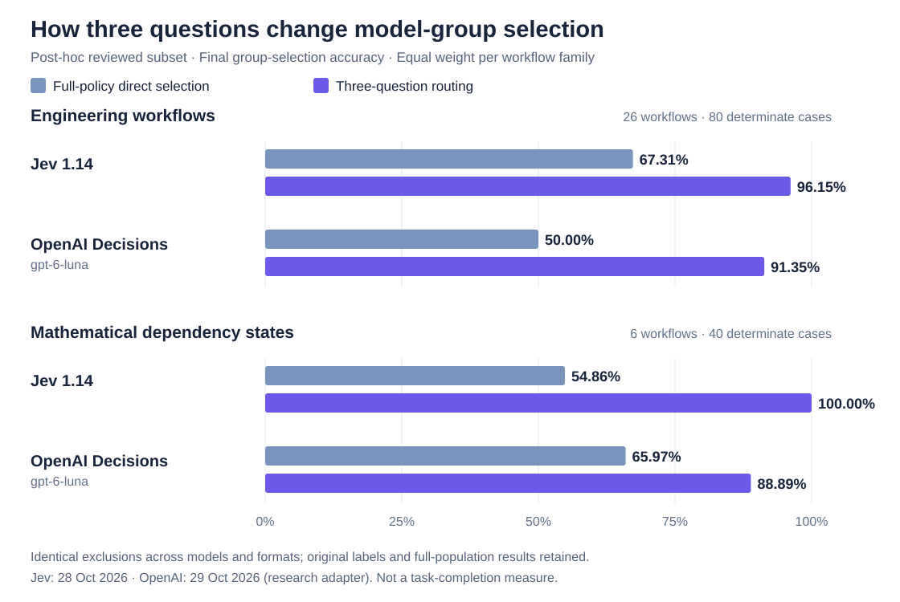

<p align="right"><a href="README.zh-CN.md">简体中文</a></p>

<p align="center">
  <a href="https://hiroute.ai/">
    
  </a>
</p>

<p align="center">
  <strong>Make Codex and Claude Code subscriptions go further.</strong><br>
  Combine subscriptions, APIs and local models in the Agent you already use.<br>
  Give routine work to economical models and keep your primary model for the hard parts.
</p>

<p align="center">
  <a href="https://hiroute.ai/en/download/">Download</a> ·
  <a href="#get-started">Quickstart</a> ·
  <a href="#how-well-does-the-routing-policy-work">Experiments</a> ·
  <a href="https://hiroute.ai/en/docs/">Documentation</a> ·
  <a href="CONTRIBUTING.md">Contributing</a>
</p>

<p align="center">
  <a href="https://github.com/higress-group/HiRoute/releases/latest"></a>
  <a href="LICENSE"></a>
  <a href="https://hiroute.ai/en/download/"></a>
</p>

## Familiar Agents, more model choices

Keep working in **Codex, Claude Code, Qoder, Pi, OpenCode, Hermes or DeepSeek Harness**.
HiRoute runs locally and brings supported subscriptions, API connections and local models
into one place. For example, combine an economical API model with your Codex subscription,
or use a smaller and a stronger model from the same supported source.

| What you want | What HiRoute provides |
| --- | --- |
| **Keep your workflow** | Continue in your familiar Agent while models share the work within a session. |
| **Make strong-model capacity last** | Route suitable work to economical models and keep primary-model protection available. |
| **Try a new model gradually** | Choose its initial trust level, keep a familiar primary model and adjust the division of work. |
| **Understand each decision** | Inspect the actual models, routing reasons, stage performance, usage and cost estimates. |

## One task, the right model for each stage

A difficulty-routing plan follows both the work ahead and what happened before:

- **Routine work:** use the economical group when the task meets your criteria.
- **Relevant failure:** keep primary-model protection when a poor prior result still affects the work.
- **Problem resolved or task changed:** reassess the current work and whether the old problem still matters.

**System One answers three questions: How demanding is the current work? How well did the
previous stage go? Does its problem still affect the current task?** HiRoute combines these
judgments with your plan to choose the executing model.

<!-- README-SCREENSHOT S1: decision-extensions/assets/readme-session-en.png -->
> **Screenshot pending — real session timeline.** Show readable model names, several stages of
> the same task, and one selected stage's routing reason.

Keep asking follow-up questions or let your Agent advance a long task. HiRoute can reassess
at supported new-input and context-reconstruction boundaries; tool continuations normally
reuse the stage's decision. See [routing behavior and supported-client limits](apps/website/content/guides/model-routing.en.md).

[Watch the product tour](https://hiroute.ai/en/#tour) · [Explore routing modes](decision-extensions/README.md)

## Try new models with a primary model ready to help

Select the model you want to try, pair it with a familiar primary model, and choose an
initial trust level. Click a preset or adjust the slider, review the changes, then publish
and map the plan to your Agent. You decide how much work to entrust to the new model.

<!-- README-SCREENSHOT S2: decision-extensions/assets/readme-trial-en.png -->
> **Screenshot pending — trial setup.** Show the new and primary models, their sources, and
> the trust slider with its clickable presets.

### Use execution reports to decide what to change

The session timeline shows which model actually ran and why. Model performance reports
bring together stage assessments, the share handled by the regular group and available
cost estimates. When there is enough evidence, review a suggested adjustment, inspect the
changes and choose whether to publish it.

<!-- README-SCREENSHOT S3: decision-extensions/assets/readme-report-en.png -->
> **Screenshot pending — real execution report.** Show the report's scope, scored stages
> and a supported adjustment suggestion, if one is available.

You can also tailor the judgment criteria to your own tasks and compare prompt changes
using the [published evaluation method](experiments/system-one-routing-paper/README.md).

## How well does the routing policy work?

Both approaches receive the same task context and complete routing policy. One selects
a model group directly; the other answers three questions and lets HiRoute combine the
answers. The comparison uses engineering workflows and mathematical dependency states.



| Scenario | Decision model | Full-policy direct selection | Three-question routing |
| --- | --- | ---: | ---: |
| Engineering | Jev 1.14 | 67.31% | **96.15%** |
| Engineering | OpenAI Decisions / gpt-6-luna | 50.00% | **91.35%** |
| Mathematical dependency states | Jev 1.14 | 54.86% | **100.00%** |
| Mathematical dependency states | OpenAI Decisions / gpt-6-luna | 65.97% | **88.89%** |

**Metric:** final group-selection accuracy, averaged equally across workflow families.
Engineering has 80 determinate cases across 26 workflows; mathematics has 40 across six.
This is a **post-hoc reviewed subset**, with the same exclusions applied to every model
and both formats after inspecting outputs. Original labels and full-population results
remain available. Jev calls ran on 28 October 2026 and OpenAI calls on 29 October; inputs
and policy match, but the calls were not contemporaneous.

The results measure conformance to the stated routing policy, not task completion or
realized savings. OpenAI was evaluated through a research adapter, not a tested product
integration. Use the [study and cases](experiments/system-one-routing-paper/README.md)
to evaluate decision prompts against your own tasks.

[Comparison, exclusions and saved responses](experiments/system-one-routing-paper/supplements/decision-interface-transfer/README.md) ·
[Dataset construction and review](experiments/system-one-routing-paper/DATA-CARD.md)

## Get started

[**Download HiRoute**](https://hiroute.ai/en/download/) ·
[Installation guides](https://hiroute.ai/en/docs/) ·
[Latest release](https://github.com/higress-group/HiRoute/releases/latest)

1. **Connect your models.** Add a supported subscription or API connection and choose an
   economical model plus a primary model.
2. **Set the division of work.** Connect a decision model in **Models → Decision models**,
   choose a trust level, then publish and map the plan to your Agent. Built-in connections
   support Bailian, OpenRouter Jev, TypeSafe and compatible endpoints without self-hosting Jev.
3. **Work as usual.** Continue in your Agent, then inspect model switches and execution
   reports in HiRoute.

<details>
<summary>macOS Desktop and Linux headless installation</summary>

**macOS:** download the DMG, drag HiRoute into Applications, and follow the
[self-signed package instructions](docs/macos-installation.md) if macOS asks for approval.
Supports macOS 15+ on Apple silicon and Intel.

**Linux:** install the current-user CLI and daemon on x86_64 or ARM64 without `sudo`:

```sh
curl -fsSL https://hiroute.ai/install.sh | sh
hiroute service start --output json
hiroute system status --output json
```

The installer verifies the published manifest and checksums; service startup is explicit.
See the [Linux installation guide](https://hiroute.ai/en/docs/install-linux/) and
[CLI reference](docs/standalone-cli.md).

</details>

## Go further

- **Other routing modes:** fixed model, custom branches and free first, alongside difficulty
  routing. [Model routing](https://hiroute.ai/en/docs/model-routing/)
- **Agent collaboration:** expose Worker plans for delegated tasks. [Task routing](https://hiroute.ai/en/docs/task-routing/)
- **Your own decision service:** configure criteria or implement the optional
  [decision extension API](decision-extensions/api/README.md).
- **Detailed behavior:** candidate fallback, scoring eligibility, recovery and client
  limits are documented in the [routing guide](apps/website/content/guides/model-routing.en.md).

## News

- [Latest stable release and release notes](https://github.com/higress-group/HiRoute/releases/latest)
- **2026-10-14** — [Switching Models Loses Cache, Not the Savings](news/2026-10-14-routing-cache-cost.en.md)
- [All news and case studies](news/README.md) · [Experiments](experiments/README.md)

## Contribute

Start with the [contributing guide](CONTRIBUTING.md) for setup and validation, and the
[code map](docs/code-map/README.md) to find each capability's implementation.
HiRoute uses [Apache License 2.0](LICENSE). Report bugs and feature requests through
[GitHub Issues](https://github.com/higress-group/HiRoute/issues); follow [SECURITY.md](SECURITY.md)
for security reports and crash-report handling.

Community link: [LINUX DO](https://linux.do/) (technical discussion community).
