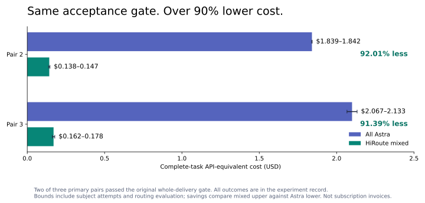
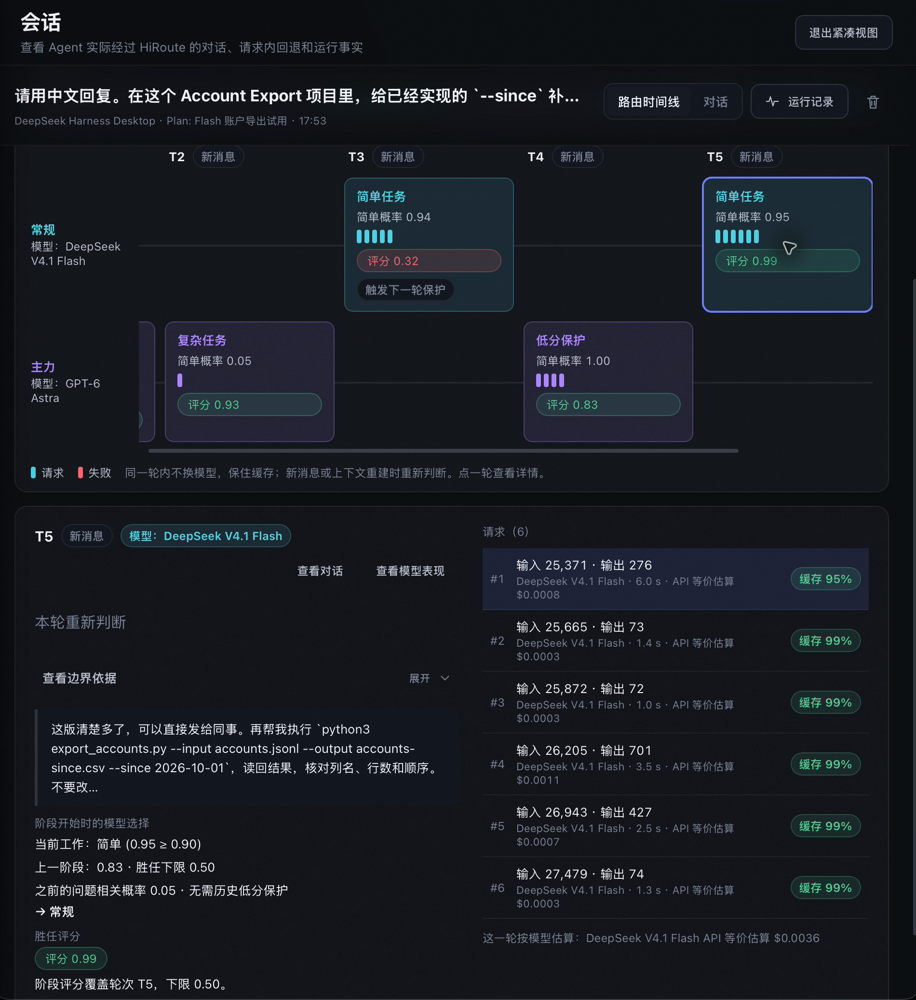
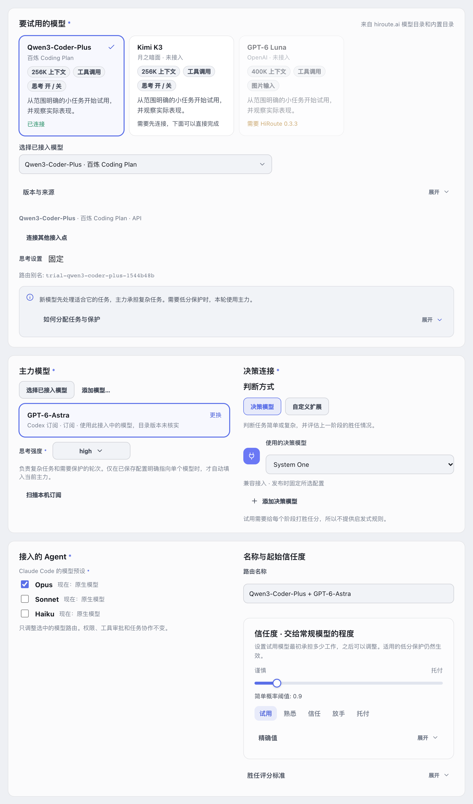
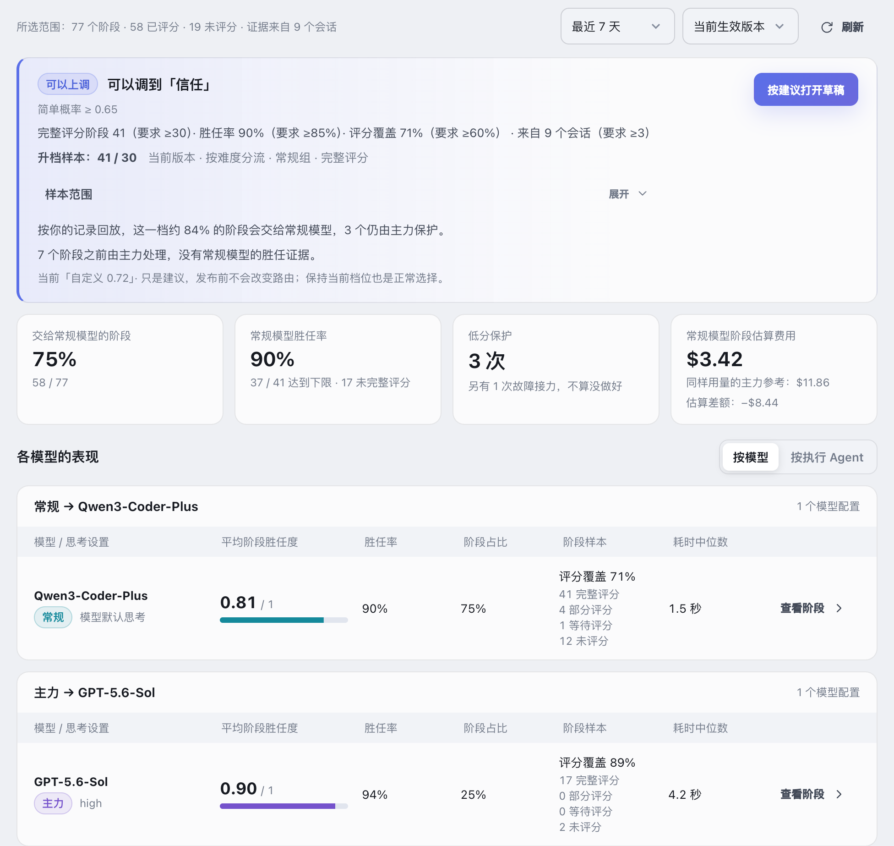
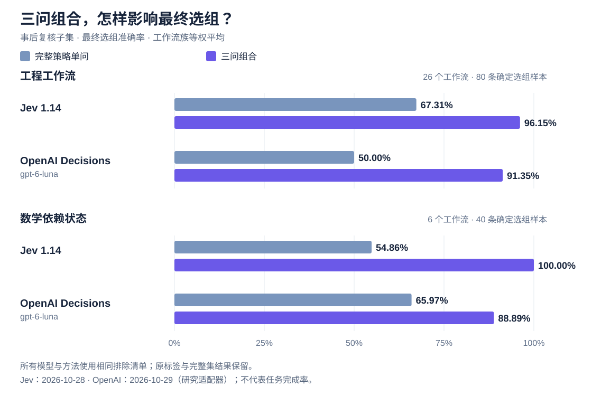

<p align="right"><a href="README.md">English</a></p>

<p align="center">
  <a href="https://hiroute.ai/#tour"></a>
</p>

<p align="center">
  <strong>只在需要的地方，为最强的模型付费。</strong><br>
  常规工作交给经济模型，复杂任务交给主力；经济模型没做好，主力随时接手。<br>
  继续使用 Codex、Claude Code 等 Agent，组合订阅、API 和本地模型。
</p>

<p align="center">
  <a href="https://hiroute.ai/download/">下载</a> ·
  <a href="#快速开始">快速开始</a> ·
  <a href="#真实场景的成本节省">成本效果</a> ·
  <a href="#选模效果用实验检验">实验结果</a> ·
  <a href="https://hiroute.ai/docs/">使用文档</a> ·
  <a href="CONTRIBUTING.md">参与贡献</a>
</p>

<p align="center">
  <a href="https://github.com/higress-group/HiRoute/releases/latest"></a>
  <a href="LICENSE"></a>
  <a href="https://hiroute.ai/download/"></a>
</p>

## 真实场景的成本节省

在一次真实的技术调研与架构评审任务中，Qwen 3.8 Flash 负责调研，GPT-6 Astra 负责关键决策。
达到同样的验收标准，成本比全部使用 Astra **降低约 90%**。

[](news/2026-10-04-astra-qwen.zh-CN.md)

<sub>费用为 API 等价估算。[完整案例](news/2026-10-04-astra-qwen.zh-CN.md)</sub>

### 切换模型，省下的钱不会丢

HiRoute 只在明确的边界切换模型：用户发送新消息，或上下文压缩、重建时。同一轮内的工具调用始终使用同一个模型。
切换后只有第一次请求丢失缓存，之后的调用会重新命中，缓存损失不会吃掉省下的成本。
[切换模型会损失缓存，智能路由还省钱吗？](https://hiroute.ai/news/routing-cache-cost/)

## 熟悉的 Agent，更多模型选择

继续使用 **Codex、Claude Code、Qoder、Pi、OpenCode、Hermes 或 DeepSeek Harness**。
HiRoute 在本地运行，将受支持的订阅、API 接入和本地模型集中管理。例如，用经济型 API 模型
搭配自己的 Codex 订阅，或在同一个受支持的来源中组合较小模型与主力模型。

| 你希望做到 | HiRoute 提供什么 |
| --- | --- |
| **少花在最强的模型上** | 常规工作交给经济模型，主力只负责复杂阶段和低分保护。 |
| **保留熟悉的工作流** | 继续在原来的 Agent 中工作，让不同模型在同一会话中分工。 |
| **逐步试用新模型** | 自选初始信任程度，熟悉的主力兜底，再根据自己任务的证据调整。 |
| **看懂每次选择** | 查看实际模型、切换依据、阶段表现、用量和费用估算。 |

## 同一个任务，为不同阶段选择合适的模型

按难度分流同时关注接下来的工作和此前的执行表现：

- **常规工作**：任务满足你设定的标准时，使用经济模型。
- **相关失败仍未解决**：上一阶段评分低于胜任下限，且问题仍影响当前工作时，低分保护让主力接手下一阶段。
- **问题解决或任务变化**：重新判断当前工作，以及旧问题是否仍然相关。

**System One 判断三件事：当前工作有多难、上一阶段做得怎样、之前的问题是否仍影响现在。**
HiRoute 结合这些判断与你的路由计划，选择实际执行的模型。

<p align="center">
  
</p>
<p align="center"><sub>真实会话：Flash 评分偏低后，主力接手下一阶段；问题解决后，选中的一轮回到 Flash，并说明原因。</sub></p>

你可以继续追问，也可以让 Agent 自动推进长任务。HiRoute 在受支持的新输入与上下文重建窗口
重新判断，同一阶段的工具续接通常沿用已有决策。详见[路由行为与客户端支持范围](apps/website/content/guides/model-routing.zh.md)。

[了解路由模式](decision-extensions/README.zh-CN.md)

## 新模型逐步试，主力随时准备接手

从首页的**新模型**开始。新模型不必一次全面接管，HiRoute 按任务难度逐步放量。

- **信任度就是难度门槛**：System One 判断每一轮有多简单，够简单的交给新模型，更难的仍由主力处理。
- **逐步放开**：新模型表现稳定后，从试用调到熟悉、信任或放手，它就会承担更多工作。
- **主力继续兜底**：新模型的阶段评分低于胜任下限、且问题仍然相关时，低分保护让主力接手下一轮。

<p align="center"></p>
<p align="center"><sub>越往右，越多简单任务交给新模型。</sub></p>

### 用自己任务的证据调整

会话时间线展示每次实际用了哪个模型、为什么切换。模型表现报告汇总阶段评分、常规组承担比例
和可用的费用估算。证据足够时，报告会给出上调或下调建议；你可以用自己的记录回放这个设置，
检查改动，再决定是否发布。

<p align="center"></p>
<p align="center"><sub>常规模型稳定达标后，模型表现报告会建议上调信任度。费用为 API 等价估算。</sub></p>

也可以按自己的任务调整判断标准，使用[公开评测方法](experiments/system-one-routing-paper/README.md)
对照检查提示词改动的效果。

## 选模效果，用实验检验

两种方法读取相同的任务上下文和完整路由策略：一种直接选择模型组，另一种回答三个问题，
再由 HiRoute 组合判断。对比覆盖工程工作流和数学依赖状态场景。



| 场景 | 决策模型 | 完整策略单问 | 三问组合 |
| --- | --- | ---: | ---: |
| 工程 | Jev 1.14 | 67.31% | **96.15%** |
| 工程 | OpenAI Decisions / gpt-6-luna | 50.00% | **91.35%** |
| 数学依赖状态 | Jev 1.14 | 54.86% | **100.00%** |
| 数学依赖状态 | OpenAI Decisions / gpt-6-luna | 65.97% | **88.89%** |

**口径：最终选组准确率，按工作流族等权平均。**工程含 26 个工作流中的 80 条确定选组样本，
数学含 6 个工作流中的 40 条。这是查看输出后的**事后复核子集**，所有模型和两种方法应用
相同排除清单，原标签和完整集结果保留。Jev、OpenAI 分别于 2026 年 10 月 28、29 日调用，
输入和策略匹配，但并非同期调用。

结果衡量对既定路由策略的遵循程度，不代表任务完成率或实际节省比例。OpenAI 结果来自实验中的
研究适配器，不代表 HiRoute 内置 OpenAI 连接的表现。也可以参照[实验方法与案例](experiments/system-one-routing-paper/README.md)，
用自己的真实任务检验和改进决策提示词。

[对比、排除清单与原始语义回答](experiments/system-one-routing-paper/supplements/decision-interface-transfer/README.md) ·
[数据构建与复核](experiments/system-one-routing-paper/DATA-CARD.md)

## 快速开始

[**下载 HiRoute**](https://hiroute.ai/download/) ·
[安装指南](https://hiroute.ai/docs/) ·
[最新版本](https://github.com/higress-group/HiRoute/releases/latest)

HiRoute **0.5.0 新增 Windows x64 桌面版和 Linux Web UI**，继续提供 macOS 桌面版与 CLI。
[下载页](https://hiroute.ai/download/)列出已发布的安装包；新增界面需要 0.5.0 或更高版本。

1. **接入模型**：加入受支持的订阅或 API，选择经济模型与主力。
2. **配置分工**：在**模型 → 决策模型**中连接判断服务，选择信任程度，发布并映射到 Agent。
   内置连接支持百炼、OpenAI、OpenRouter Jev、TypeSafe 与兼容接入点，无需自行部署 Jev。
3. **照常工作**：继续在原来的 Agent 中使用，到 HiRoute 查看模型切换和执行报告。

<details>
<summary>macOS、Windows 与 Linux 安装</summary>

**macOS：** 下载 DMG，拖入“应用程序”；如系统要求批准，请按
[自签名安装说明](docs/macos-installation.zh-CN.md)操作。支持 macOS 15+、Apple 芯片与 Intel。

**Windows：** 使用 0.5.0 或更高版本的 x64 桌面安装包。按当前用户安装，自带后台服务、
WebView2 引导安装器和 CLI，不要求 Python 或管理员权限。校验摘要、首次启动和恢复步骤见
[Windows 安装指南](https://hiroute.ai/docs/install-windows/)。

**Linux：** 支持 x86_64 与 ARM64，无需 `sudo`，安装到当前用户目录：

```sh
curl -fsSL https://hiroute.ai/install.sh | sh
hiroute service start --output json
hiroute system status --output json
```

在 **0.5.0 或更高版本**中，可以打开 Web UI，在浏览器中接入模型、配置路由与 Agent、查看会话：

```sh
hiroute console init --mode loopback --port 5838
hiroute service restart --output json
hiroute console open
```

在浏览器打开输出的一次性登录链接。远程主机可按
[远程访问或 SSH 隧道说明](docs/web-console.md#access-from-another-device)连接。
CLI 继续支持终端和自动化工作流。安装器校验已发布的 manifest 与文件摘要；服务由用户显式启动。详见
[Linux Web UI 与 CLI 指南](https://hiroute.ai/docs/install-linux/)与 [CLI 参考](docs/standalone-cli.zh-CN.md)。

</details>

## 继续探索

- **更多路由模式**：除按难度分流外，还支持固定模型、自定义分支与免费优先。
  [智能模型路由](https://hiroute.ai/docs/model-routing/)
- **Agent 协作**：通过 Worker 计划委派独立任务。[智能任务路由](https://hiroute.ai/docs/task-routing/)
- **自己的决策服务**：配置判断标准，或实现可选的[决策扩展 API](decision-extensions/api/README.zh-CN.md)。
- **详细行为**：候选故障接力、评分适用条件、恢复与客户端限制，统一查看
  [模型路由指南](apps/website/content/guides/model-routing.zh.md)。

## 最新动态

- [最新稳定版本与版本说明](https://github.com/higress-group/HiRoute/releases/latest)
- **2026-10-14** — [切换模型会损失缓存，智能路由还省钱吗？](news/2026-10-14-routing-cache-cost.zh-CN.md)
- [全部新闻与实战案例](news/README.md) · [实验材料](experiments/README.md)

## 参与贡献

开发环境与验证方法见[贡献指南](CONTRIBUTING.md)，各项能力的实现入口见
[代码地图](docs/code-map/README.md)。HiRoute 使用 [Apache License 2.0](LICENSE)。
缺陷和功能建议请提交到 [GitHub Issues](https://github.com/higress-group/HiRoute/issues)；
安全问题与 crash report 请按 [SECURITY.md](SECURITY.md) 处理。

友情链接：[LINUX DO](https://linux.do/)（技术交流社区）。
