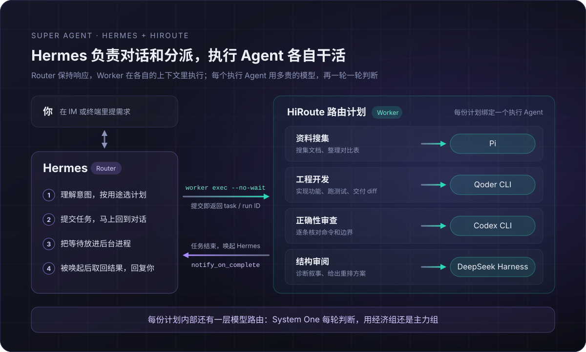

# 用 Hermes 和 HiRoute 搭一个 DeepSeek 式的 Super Agent

10 月 31 日，DeepSeek Harness 团队发布了长文《Super-agent 设计探索：迈向更自主的 Agent 系统》，同时开源了研究原型 [dsh-superagent-prototype](https://github.com/deepseek-ai/dsh-superagent-prototype)。文章的出发点我很有共鸣：一个人同时能照看的 Agent 会话，大概只有三到五个。模型越来越能干，瓶颈变成了人的注意力。

我日常用 Hermes 当主 Agent。它是一个开源的 personal agent 框架，可以接在 IM 里用。独立的任务，我通过 [HiRoute](https://github.com/higress-group/HiRoute) 委派给不同的执行 Agent。对照 DeepSeek 的设计再看，这套组合就是一个 Super Agent：Hermes 做 Router，HiRoute 的路由计划和执行 Agent 做 Worker。这篇文章讲讲它是怎么搭起来的，和 DeepSeek 的原型有哪些相同和不同，以及用之前要知道的边界。

## DeepSeek 提出了什么

文章提出的是 Router–Worker 两层架构：

- **Router** 常驻，负责对外沟通、全局协调和任务分派，自己可以完全不执行任务。公开原型里，Router 甚至不配 Bash 工具。
- **Worker** 在隔离的上下文里专注执行单个任务，结果交回 Router，由 Router 统一对外回复。

这样分层，Router 始终能及时响应新消息，不会被某个长任务卡住；每个 Worker 只看自己那份上下文，也不会被别的任务干扰。

先说清定位：dsh-superagent-prototype 是研究原型，不是 DeepSeek 的正式产品。它面向一个 GitHub 仓库，也可以接入飞书：有人请它干活时，原型开一个工作项，在独立的会话和目录里执行，再回到原来的对话里答复，比如提一个 PR。同一个工作项后续的评论，会通过订阅直接送到对应的 Worker。原型的 README 也说明，文章讨论的部分设计是未来的方向，原型里还没有实现。

## Router 要处理好三件事

把这套设计放进自己的日常，我发现一个 Router 至少要处理好三件事：

1. **怎么不被任务卡住？** 任务派出去以后，Router 要马上回到对话；任务结束时，又要有人把结果带回来。
2. **交给谁？** 写初稿、改代码、审查正确性、调整结构，适合的执行 Agent 并不一样。
3. **用多贵的模型？** 同一个任务里，大部分步骤是常规工作，只有少数几步需要强模型。

DeepSeek 的文章重点在第一件事。原型为每个新的工作项创建一个 Worker，Worker 用哪个模型，取决于你给 DeepSeek Harness 配的 profile。后两件事，正是 HiRoute 在做的。



### 一、不被卡住：提交即返回，结束时唤起

Hermes 把任务交给 HiRoute，用的是这样一条命令：

```sh
hiroute worker exec --plan <PLAN_ID> --cwd /work/mq-research --no-wait \
  -- "搜集三种消息队列的官方文档和发布说明，整理成对比表"
```

加上 `--no-wait`，任务一被接受，命令就返回 task ID 和 run ID，Hermes 马上回到对话。多个任务可以同时派出去，各自在自己的会话里执行。

结果怎么回来，靠的是 Hermes 自带的 `notify_on_complete`。Hermes 可以把命令放进后台进程执行；打开 `notify_on_complete` 后，这个进程一结束，Hermes 就会被唤起，开始新的一轮。做法是让 Hermes 把“等待这次任务结束”放进这样的后台进程：任务一结束，Hermes 被唤起，用 `hiroute worker result --run <RUN_ID>` 取回结果，再在对话里告诉你。等待发生在后台，不占用对话。

为什么不直接用 Hermes 自己的子 Agent？Hermes 的 `delegate_task` 也能在后台跑任务，但它的文档写得很清楚：顶层委派虽然是异步的，仍然绑在所属会话和 Hermes 进程上，会话关闭、`/stop`、`/new` 或者进程重启，都可能取消或丢下进行中的任务；需要跨过这些边界的工作，文档建议用定时任务，或者带 `notify_on_complete` 的后台进程。HiRoute 的任务由 HiRoute 的后台服务执行，结果持久保存，凭 run ID 随时可以查回来。

### 二、交给谁：一份计划绑定一个执行 Agent

在 HiRoute 里，每份路由计划对应一类工作，写清三样东西：适合做什么（使用场景）；由哪个执行 Agent 干，可选 Codex CLI、Claude Code、Qoder CLI、Pi、DeepSeek Harness 或 OpenCode；模型怎么分档，也就是经济组和主力组。

Hermes 委派前先运行 `hiroute worker plans`，读出已发布、允许委派的计划，按每份计划写明的使用场景选一个；没有合适的，它会直说，不会硬选。你也可以直接点名：“使用 HiRoute，将当前任务委派给【资料搜集】执行。”

使用场景别只写“开发”“干活”这种没法区分的词。我会写清四件事：适合什么任务；需要什么输入和工作目录；交付什么；和相邻的计划怎么区分。“审查 PR 并贴回评论”和“审查本地 diff 并列出问题”，就该拆成两份计划。

按我自己的使用体感，四个执行 Agent 大致这样分工：

| 执行 Agent | 我交给它的活 |
| --- | --- |
| Pi | 搜集资料、写初稿、按清单批量落地；任务书写清楚，它跑得很快 |
| Qoder CLI | 开发工程代码；对外文档的边界表述和中文行文 |
| Codex CLI | 正确性审查：逐条对照安装版的 help 和 schema，核对命令能不能跑、边界在哪；更慢也更贵，留给错了代价大的活 |
| DeepSeek Harness | 叙事和结构：判断读者在哪一步掉线，给出重排方案；不替代逐条的事实核对 |

这只是我的经验，不是评测结论。换成你的任务，完全可能是另一套分工；好在换执行 Agent 只是改一份计划，不用动 Hermes。

### 三、用多贵的模型：执行 Agent 里还有一层模型路由

选中计划，只决定了谁来干。这个执行 Agent 每一轮用哪个模型，再由计划里的模型路由判断。每一轮开始时，System One 回答三个问题：上一步做得怎么样，这一步有多难，上一步的问题会不会带进这一步。够简单的交给经济组；上一步没做好、问题又会延续，主力接手；问题解决了，再回到经济组。同一轮里的工具调用不换模型，缓存不会白丢。

对委派来说，第一轮从任务开始算起，没有上一步，只按难度判断。Hermes 用 `hiroute worker continue` 给同一个任务追加要求时，是新的一轮，会参考上一轮的评分重新判断。

所以“选谁干”和“用多贵的模型干”是两次独立的判断：选中 Qoder CLI，不等于固定用某一档模型。用一段时间后，每份计划的模型表现报告会汇总经济组的胜任情况，证据足够时建议上调或下调信任度。建议只是建议，回放确认后才会发布。

## 一个真实的例子：这篇文章的上一版

这篇文章之前有一个更长的版本，讲我在 Hermes 里做任务委派的完整实践。那一版从一份 2.7KB 的任务书到推送进仓库，就是按这套分工跑完的：

| 阶段 | 执行 Agent | 交付 |
| --- | --- | --- |
| 初稿（17 分钟） | Pi | 2.7KB 任务书 → 298 行初稿，自查后推送 |
| 正确性审查 | Codex CLI | 逐条核对命令与安装版的 schema |
| 叙事审查（6 分钟） | DeepSeek Harness | 诊断“手册感”，提出场景先行的重排方案 |
| 边界与中文审查 | Qoder CLI | 边界表述与行文修改 |
| 二轮修改（9 分钟） | Pi | 按三家意见改稿，正文压缩 29% |
| 结构重排 | DeepSeek Harness | 按场景先行重排全文骨架 |
| 收尾（1 分钟） | Pi | 文件头信息、尾随空格、`git diff --check` |

表里只记了 Pi 和 DeepSeek Harness 的耗时，Codex 和 Qoder 的审查没有单独计时。顺带一提，DeepSeek Harness 自己也在这套分工里，当了两次 Worker。

三份审查，我特意让它们互相看不到对方的结论。结果大方向收敛：手册感太重、边界要写清、命令要能跑。各自的独家发现又几乎不重叠：

- **Codex 是唯一逐条核对命令能不能跑的。** 它对照安装版的 `--help` 和 schema，抓出定时任务示例里一个并不存在的 `--timezone` 参数，还有 8 处缺 `--non-interactive` 的命令。
- **DeepSeek Harness 的诊断最接近读者感受。** 它的结论是“手册感压过了布道感”，6 分钟就给出了场景先行的重排方案。
- **Qoder 把“能做什么、不能做什么”抠得最细**，中文行文也最好。

多派两家审查，值不值？如果三家只是互相复述，就是浪费；正因为各自看见了不同的东西，分工才成立。这也是 Super Agent 的意义：Router 不需要样样精通，只要知道该把什么交给谁。

## 怎么搭起来

完整步骤见[智能任务路由](https://hiroute.ai/docs/task-routing/)，这里只列关键的三步：

1. **建计划**：在 HiRoute 的「智能路由」里，为每类工作建一份计划，打开“允许委派任务给执行 Agent”，选好执行 Agent，写清使用场景，然后发布。执行 Agent 要通过本机的依赖检查，才能真正启动任务。
2. **让 Hermes 能委派**：在「Agent」里选择 Hermes，打开「任务路由」，选择委派时机：仅在你明确要求时委派，或者默认由 Agent 判断。保存后，按提示完成任务委派技能检查。Hermes 自己的模型请求也可以一起接入 HiRoute，两件事互不影响。
3. **在 Hermes 里委派**：对 Hermes 说“使用 HiRoute，将当前任务委派给【计划名称】执行”，或者“使用 HiRoute 委派当前任务，选择合适的路由”。再把这条约定写进 Hermes 的长期指令：委派后把等待放进后台进程，打开 `notify_on_complete`，任务结束后取回结果再回复。

OpenClaw 等其他 personal agent，只要能在本机执行命令行，也可以直接调用 `hiroute worker` 这一组命令，做法相同。

## 用之前要知道的边界

这套组合和 DeepSeek 原型的思路相同，做法上有几处不同：

- **Router 不执行，是约定，不是隔离。** DeepSeek 的原型直接不给 Router 配 Bash；Hermes 仍然保留自己的工具。把委派时机设为默认由 Agent 判断，它会倾向于把适合独立执行的工作委派出去，但不会因此失去执行能力。需要硬隔离，要在 Hermes 自己的工具配置里收紧。
- **追问经过 Router。** 原型里，同一个工作项后续的评论会直接送到对应的 Worker。在这里，执行 Agent 不能中途直接问你，追加要求由 Hermes 用 `hiroute worker continue` 发给同一个任务。
- **委派只有一层。** 执行 Agent 不能再委派别的任务；计划发现、状态查询、等待和结果汇总，都留在 Hermes。
- **一份计划只绑一个执行 Agent。** 执行失败时，不会自动换成另一种 Agent。
- **执行权限不是沙箱。** 执行 Agent 以 approve-all 运行，可以按自身能力读写文件、执行命令和访问网络，HiRoute 不提供操作系统级沙箱。必须强制只读的任务，不要通过它委派。工作目录也不是锁，多个任务用同一个目录时，要自己避免互相覆盖。
- **取消只停这一次运行。** 已经写入的文件和已经完成的外部操作，不会因此撤销。

## 写在最后

DeepSeek 把 Super Agent 拆成 Router 和 Worker，这个方向我很认同。只是在日常里，它不一定要从头造：一个会聊天的 personal agent，加上一层任务路由，Router 就能保持响应，把任务交给合适的执行 Agent；每个执行 Agent 用多贵的模型，再按证据一轮一轮判断。

HiRoute 和 Hermes 都是开源的。欢迎试一试，也欢迎告诉我们哪里不好用。

[GitHub](https://github.com/higress-group/HiRoute) · [智能任务路由](https://hiroute.ai/docs/task-routing/) · [HiRoute 新版本发布](https://hiroute.ai/news/new-model-trials-and-task-routing/)
