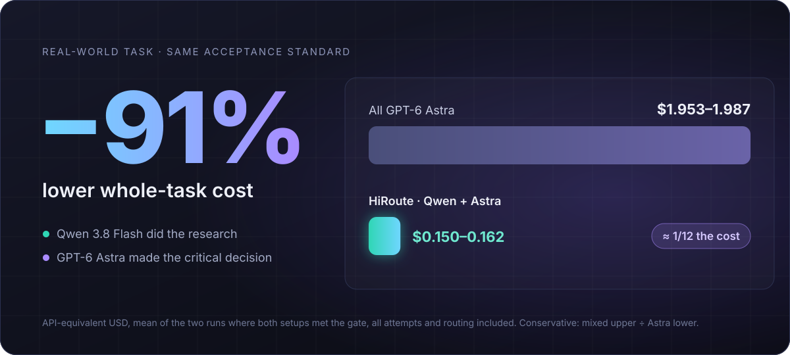
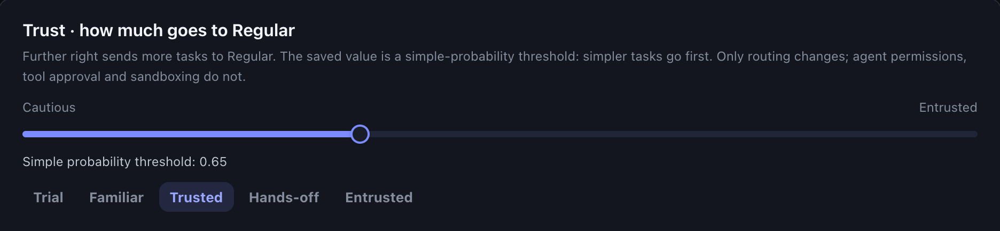
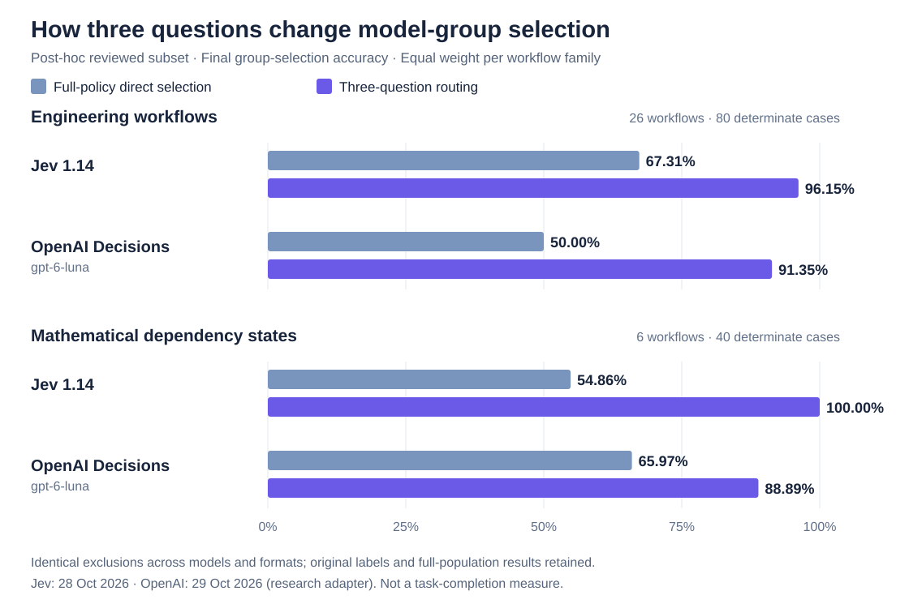

# New HiRoute Release: Try New Models Safely, Hand Tasks to the Right Agent

A new model seems to ship every few weeks, priced at a fraction of a primary model and scoring close to it on general benchmarks. Epoch AI's September report, "The plunging price of thought", estimates that since 2023 the cost of reaching a given capability level has fallen by about 47% per quarter. Cheap, capable-enough models will only get more common. The hard part is now twofold: which steps of your own work can go to them, and which Agent should take on a given task.

[HiRoute](https://github.com/higress-group/HiRoute) is an open-source smart routing engine for Agents that runs locally. You keep using Codex, Claude Code, Qoder, Pi, OpenCode, Hermes, DeepSeek Harness or another familiar Agent, and HiRoute decides which model handles each step. This update is built around those two questions:

- **Evaluate new models as you work.** Start a trial from **New models** on Home and set trust anywhere along a continuous scale. Model performance reports suggest raising or lowering trust from evidence in your own tasks, and you replay and confirm before publishing.
- **System One asks three questions each turn.** Look back at the last step, size up this one, and guard the next. On the paper's reviewed subset, both decision models select model groups much more accurately in engineering and mathematics scenarios. Decision models can now use OpenAI Decisions or reuse an existing Bailian, OpenAI or OpenRouter connection.
- **Hand each task to the right Agent.** Routing plans can bind an execution Agent. Hermes gains model routing and task routing, and OpenCode can both delegate and execute. With Hermes and HiRoute you can build an architecture much like the Super Agent that DeepSeek recently described.
- **A graphical interface on every platform.** Windows Desktop ships for the first time, and Linux gets the same interface in a browser.
- **More improvements.** Subscriptions and API keys in one setup, API Key spending allowances, per-connection proxies and leaner local records.

## 1. A fresh decision at every step: complex work has simple parts too

A common approach is to split work by scenario: a strong model for coding, a cheap one for organizing material. Scenarios do need different capabilities, but in real sessions we see difficulty change step by step. Complex scenarios contain plenty of simple work, and simple ones can suddenly turn hard.

We ran a comparison on a technology selection task: research six candidate technologies, verify official sources, then write a decision memo on the key design. With research on the cheap model and the key judgments on the primary model, the judgments matched an all-primary run at roughly one twelfth of the total cost. Running everything on the cheap model handled the research well enough, but two of the three key judgments contained major errors.



So HiRoute divides the work this way: the scenario sets the candidate models and the acceptance standard, and the model for each step is chosen at that step. Switches happen only on a new user message or after context compaction or rebuild. Tool calls within a turn stay on the same model, and after a switch only the first request misses the cache. See the [case study](https://hiroute.ai/en/news/astra-qwen-smart-routing/) and the [cache cost analysis](https://hiroute.ai/en/news/routing-cache-cost/).

Here is a screen recording of a real session. DeepSeek Harness is on the left and HiRoute on the right. The plan uses DeepSeek V4.1 Flash as the new model to try and GPT-6 Astra as the primary model. The user simply works in the Agent and never switches models by hand.

<figure class="article-video"><video controls playsinline preload="none" poster="/media/hiroute-promo-en-poster.jpg" aria-label="HiRoute three-minute product tour video"><source src="/media/hiroute-promo-en.mp4" type="video/mp4"></video><figcaption>The 3-minute tour: a recorded real session; trust-level scenes are illustrations and costs are API-equivalent estimates.</figcaption></figure>

1. Adding regression tests and discussing a design trade-off are not simple enough, so the primary model handles both. The first turn stays on one model across 23 calls, with a 93% cache hit rate.
2. A short usage card for a colleague who does not program is simple enough for the new model.
3. The user points out that the colleague still would not know how to open Terminal in the folder. The previous step scored 0.24 and the problem still applies, so low-score protection hands the rewrite to the primary model.
4. The rewrite scores 0.73, the problem is resolved, and the export goes back to the new model.


*The session timeline records which model ran in each turn and why.*

## 2. New models: evaluate them in your own work

Benchmarks and leaderboards are good for a first screen, but they cannot tell you whether a model works on your tasks. Scale AI's SWE-Bench Pro, released last September, is one example. Leading models that solved more than 70% of SWE-bench Verified scored around 23% on the SWE-Bench Pro public set, and the best result on private startup codebases fell to 17.8%. The Pro problems are harder, so not all of the first drop comes from unseen code. The public and private sets were built the same way, though, so the second drop says more. To a model, your codebase is exactly that kind of unseen private code.

New models arrive too quickly to build an evaluation set for each one. Our approach is to evaluate as you work: give the new model only simple-enough steps at first, check the result of every step, let the primary model take over when something goes wrong, and hand over more once the evidence is there. This update completes that path:

- **Start a trial from Home.** **New models** on Home shows recommended new models. Choose the model to try and a primary model you know, then map them to your Agent; every change is listed before publishing. The model name your Agent uses stays the same, so your Agent settings do not change.
- **Set trust on a continuous scale.** Trust is a difficulty bar: further right, more simple work goes to the new model. Besides the Trial, Familiar, Trusted, Hands-off and Entrusted presets, you can stop anywhere in between.
- **The primary model is always ready.** When a step by the new model scores below the competence floor and the problem still matters for the next piece of work, low-score protection hands that work to the primary model. Once the problem no longer applies, routing goes back to choosing by difficulty.



The most direct evidence of how a step went is the user's next message. An explicit rejection of the result is evidence that the step fell short. Simply moving on, or saying nothing, does not show that it failed. This update also brings scoring closer to real feedback: it recognizes explicit acceptance, tells partial praise apart from a fully accepted result, and credits usable partial progress.

After some time, a model performance report brings together stage scores, the share handled by the new model and cost estimates. A single score can be wrong, so trust changes need enough evidence:

- **Suggest raising trust:** since the last change, at least 30 fully scored stages from at least 3 sessions, scoring coverage above 60%, and at least 85% of those stages at or above the competence floor.
- **Suggest lowering trust:** among at least 30 fully scored stages, fewer than 70% meet the floor.


*Each rule shows its actual value next to its requirement, and a replay of your records shows the effect of the change. Costs are API-equivalent estimates.*

Raising trust has a higher bar than lowering it, on purpose: a few good results are not enough to hand over more, while a clear problem should pull trust back quickly. A suggestion is only a suggestion. Routing does not change until you publish, and keeping the current level is a normal choice. On the **Agent** page, turn on **HiRoute management** for the Agent you use every day, and you can also ask it to read the report and its suggestions. For regular reviews, use the Agent's own scheduled tasks.

## 3. System One: three questions each turn

These decisions happen every turn. The direct approach is to give a decision model the task, the history and the routing policy and ask which model should handle this step. We tried that, and the results were unstable. The model has to weigh difficulty, past performance, whether a problem was resolved and what the policy says, all at once, and a slip on any one of them produces the wrong answer.

System One splits the decision into three independent questions, answered separately in one request:


- **Previous: how did the last step go?** A competence score, which also feeds model performance reports.
- **Current: how hard is this step?** A simple probability. Only simple-enough work can go to the economical model.
- **Next: will the last step's problem carry into the next one?** This asks whether a known, unresolved problem still applies, not whether the next step will succeed.

The decision model only answers the questions. Thresholds, group selection and execution stay in HiRoute, and changing trust changes the thresholds, not the questions. With this update the third question is part of the default decision: when the last step fell short and the problem carries forward, the primary model takes over; once the problem is resolved or no longer relevant, protection is released.

We wrote the method up as a paper and published bilingual datasets, raw model responses and offline replay tools. In the experiments, both methods read the same task context and full routing policy. One selects a model group directly; the other answers the three questions and lets HiRoute combine the answers.



One detail stands out: when selecting directly, the two decision models erred in opposite directions. In the mathematics scenario, Jev 1.14 was too bold and chose correctly on only 6 of 24 records that needed protection. OpenAI Decisions was too cautious and chose correctly on only 2 of 16 records where protection should be released. With three questions, Jev 1.14 got all 24 protection cases right and kept all 16 releases correct. OpenAI Decisions rose to 14 correct releases, while its protection cases went from 24 to 22. The same split sharply reduced two biases that point in opposite directions.

Cost and latency are not obstacles either. At Jev's actual billing, three-question decisions cost about USD 0.084–0.086 per 1,000. Excluding connection setup, the measured median decision latency was between half a second and one second, so a fresh decision every turn is affordable.

To be clear about scope: these numbers measure whether the router follows the declared policy, not task completion or actual savings. The comparison uses a subset reviewed after seeing the outputs, with the same exclusion list for every model and both methods, and gains vary by decision model and scenario. The OpenAI results come from a research adapter used in the experiments and do not represent HiRoute's built-in OpenAI connection. The full data, exclusions and limitations are in the [paper](../experiments/system-one-routing-paper/README.md).

Decision model connections are more flexible too:

- **OpenAI Decisions is new.** Built-in connections also cover Bailian, OpenRouter Jev, TypeSafe and compatible endpoints.
- **Reuse your API connections.** OpenAI, OpenRouter and both Bailian Token Plan and workspace connections can share their keys with ordinary models. TypeSafe and other compatible endpoints still take their own URL and key.
- **Decision context fits the model's window.** Known models use official metadata, and you can set your own limit. The current input and the three questions are always kept whole, and as many recent complete steps as fit are added.

## 4. Task routing: hand each task to the right Agent

Model routing decides which model handles a step. Task routing decides which execution Agent takes on a piece of work. Each routing plan states what work it suits and can bind one execution Agent: Codex CLI, Claude Code, Qoder CLI, Pi, DeepSeek Harness or OpenCode. While that Agent works, each of its turns still goes through the plan's model routing, choosing between the economy and primary groups.

In this update:

- **Hermes** can route its own model requests through HiRoute and turn on task routing to delegate to published plans.
- **OpenCode** can delegate tasks as your everyday Agent and also run them as an execution Agent.
- **Execution Agents** are admitted by what the local installation can actually do, and the reasons for failed runs are kept. The CLI also points out what is missing from a delegation setup, such as a plan's purpose.

On October 31 the DeepSeek Harness team published "Exploring Super-agent Design: Towards a More Autonomous Agent System" and open-sourced a research prototype, [dsh-superagent-prototype](https://github.com/deepseek-ai/dsh-superagent-prototype). It splits the system into two layers. A resident Router handles outside communication, overall coordination and dispatch, and need not execute tasks at all. Workers each focus on a single task in isolated context and return their results to the Router, which replies on their behalf. The Router can always respond to new messages instead of getting stuck behind a long task. The motivation is practical: one person can follow only three to five active Agent sessions at a time, so human attention becomes the bottleneck.

You can build a similar architecture from what HiRoute already offers, without a dedicated Super Agent routing mechanism:

![Super Agent architecture: Hermes acts as the Router, understands intent and picks a plan, submits with hiroute worker exec --no-wait and returns to the chat at once, then waits in a background process until the run ends; each HiRoute routing plan binds one execution Agent: research goes to Pi, analysis to DeepSeek Harness, coding to Qoder CLI and code review to Codex CLI; when the run ends, the wait exits and notify_on_complete wakes Hermes, which fetches the result and replies; inside each plan, System One picks the economy or primary group turn by turn](assets/super-agent-en.svg)

- **A personal agent as the Router.** Hermes can turn on task routing directly in HiRoute. Other personal agents such as OpenClaw can call the same commands as long as they can run a local command line.
- **Delegate with `hiroute worker exec`.** Give `hiroute worker exec` the task, the working directory and the acceptance criteria. With `--no-wait` it returns as soon as the task is accepted, so the Router goes straight back to the conversation. Several tasks can run in parallel.
- **Report back when a task ends.** Hermes, for example, waits in a background process until the task ends and turns on its built-in `notify_on_complete`. When the task ends, that process exits, and Hermes wakes up, fetches the result and tells you in the conversation.
- **Choose the execution Agent.** Send light work such as collecting material to a plan bound to Pi, engineering work to a plan bound to Qoder CLI, and code review to a plan bound to Codex CLI. Name a plan when you delegate, or let the Router choose by the purpose each plan states.

```sh
# Send research to the plan bound to Pi; returns as soon as the task is accepted
hiroute worker exec --plan <PLAN_ID> --cwd /work/mq-research --no-wait \
  -- "Collect the official docs and release notes of three message queues and build a comparison table"

# Check progress at any time; fetch the result when the task ends
hiroute worker status --run <RUN_ID>
hiroute worker result --run <RUN_ID>
```

The Router only understands intent, dispatches work and summarizes results. How expensive a model each execution Agent uses is decided turn by turn by its plan. For the full Hermes setup, see ["A DeepSeek-Style Super Agent with Hermes and HiRoute"](https://hiroute.ai/en/news/hermes-super-agent/).

## 5. A graphical interface on macOS, Windows and Linux

- **macOS:** the Desktop app supports macOS 15 or later on Apple silicon and Intel.
- **Windows:** Desktop ships for the first time. The x64 installer installs for the current user and bundles the CLI, the background service and a WebView2 bootstrapper, with no Python or administrator rights needed. In-app upgrades wait for running calls and Worker tasks to finish before installing.
- **Linux:** x86_64 and ARM64, installed to your user directory without `sudo`. The browser opens the same interface as Desktop. The server needs no desktop: `hiroute console open` creates a single-use sign-in link that is valid for two minutes, and remote servers can be reached through an SSH tunnel.

```sh
curl -fsSL https://hiroute.ai/install.sh | sh -s -- --console-mode loopback --console-port 5838
hiroute service start --output json
hiroute console open
```

## 6. More improvements

- **Subscriptions and API keys in one setup.** When you connect a Codex or Claude subscription, you can add a matching OpenAI or Anthropic API Key. One model selection and one save import the models into both sources. This puts subscription API credits to use: eligible ChatGPT Pro and Business plans, and Claude Max, Ultra and Team plans, can claim API credits every billing cycle, and unused credits do not roll over (see the official guides from [OpenAI](https://developers.openai.com/api/docs/guides/chatgpt-api-credits) and [Anthropic](https://support.claude.com/en/articles/17154008-monthly-api-credits-for-max-ultra-and-team-plans)). Enter a Key from the organization that receives the credits, then create a route for the subscription's model from its model details. HiRoute finds the same model in the API connection and can add both as candidates. The same model from the subscription and the API then works as one model: your Agent uses one model name, and HiRoute uses the subscription first and moves to the API when the subscription is temporarily unavailable.
- **Spending allowances for API Keys.** Set a one-time amount, a calendar renewal, or an allowance shared by several keys. HiRoute reserves funds before forwarding a request and settles after it completes. Amounts are estimated from the traffic HiRoute forwards, not read from the provider's account balance. This also suits credits: give that Key a monthly allowance that matches the credit amount, and HiRoute skips the Key once it is used up.
- **A proxy per connection.** Each API connection can go direct, inherit the background service's environment proxy, or use a manual HTTP(S) proxy with bypass rules. Decision models that share the connection follow the same setting.
- **Leaner local records.** Long conversations no longer store full request snapshots and protocol journals over and over. HiRoute keeps what history views, scoring and model attribution need. Local records use at most 20 GB by default; you can change or turn off the limit, and the seven-day retention still applies.
- **Model data updates on its own.** Official model metadata such as context windows, and the new-model recommendations on Home, are published through HiRoute's model catalog without waiting for an app upgrade.
- **Local and open source.** HiRoute runs on your computer or server under the Apache-2.0 license.

## Get started

1. **Connect models.** Add a supported subscription or API and choose an economical model and a primary model.
2. **Set the division of work.** Connect a decision model in **Models → Decision models**, choose a trust level, then publish and map the plan to your Agent.
3. **Work as usual.** Keep working in your Agent, then check model switches and model performance reports in HiRoute. To delegate tasks, follow [smart task routing](https://hiroute.ai/en/docs/task-routing/) to choose an execution Agent for a plan.

HiRoute is not perfect, and decision models make mistakes too. Try it on your own work, and tell us where it chooses wrong.

[Download HiRoute](https://hiroute.ai/en/download/) · [Documentation](https://hiroute.ai/en/docs/) · [GitHub](https://github.com/higress-group/HiRoute)
