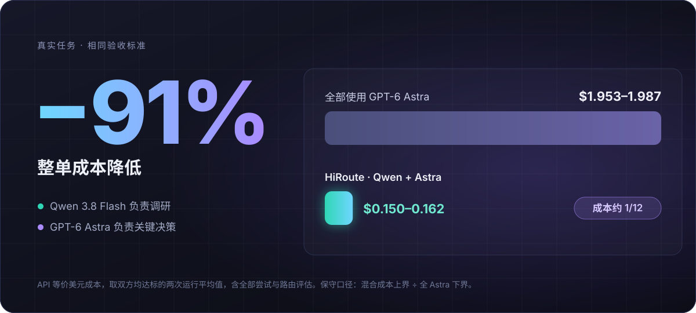
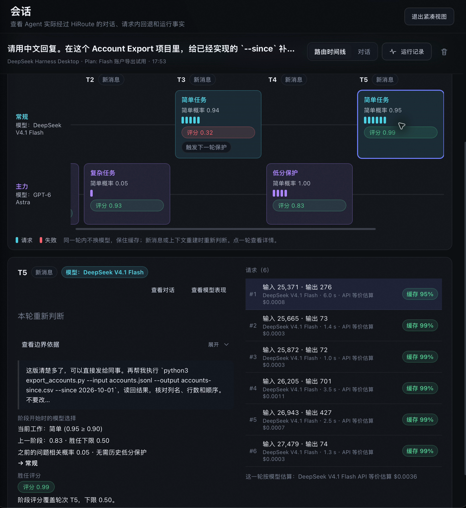
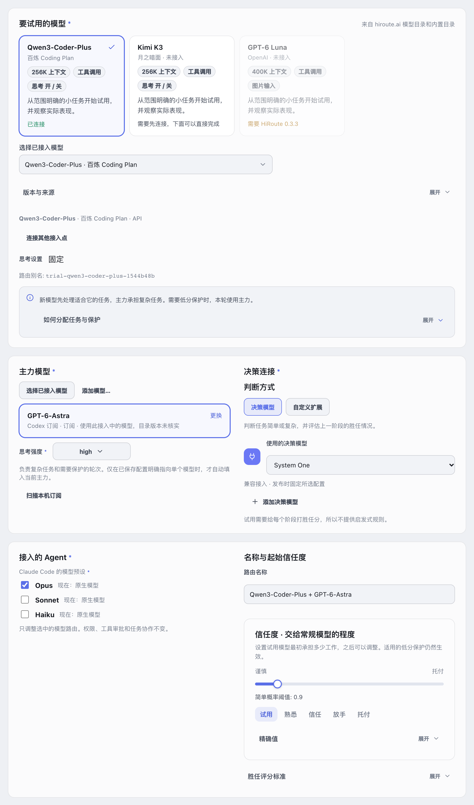
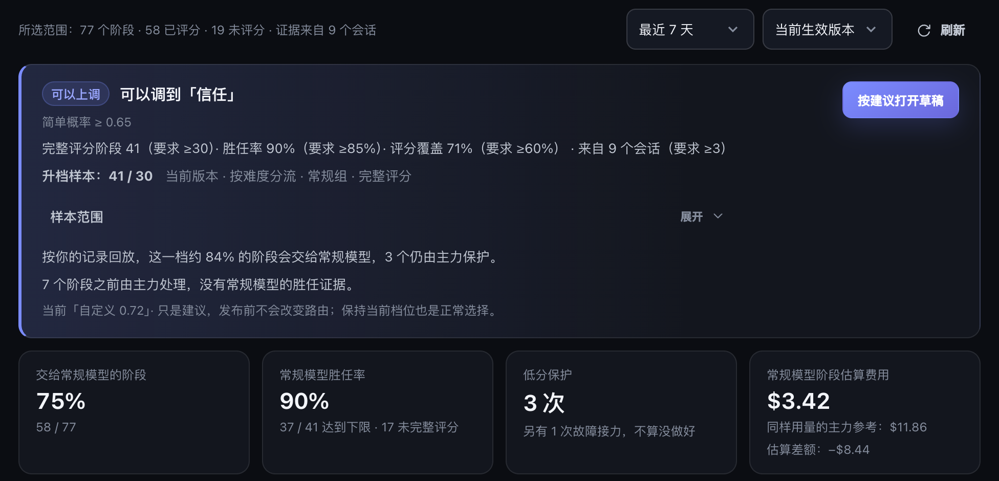
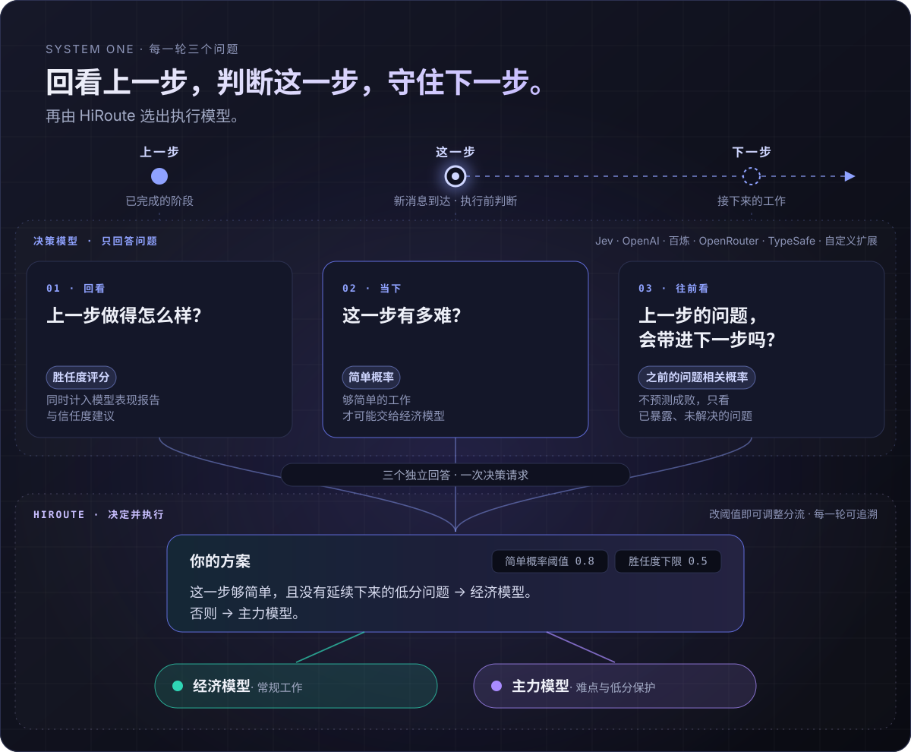
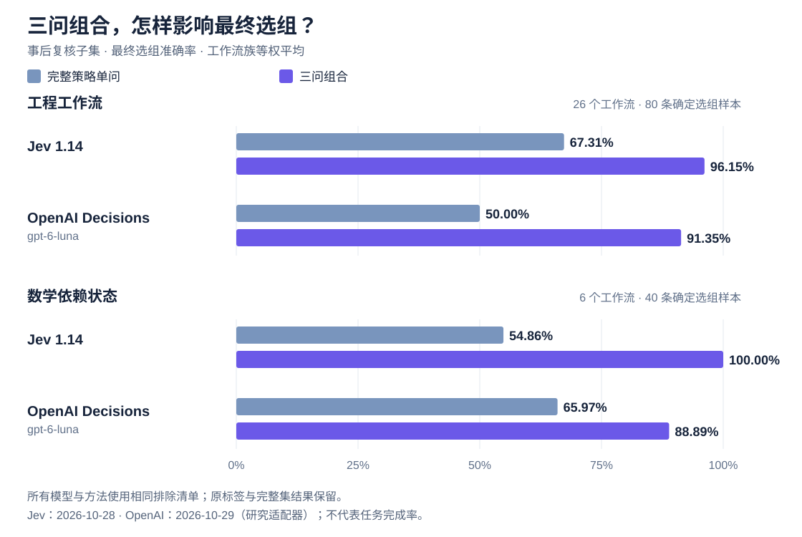

# HiRoute 新版本发布：新模型放心试，任务交给对的 Agent

最近几乎每隔几周就有新模型发布，价格是主力模型的零头，通用评分却已经很接近。Epoch AI 今年 9 月的报告《The plunging price of thought》估算，2023 年以来，达到同一能力水平的成本平均每季度下降约 47%。便宜、够用的模型只会越来越多，真正难的变成了两件事：自己工作里的哪些步骤可以交给它，一项任务又该交给哪个 Agent 去做。

[HiRoute](https://github.com/higress-group/HiRoute) 是一个开源、运行在本地的 Agent 智能路由引擎。你继续用 Codex、Claude Code、Qoder、Pi、OpenCode、Hermes、DeepSeek Harness 等熟悉的 Agent，由 HiRoute 判断每一步交给哪个模型。这次更新围绕上面两件事展开：

- **新模型边用边评**：从首页的「新模型」开始试用，信任度可以连续调节。模型表现报告按你自己任务里的证据，建议上调或下调信任度，回放确认后再发布。
- **System One 每轮三问**：回看上一步、判断这一步、守住下一步。在论文的复核子集上，两个决策模型在工程和数学场景的选组准确率都明显提高。决策模型新增 OpenAI Decisions，也可以直接复用已有的百炼、OpenAI 或 OpenRouter 接入。
- **任务交给合适的 Agent**：路由计划可以绑定执行 Agent。Hermes 新增模型路由和任务路由，OpenCode 既能委派任务，也能当执行 Agent。用 Hermes 加 HiRoute，就能搭出类似 DeepSeek 最近提出的 Super Agent 架构。
- **三个平台都有图形界面**：Windows 桌面版首次发布，Linux 可以在浏览器里使用同一套界面。
- **更多改进**：订阅和 API 一起接入、API Key 花费额度、按接入设置代理、更省空间的本地记录。

## 一、每一步重新判断：复杂任务里也有简单的活

常见的做法是按场景分工：写代码配一个强模型，整理资料配一个便宜的模型。不同场景要的能力确实不同，但在实际会话里我们看到，难度是一步一步变化的：复杂场景里有大量简单的活，简单场景里也会突然冒出难题。

我们做过一次技术选型的对比实验：前面调研六种候选技术、核验官方资料，最后写一份关键方案的决策备忘录。资料整理交给便宜的模型、关键判断交给主力，关键判断的质量和全程用主力一样，整单成本只有后者的十二分之一左右。反过来全程用便宜的模型，资料整理做得并不差，但三次关键判断里有两次出了重大错误。



所以 HiRoute 的分工是：场景决定有哪些候选模型、按什么标准验收；每一步用哪个模型，到这一步再判断。切换只发生在用户发送新消息、上下文压缩或重建时，同一轮里的工具调用始终用同一个模型，切换后只有第一次请求会错过缓存。详见[实战案例](https://hiroute.ai/news/astra-qwen-smart-routing/)和[切换模型与缓存的成本分析](https://hiroute.ai/news/routing-cache-cost/)。

下面是一段真实会话的录屏。左边是 DeepSeek Harness，右边是 HiRoute；路由计划把 DeepSeek V4.1 Flash 作为要试的新模型，GPT-6 Astra 作为主力。用户只在 Agent 里正常提需求，从头到尾没有手动换过模型。

<figure class="article-video"><video controls playsinline preload="none" poster="/media/hiroute-promo-zh-poster.jpg" aria-label="HiRoute 三分钟产品介绍视频"><source src="/media/hiroute-promo-zh.mp4" type="video/mp4"></video><figcaption>三分钟产品介绍：真实会话录屏，信任度部分为示意画面，费用为 API 等价估算。</figcaption></figure>

1. 补测试、讨论设计取舍，这两轮不够简单，由主力完成。第一轮 21 次调用都留在同一个模型上，缓存命中近九成。
2. 写一段使用说明，足够简单，交给新模型。
3. 用户说这版读起来像功能介绍。上一步评分 0.32，这个问题和接下来的改写直接相关，低分保护让主力接手。
4. 改写后的版本评分 0.83，问题解决了，下一步导出数据又回到新模型。



*会话时间线记录了每一轮用了哪个模型、为什么这么选。*

## 二、新模型：在自己的工作里边用边评

各类评测和榜单适合初筛，回答不了“它在我的工作里行不行”。Scale AI 去年 9 月发布的 SWE-Bench Pro 是个例子：在 SWE-bench Verified 上能解决七成以上问题的头部模型，在 SWE-Bench Pro 的公开题上只有 23% 左右；换到创业公司的私有代码库，最好的成绩又降到 17.8%。题目本身更难，前面那段落差不能全算在“没见过”上；但公开题和私有题是按同一套方法构建的，后面这一截落差更能说明问题。你的代码库，对模型来说正是没见过的私有代码。

新模型来得太快，不可能每来一个就专门做一套评测集。我们的思路是边用边评：先把足够简单的步骤交给新模型，每一步做完都看结果，出了问题由主力接手，证据够了再逐步多放手。这次更新把这条路补完整了：

- **从首页开始试用**：首页的「新模型」会展示推荐的新模型。选好要试的新模型和熟悉的主力，映射到你的 Agent；发布前会列出全部改动。Agent 里用的模型名不变，不用改 Agent 配置。
- **信任度连续可调**：信任度就是难度门槛，越往右，越多简单工作交给新模型。除了试用、熟悉、信任、放手、托付五个档位，也可以停在任意位置。
- **主力随时接手**：新模型某一步的评分低于胜任下限、问题又仍关系到接下来的工作时，低分保护让主力接手；问题不再相关，就回到按难度选择。



判断“这一步做得怎么样”，最直接的证据在用户的下一条消息里：明确否定上一步的结果，就是没做到的证据；只是接着往下安排，或者什么都没说，并不能说明失败。这次更新也让评分更贴近真实的反馈：能识别明确的认可，区分部分肯定和完整通过，部分可用的进展也会计入。

用一段时间后，模型表现报告会汇总阶段评分、新模型承担的比例和费用估算。单次评分会有误差，调整信任度要看足够多的证据：

- **建议上调**：上次调整之后，至少积累 30 个完整评分的阶段，来自至少 3 个会话，评分覆盖六成以上，其中 85% 以上达到胜任线。
- **建议下调**：至少 30 个完整评分的阶段里，达标的不到 70%。



*每条规则的实际值和要求并排列出，并按你的记录回放调整后的效果。费用为 API 等价估算。*

上调的门槛比下调高，这是有意的：偶尔几次做得好，不足以多放手；问题足够明显时，收回要更及时。建议只是建议，发布之前不会改变路由，保持当前档位也是正常的选择。在「Agent」里为日常使用的 Agent 打开「HiRoute 管理」后，也可以直接让它读取模型表现报告和调档建议；需要定期复查，交给 Agent 自己的定时任务。

## 三、System One：每一轮只问三个问题

上面的判断每一轮都要做一次。最直接的办法是把任务、历史和路由策略都交给决策模型，问它“这一步该用哪个模型”。我们试过，结果并不稳定：它得同时权衡任务难度、过往表现、问题有没有解决、策略是怎么规定的，任何一项想偏了，结论就错了。

System One 把它拆成三个独立的问题，在一次请求里各自回答：



- **上一步 · 回看：做得怎么样？** 给出胜任度评分，同时计入模型表现报告。
- **这一步 · 当下：有多难？** 给出简单概率，够简单的工作才可能交给经济模型。
- **下一步 · 往前看：上一步的问题，会带进下一步吗？** 判断一个已知、未解决的问题是否仍然适用，而不是预测下一步能不能成功。

决策模型只回答问题，阈值、选组和执行都由 HiRoute 负责；调整信任度，改的是阈值，不是问题本身。这次更新起，第三个问题成为默认判断的一部分：上一步没做好、问题又会延续时，主力接手；问题解决了或者不再相关，就解除保护。

我们把这个机制写成了论文，公开了中英文数据集、原始模型回答和离线复现工具。实验里，两种方法读取相同的任务上下文和完整路由策略：一种直接选模型组，另一种回答三个问题，再由 HiRoute 组合判断。



这组数据里，有一点值得多说几句：两个决策模型直接选组时，错的方向正好相反。在数学场景里，Jev 1.14 偏大胆，24 条需要保护的记录只选对 6 条；OpenAI Decisions 偏保守，16 条应当解除保护的记录只选对 2 条。改成三个问题以后，Jev 1.14 的 24 条保护全部选对，16 条解除也保持全对；OpenAI Decisions 的解除提升到 14 条，保护则从 24 条变成 22 条。方向相反的两种偏差，用同一种拆法都明显压了下来。

成本和延迟也不是问题。按 Jev 的实际计费，每千次三问决策约 0.084–0.086 美元；不计连接建立，实测决策耗时的中位数在半秒到一秒之间，每一轮都重新判断负担得起。

需要说明的是，这些数据衡量的是“有没有按声明的策略选对模型组”，不是任务完成率，也不是实际省下的钱。这组对比用的是查看输出之后复核的子集，所有模型和两种方法使用同一份排除清单，提升幅度也因决策模型和场景而异；OpenAI 的结果来自实验中的研究适配器，不代表内置 OpenAI 连接的表现。完整数据、排除清单和局限见[论文](../experiments/system-one-routing-paper/README.md)。

决策模型的接入也更灵活了：

- **新增 OpenAI Decisions**，内置连接还支持百炼、OpenRouter Jev、TypeSafe 和兼容接入点。
- **复用已有的 API 接入**：OpenAI、OpenRouter，以及百炼的 Token Plan 和工作空间接入，可以和普通模型共用 Key；TypeSafe 和其他兼容接入点仍可单独填写地址和 Key。
- **决策上下文按模型窗口分配**：已知模型按官方资料，也可以自己设上限。当前输入和三个问题总是完整保留，再尽量多放进最近的完整步骤。

## 四、任务路由：每个任务交给合适的 Agent

模型路由决定“这一步用哪个模型”，任务路由决定“这项工作交给哪个执行 Agent”。每份路由计划写明适合哪类工作，并可以绑定一个执行 Agent：Codex CLI、Claude Code、Qoder CLI、Pi、DeepSeek Harness 或 OpenCode。执行时，这个 Agent 的每一轮仍按计划里的模型路由，在经济组和主力组之间判断。

这次更新里：

- **Hermes** 可以把自己的模型请求接入 HiRoute，也可以开启任务路由，委派已发布的计划。
- **OpenCode** 既能作为日常使用的 Agent 委派任务，也能当执行 Agent。
- **执行 Agent** 按本机实际安装的能力检查是否可用，执行失败的原因会如实保留；CLI 也会直接指出委派配置里缺了什么，比如计划的使用场景。

DeepSeek Harness 团队 10 月 31 日发布了长文《Super-agent 设计探索：迈向更自主的 Agent 系统》，并开源了研究原型 [dsh-superagent-prototype](https://github.com/deepseek-ai/dsh-superagent-prototype)。它把系统分成两层：常驻的 Router 负责对外沟通、全局协调和任务分派，自己可以完全不执行任务；Worker 在隔离的上下文里专注执行单个任务，结果交回 Router 统一回复。这样 Router 始终能及时响应新消息，不会被某个长任务卡住。文章的出发点很现实：一个人同时能照看的 Agent 会话大概只有三到五个，人的注意力成了瓶颈。

类似的架构，用 HiRoute 现有的能力就能搭出来，不需要专门再造一套 Super Agent 的路由机制：


- **personal agent 做 Router**：Hermes 可以在 HiRoute 里直接开启任务路由；OpenClaw 等其他 personal agent，只要能在本机执行命令行，也能调用同一套命令。
- **用 `hiroute worker exec` 委派**：把任务、工作目录和验收要求交给 `hiroute worker exec`。加上 `--no-wait`，任务一被接受就返回，Router 马上回到对话；多个任务可以并行执行。
- **任务结束时自动回报**：以 Hermes 为例，提交之后，它在后台进程里一直等到任务结束，并打开自带的 `notify_on_complete`。任务一结束，这个进程退出，Hermes 就会被唤起，取回结果，再在对话里告诉你。
- **可以指定执行 Agent**：搜集资料这类轻量任务，交给绑定 Pi 的计划；开发工程代码，交给绑定 Qoder CLI 的计划；代码审查，交给绑定 Codex CLI 的计划。委派时可以直接点名计划，也可以让 Router 按每份计划写明的用途自己选。

```sh
# 把资料搜集交给绑定 Pi 的计划，提交后立即返回
hiroute worker exec --plan <PLAN_ID> --cwd /work/mq-research --no-wait \
  -- "搜集三种消息队列的官方文档和发布说明，整理成对比表"

# 随时查看进度；任务结束后取回结果
hiroute worker status --run <RUN_ID>
hiroute worker result --run <RUN_ID>
```

Router 只负责理解意图、分派任务和汇总结果；每个执行 Agent 用多贵的模型，再由它所在的计划一轮一轮判断。用 Hermes 搭建的完整过程，见[《用 Hermes 和 HiRoute 搭一个 DeepSeek 式的 Super Agent》](https://hiroute.ai/news/hermes-super-agent/)。

## 五、macOS、Windows、Linux 都有图形界面

- **macOS**：桌面应用，支持 macOS 15 及以上，Apple 芯片与 Intel。
- **Windows**：桌面版首次发布。x64 安装包按当前用户安装，自带命令行、后台服务和 WebView2 引导安装器，不需要 Python 或管理员权限。在应用里升级时，会先等进行中的调用和 Worker 任务结束再安装。
- **Linux**：支持 x86_64 与 ARM64，安装到当前用户目录，无需 `sudo`。在浏览器里打开的是和桌面版同一套界面。服务器不需要桌面，`hiroute console open` 会生成两分钟内有效、只能使用一次的登录链接；远程服务器可以通过 SSH 隧道访问。

```sh
curl -fsSL https://hiroute.ai/install.sh | sh -s -- --console-mode loopback --console-port 5838
hiroute service start --output json
hiroute console open
```

## 六、更多改进

- **订阅和 API 一起接入**：接入 Codex 或 Claude 订阅时，可以顺手填一个对应的 OpenAI 或 Anthropic API Key。选一次模型、保存一次，两边的模型同时导入。订阅附带的 API 赠金正好用得上：符合条件的 ChatGPT Pro / Business，以及 Claude Max / Ultra / Team，每个账单周期都能领一笔 API 赠金，没用完的不会顺延（见 [OpenAI](https://developers.openai.com/api/docs/guides/chatgpt-api-credits) 和 [Anthropic](https://support.claude.com/en/articles/17154008-monthly-api-credits-for-max-ultra-and-team-plans) 的官方说明）。这里填领取赠金那个组织的 Key，再在模型详情里为订阅的模型创建路由，HiRoute 会发现 API 里的同名模型，可以一起加入候选。这样，订阅和 API 里的同名模型就组装成了一个模型：Agent 只用一个模型名，HiRoute 先用订阅，订阅暂时用不了时自动接着用 API。
- **给 API Key 设花费额度**：可以设一次性额度、按日历周期补充，或让多个 Key 共用一份额度。HiRoute 转发请求前先预留，完成后结算。金额按 HiRoute 转发的流量估算，不是供应商的账户余额。管赠金也合适：按赠金的金额给那个 Key 设一份按月补充的额度，用完以后，这个 Key 会被跳过。
- **按接入设置代理**：每个 API 接入可以选择直连、沿用后台服务的环境代理，或手动填写 HTTP(S) 代理和绕过规则；共用这个接入的决策模型也遵循同样的设置。
- **本地记录更省空间**：长会话不再反复保存完整的请求快照和协议日志，只保留查看历史、评分和模型归属需要的内容。本地记录默认最多占用 20 GB，可以调整或关闭，七天保留期照常生效。
- **模型资料单独更新**：上下文窗口等官方模型资料和首页的新模型推荐，通过 HiRoute 的模型目录单独发布，不必等应用升级。
- **本地运行，开源**：HiRoute 运行在你的电脑或服务器上，采用 Apache-2.0 许可证。

## 开始使用

1. **接入模型**：加入受支持的订阅或 API，选好经济模型和主力。
2. **配置分工**：在「模型 → 决策模型」中连接决策服务，选择信任度，发布并映射到 Agent。
3. **照常工作**：继续在原来的 Agent 中使用，到 HiRoute 查看模型切换和模型表现报告。需要委派任务时，参考[智能任务路由](https://hiroute.ai/docs/task-routing/)为计划选择执行 Agent。

HiRoute 并不完美，决策模型也会判断错。欢迎在自己的场景里试一试，也欢迎告诉我们它在哪里判断错了。

[下载 HiRoute](https://hiroute.ai/download/) · [使用文档](https://hiroute.ai/docs/) · [GitHub](https://github.com/higress-group/HiRoute)
