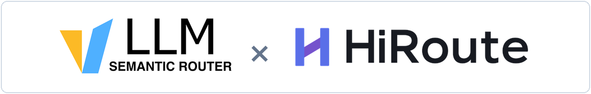

# Routine Work Stays Local, Hard Turns Go to the Cloud: A Test Run with Qwen3.8-27B, the d3 Decision Model and Qwen4-Max

By **Jinyu Zhou (zhoujinyu)** \<2319109590@qq.com\>, Master's student at Tongji University and core maintainer of vLLM Semantic Router

This post is a write-up of a small integration. I connected d3, the decision model from vLLM Semantic Router, to HiRoute, a gateway that sits between a coding agent and the models it calls. With d3 in place, HiRoute decides turn by turn whether a piece of work stays on a local Qwen3.8-27B or goes to Qwen4-Max in the cloud.

The screenshot below comes from one of the sessions, which ran for eleven turns. Seven of them ran on the local model, which is served from a GPU node in our own network, and the other four ran on Qwen4-Max on Alibaba Cloud. I wrote the steps myself and knew in advance which ones were meant to be easy and which hard, but I did not choose the model for any of the turns, since that was left to the router.


*The strip at the top shows the whole session, with one block per turn: teal blocks ran on the local model and purple ones in the cloud. The cards below it show the later turns of the session. `P(simple)` is the probability the decision model assigns to the turn being simple. Internal paths are masked in the screenshots in this post.*

The reason I wanted to try this is that most of what a coding agent does is not hard. It spends many of its turns listing files, reading a README, or checking that the file it just wrote is really there, and a 27B model on hardware you own can handle that kind of work without anything leaving your network. Only a few turns are hard in the sense that matters, such as finding the real cause of a bug or writing a fix that holds up, and those are the turns worth sending to a frontier model. So the setup I had in mind is this: **routine work and the routing decision stay local, and a turn goes to the cloud model only when it is hard or when the stage before it fell short.**

The decision is the part of this that is easy to overlook. Something has to look at every turn and decide where it goes, and if that job is given to a large model behind an API, then every turn has already left your machine before anything has decided whether it should. You would also be paying for a round trip just to find out that the next step is an `ls`. For the arrangement to make sense, the decision model has to run locally as well, and it has to be fast and cheap enough that asking it on every turn is not a burden.

<figure class="article-video"><video controls playsinline preload="none" poster="/media/hiroute-vllm-sr-d3-en-poster.jpg" aria-label="Three-minute video: vLLM Semantic Router's d3 as HiRoute's decision model"><source src="/media/hiroute-vllm-sr-d3-en.mp4" type="video/mp4"></video><figcaption>The long session in the video is a separate 12-turn recording</figcaption></figure>

## The decision model and the gateway

For the decision model, I used [vLLM Semantic Router](https://github.com/vllm-project/semantic-router). The project is a programmable router: an agent harness talks to a single API, and the router picks or combines models for each call according to a policy you write, across local, private and cloud backends. It describes itself as an open, programmable decision layer for models and compute. It makes its routing judgments with dedicated decision models, and the current family is called [Decision 3.0](https://huggingface.co/collections/vllm-sr/decision-30). I used two models from that family, [d3](https://huggingface.co/vllm-sr/d3), which is the 27B model, and [d3-mini](https://huggingface.co/vllm-sr/d3-mini), which is the 4B one, and both are released under Apache-2.0.

A decision model does not generate text. You send it an input together with a set of typed questions (pick one of these options, answer yes or no, rate on a scale), and it answers all of them in a single call by returning a probability for each option. The API for this is called System One. The router uses it internally, and any application can also call it directly at `/v1/systemone`. vLLM supports d3 natively, so a plain `vllm serve` is enough to expose the model on that endpoint.

The gateway is [HiRoute](https://github.com/higress-group/HiRoute), an open-source project from the Higress team. It runs on the developer's own machine and sits between the coding agent and its models, so you keep the agent you already use (DSH in this post; Codex, Claude Code, OpenCode and others are supported as well) and only point its base URL at HiRoute. In a routing plan you place your economical models in a Regular group and your strongest model in a Primary group. From then on, each time a new message arrives, HiRoute asks a decision model three questions: how well the previous step went, how hard the current step is, and whether the previous step's problem carries over into this one. It then applies the thresholds you configured to those answers and picks a group. The decision model's role ends at answering, while the thresholds, the choice of group and the execution all remain in HiRoute. One more term comes up later: HiRoute calls the work done in one turn a stage.

This is where the two projects meet: the three questions HiRoute asks on each message are typed questions, which is exactly the kind of question d3 answers. Note that the Semantic Router itself is not in the request path in this setup. I only took its decision model, served it on our node, and connected it at the point where HiRoute expects a decision model. HiRoute's [local model routing guide](https://hiroute.ai/en/docs/local-model-routing/) already describes this combination, with a local worker model, a cloud model for the harder turns, and a local decision model, and what I wanted was to see it actually running on our own node.

## The setup

| Role | Model | Where it runs |
| --- | --- | --- |
| Decision | d3, over System One | `vllm serve` on 2×L40, `:8900`, `/v1/systemone` |
| Regular | Qwen3.8-27B | same node, `:8910`, via a proxy on localhost `:18081` |
| Primary | Qwen4-Max on Bailian, Alibaba Cloud's model platform | localhost `:18084` shim → DashScope compatible-mode API |
| Agent | DSH (`@deepseek-ai/dsh`) | `/v1/responses`, base URL pointed at HiRoute |

Throughout this post, "local" means inside our own network. d3 and Qwen3.8-27B are served from the same GPU node on separate cards, and HiRoute and DSH run inside the same network and reach both models over private addresses. HiRoute is version 0.6.3 and runs in a Singularity container (Ubuntu 22.04), and all the screenshots in this post come from its browser console. The routing plan is called `d3-bailian-route`, and from DSH's side it appears as a single model named `hiroute-d3-bailian-route`, so the agent has no knowledge of which models sit behind that name or how HiRoute switches between them.


*The plan as it appears in the console. The connection model name is the only thing the agent sees.*

The plan uses Difficulty routing. I kept the default trust level, Familiar, which sets the simple-probability threshold to 0.80, and I also kept the default competence floor of 0.50. These two numbers appear in every run below, so it helps to spell out what they do. A turn goes to the Regular group only if d3 puts the probability that it is simple, written `P(simple)`, at 0.80 or higher. Separately, if d3 scores the previous stage below 0.50, the next turn goes to Primary even if it looks easy, and this continues for as long as the earlier problem still applies. HiRoute calls this second rule low-score protection.

One practical detail is useful to know before you try this. HiRoute keeps a new revision each time you save a decision connection, and a published plan stays pinned to the revision it was published with. The order that works is to test the connection first, then select that revision in the plan and publish it, because otherwise the plan will go on calling the old address.

As for hardware, this setup runs on a GPU node and not on a laptop. d3 is nominally a 27B model. It has 26.09B parameters stored in BF16 without quantization, which comes to about 52 GB of weights. That is more than a single 48 GB L40 can hold, so I ran it across two cards with `--tensor-parallel-size 2`. d3 is built on Qwen3.8-27B but is a separate set of weights, which means that in this setup the decision model is as large as the worker model and occupies two GPUs by itself. An individual call is cheap, but keeping a model of this size loaded all the time is a real cost. d3-mini, with 4.54B parameters, passed the same endpoint and connection checks on a single L40 (see the appendix), which makes it the natural candidate for smaller machines, although I have not yet routed a session with it.

## Run 1: I say the fix is wrong

The first test repository contains a small in-memory rate limiter that I broke on purpose. Its `allow()` function never evicts timestamps older than `window_sec`, so once a key reaches its limit it stays blocked for good and `test_blocks_over_limit_then_recovers` always fails. I chose it because it is small enough to fix in a few minutes but also easy to fix badly, since a patch can look reasonable without evicting by the window at all.

A note on the prompts before going further: I wrote them in Chinese, which is what the screenshots show, so the versions quoted here are translations, and I have trimmed internal paths from them. I opened with a message that was meant to sound like a routine chore:

> Simple task: fix window eviction in rate_limiter. Only change `allow()`: evict expired timestamps by `window_sec`.

d3 put `P(simple)` at 0.98 for this message, so the turn ran on the local Qwen3.8-27B, which quickly came back with a draft that cleans up the window. I ran this scenario several times. In some runs the draft was subtly wrong at the boundary, and in others I replaced it with a deliberately sloppy fix, one that keeps the last N hits and ignores `window_sec`, so that the failure was sure to occur. In either case I did not open the console or switch models by hand. I simply replied in the conversation, as I would to a colleague:

> No. Acceptance failed: `test_blocks_over_limit_then_recovers` still fails after the sleep window. Don't raise the limit and don't clear everything. Evict by `window_sec`.

This reply does not change anything in the repository. It is simply the next message, and it goes through the same decision step as any other. This time d3's answers pointed to Primary in two ways. Looking back, it scored the previous stage at 0.37, which is below the 0.50 floor, and looking at the new turn, it put `P(simple)` at 0.79, which is below the 0.80 threshold. Either result would have been enough to send the turn to Primary, and it ran on Qwen4-Max, with the timeline labeling it as low-score protection.


*Both turns of the session, T1 and T2. T1's card carries the 0.37 score and the "Protected the next turn" mark, and T2's card shows Low-score protection with a `P(simple)` of 0.79.*

Qwen4-Max then rewrote the eviction logic, and although the pytest run that followed is not part of this two-turn capture, both tests passed. What I find useful about this run is that nothing in it is an instruction to use a stronger model. I only said what was wrong, in the conversation, the same way I would have without any routing in place. d3 scored that feedback on our own node, and the request went to the cloud model only after the score came back at 0.37.

## Run 2: the acceptance gate keeps failing

When an agent works on its own, there is nobody around to tell it that a fix is wrong. What it gets in place of that feedback is the acceptance gate, that is, tests that are still failing. So for the second run I wanted to see how the router handles a message that reports a failing gate without adding any new requirement. To be clear, I did not run an unattended agent for this. I sent the gate result myself and worded it the way a harness would report it.

The captured session has two turns and uses the same plan. The first turn is a simple rate-limiter fix: d3 put `P(simple)` at 0.98, so it went to the local Qwen, with a competence score of 0.44. The second turn is the gate message quoted below. It came in at 0.89, which is above the 0.80 threshold, so on difficulty alone it would have stayed on the local model, yet it went to Qwen4-Max and the timeline labels it as low-score protection.

> Acceptance failed: `pytest tests/` still fails (limiter recovery + empty `stuck_keys` + diagnose healthy). This is an acceptance-gate failure, not a new requirement. Continue the same task until everything is green [...]


*The two turns of this session. T2 has a `P(simple)` of 0.89 and still ran on Qwen4-Max.*

This capture has one clear limit: the gate message arrived after the previous stage had already scored below the floor, so even though the turn looked easy it went to the stronger model. What I can show is that low-score protection acted on the gate feedback, not that difficulty judgment alone moved the work there.

What the capture does show is the second trigger at work, since a turn that looked easy was sent to the stronger model because of what had happened before it. That is the rule I would want in place before leaving a local model to work on a task overnight, although this run does not test that scenario.

## Run 3: eleven turns, until both gates pass

The rate limiter is good for showing individual switches, but I also wanted something closer to an ordinary working session. For the third run I used `demo-vllm-sr-decision`, a small set of helper scripts around System One decision wiring that covers parsing probe results, a latency window, endpoint health and log scanning. I broke five of its files on purpose:

- `decision_parse.py` reads the wrong field from a decision probe result
- `latency_window.py` never evicts by time, so its counts stay too high
- `endpoint_health.py` treats "not ready" as ready
- `log_scan.py` counts unrelated WARN lines as failures
- `diagnose.py` ends up with health and routing expectations that don't line up when it sums these up

Acceptance has two gates, and both must pass. `pytest tests/` has to be fully green (14 passed in this run), and `python diagnose.py` has to report `healthy`, `route_ok`, `latency_ok`, `endpoints_ok` and `log_ok` all as true. The expected values in the fixtures may not be edited, so only the `.py` files can change.

I drove the session with DSH as a real tool-using agent. Each user message is still one turn and gets one routing decision, but inside that turn the agent may issue several model requests (read → edit → test → …). HiRoute keeps the model fixed for those in-turn calls so the prompt cache stays warm; a new user message triggers a fresh decision. I alternated easy and hard steps deliberately: first list the files and read the sample logs, then send a message along the lines of "here is the failing output, write the fixed file in full this turn", and then check that the write had landed. The session was allowed to stop only when both gates were green, and it had to get there within the same session, without starting a fresh chat that merely looked fixed.

I should disclose one thing here, which is that the messages for the easy steps begin with "Simple task:" and name the command to run, as you can see in the screenshots. The `P(simple)` values of 0.99 and 1.00 on those turns are therefore the easiest case a decision model can get, and they do not show that d3 can recognize an easy turn without being told.

This is the session shown at the top of the post. Turns 1 to 3 list and read files and ran on the local Qwen. Turn 4, the first actual fix, went to Qwen4-Max. From there the session keeps moving between the two models: turn 5 is local, turn 6 is in the cloud (`P(simple)` 0.69), turn 7 is local, turn 8 is in the cloud (0.60), turn 9 is local, turn 10 is in the cloud, and turn 11 is local again. Turn 11 is the closing step, in which my message reports that both gates have passed and asks for a `done` action.


*A mid-session switch as the console records it: T5 is simple at 0.99 on Regular; T6, at 0.69, is another turn sent to Qwen4-Max.*

The screenshot at the top of this post shows the end of the same session: T8 and T10 ran on Primary, and T7, T9 and T11 on the local Qwen.

The first thing I looked for was whether the routing comes back down after an escalation, and it does. After a hard turn, the next easy one returns to the local model, as turns 5, 7, 9 and 11 show. If the router only ever escalated, the session would have stayed on Qwen4-Max from turn 4 onward.

Not every escalation in this session is explained on screen, though. Turn 10 has no selection reason recorded and its `P(simple)` shows as unknown. It ran on Primary, and the record does not say why. HiRoute's documented behavior is to use the Primary group when a difficulty result is unavailable, which would fit what happened here, but I cannot confirm that from this record. Turn 4's card also lacks a clear `P(simple)`. So of the four turns that went to Primary, turns 6 and 8 are the ones whose reasons are clearest in the screenshots.

The next two screenshots are from an earlier run of the same script, not from the eleven-turn session above.


*What individual turns look like: the end of a rewritten `endpoint_health.py`, followed by a one-line check that the local model answers.*


*The run record of that earlier run. The usage data is partial and nothing is priced.*

That run record is incomplete. It notes that seven of its twelve attempts lack input or cache-read usage, and the cost line reads "Unpriced", which is why this post does not include any cost figures.

## The three runs side by side

| | Run 1: I say the fix is wrong | Run 2: the gate keeps failing | Run 3: until both gates pass |
| --- | --- | --- | --- |
| Turns in the session | 2 | 2 | 11 |
| On local Qwen3.8-27B | T1, `P(simple)` 0.98 | T1, 0.98 | 7 turns; mostly 0.99 / 1.00 on screen |
| On Qwen4-Max | T2 | T2 | 4 turns: T4, T6, T8, T10 |
| Reason on screen | previous stage 0.37 < 0.50, and 0.79 < 0.80 | previous stage 0.44 < 0.50; T2 (0.89): low-score protection | T4: none recorded. T6: 0.69. T8: 0.60. T10: none recorded |
| What I sent | a "no" in the chat | at turn 2, a gate failure with no new requirement | scripted easy and hard steps |

## What these runs don't show

Before drawing any conclusions, here are the limits of what these three runs can tell you.

- The tasks are small and scripted. I wrote the steps, the easy ones label themselves "Simple task:", and the failures in runs 1 and 2 were partly staged. The seven-to-four split in run 3 follows from my script. The runs show that the routing responds to these signals, but they are not a benchmark of d3's judgment or of either Qwen model.
- There is no cost or time comparison against an all-local or all-cloud run, because the run record is partial and unpriced.
- Everything ran on one hardware setup, in which the decision model is a 26B model on two L40s. d3-mini passed the same two checks on one L40 (see the appendix), but I did not use it to route these sessions, and that is the next thing I would try.
- The scores are d3's answers under the criteria of this plan, and nobody has checked them against ground truth.

## What stayed local and what went to the cloud

With those limits in mind, here is how I read the results. The routine work did not need to leave our network: in the eleven-turn session, seven turns were listing, reading and confirming, and the 27B model on our node handled all of them. The routing decision did not need to leave either. HiRoute makes one decision per new message, and according to its documentation the tool calls within a turn reuse that decision (the DSH runs here do exercise that part: individual turns show Requests (4) to Requests (8) in the console). d3 answers in a single call with probabilities and generates no text. On the two L40s, a direct System One call to d3 took about 122 ms at the median, and through HiRoute's own decision test the model median was about 825 ms. For d3-mini on one card the two figures were about 55 ms and 150 ms. All four figures are medians over the short test cases described in the appendix.

What does leave the network is each turn that is routed to Primary, along with whatever the agent sends in that request. An agent that resends its history will include the earlier local turns in the request, so this setup should not be read as a privacy boundary around the easy turns. My messages in these runs were short and self-contained (the Qwen4-Max request in run 1 carried 94 input tokens), so the runs do not measure how much context would leave in practice. What I can say stays local for certain is the decision call for every turn, and any session that never escalates.

It also helps to keep the two escalation triggers apart, because they do different jobs. `P(simple)` is a forecast made before the work is done. It estimates how simple the turn is by the plan's criteria, and it says nothing about whether a particular model will get it right. The competence score looks back and asks whether the last stage held up. Turn 2 of run 2 is a case where the two disagree, with a `P(simple)` of 0.89 and the turn still going to Primary. If routing relied on the forecast alone, a model that was already struggling would keep receiving turns that look easy.

None of this depends on the particular models I used. d3 only answers questions, the 0.80 and 0.50 thresholds are settings in HiRoute, and DSH sees a single model name the whole time, so in principle you could swap the local model, the cloud model or the thresholds without touching the rest. That is a statement about the design, though, and the combination in this post is the only one I have actually run.

I started out wanting to check whether d3 could serve as HiRoute's decision model, and it can. In the eleven-turn run, seven turns stayed on our node, four went to Qwen4-Max, and the session ended with both gates green. The scale is small and the script was my own, so I would treat this as a working demo and not as an evaluation. Even so, it is the arrangement I would like to keep building on, with the worker model and the decision model on hardware we own and the cloud model used for the turns that need it.

## Where to start



Both projects are open source under Apache-2.0, and these are the places to start if you want to try the setup yourself.

- **HiRoute**: [GitHub](https://github.com/higress-group/HiRoute) · [hiroute.ai](https://hiroute.ai/en/) · [local model routing guide](https://hiroute.ai/en/docs/local-model-routing/). It has desktop apps for macOS, Windows and Omarchy, and a Web UI and CLI for Linux, which is what I used. To reproduce this setup, add your local model as a custom API connection, add the decision model as an "Other compatible connection" with the full `/v1/systemone` URL, create a Difficulty routing plan, and point your agent at it.
- **vLLM Semantic Router and Decision 3.0**: [GitHub](https://github.com/vllm-project/semantic-router) · [vllm-sr.ai](https://vllm-sr.ai) · [blog](https://vllm-sr.ai/blog/) · [d3](https://huggingface.co/vllm-sr/d3) · [d3-mini](https://huggingface.co/vllm-sr/d3-mini). The d3 model card has the instructions for `vllm serve` and System One, and at the time of writing d3 support is in vLLM's nightly builds. If you are interested in the whole router and not only its decision model, the documentation is the place to start.

---

## Appendix: wiring, and both d3 models

I served both models with the official `vllm serve` and ran the same two checks against each of them: twelve System One cases sent directly to the endpoint, followed by HiRoute's own decision test.

| Model | Deploy | Decision service | System One cases | HiRoute `decision services test` | System One p50 | HiRoute model p50 |
| --- | --- | --- | --- | --- | --- | --- |
| [vllm-sr/d3-mini](https://huggingface.co/vllm-sr/d3-mini) | 1×L40 · `:8899` | `local-d3-mini` | **12/12 PASS** | **8/8 PASS** | ~55 ms | ~150 ms |
| [vllm-sr/d3](https://huggingface.co/vllm-sr/d3) | 2×L40 · `:8900` · `-tp 2` | `local-d3-full` | **12/12 PASS** | **8/8 PASS** | ~122 ms | ~825 ms |

The twelve cases cover coding, writing, math and ops, and both models answered all of them correctly. d3 answered with higher mean confidence (0.99 to 1.00 across the four domains, compared with 0.87 to 1.00 for d3-mini) and took longer per call. The last two columns use the labels from the figures below: the first is the median for a direct System One call, and the second is the model median reported by HiRoute's test. The wiring is identical for both models, and the three runs above all used the full d3. These are the commands for d3, where `@5` is the saved revision of the connection on my side, so yours will differ.

```sh
vllm serve /path/to/d3 --max-model-len 32768 --tensor-parallel-size 2 --host 0.0.0.0 --port 8900
hiroute decision connections test --service local-d3-full@5 --output json
```

On sizing, the model cards report peak GPU memory of roughly 62 to 65 GiB for d3 and 15 to 23 GiB for d3-mini, depending on how the model is served. Those figures were measured on an AMD Instinct MI325X and none of them is for `vllm serve`, which by default reserves 92% of each GPU's memory, so lower `--gpu-memory-utilization` if you need to share a card. If you do not have room for the full d3 next to a worker model, d3-mini is the one to evaluate first.

One more note for anyone following the d3 model card: its own `vllm serve` verification was done on AMD (ROCm), and the card says that the CUDA install path had not yet been run on an NVIDIA GPU when it was written. These runs add one data point on that side, with d3 on two L40s and d3-mini on one, both served with `vllm serve` and both passing 12 of 12 System One cases.


The remaining image is the console form used to add the decision model.


*Adding d3 as a decision model by choosing "Other compatible connection" and entering the model ID and the complete System One URL. The path prefix and the host address are masked.*
