<p align="center">
  
</p>

# Local d3 on HiRoute: economy Qwen explores, Bailian Qwen4-Max takes the hard turns

Author: **zhoujinyu** \<2319109590@qq.com\>

With a coding Agent, the expensive part is rarely the few lines of the core patch. It is the dozens of turns around it—reading code, fixing tests, chasing errors. Keep a flagship model on for every turn and you burn quota on cleanup. Stay on a cheap model the whole way and you risk a “tests look green” patch that never fixed the real bug.

[HiRoute](https://github.com/higress-group/HiRoute) is meant for that gap: keep the Agent you already use (Codex here), and let a local gateway pick the model by stage. Routine work goes to an economy model; hard judgment goes to primary. A Decision scores difficulty. Human rejects and failing acceptance checks can both become signals to escalate on the next turn.

This note is not a month-long token ledger. It is a **reproducible wiring experiment**: run [vLLM-SR Decision 3.0](https://huggingface.co/vllm-sr/d3) on two on-prem L40s as a HiRoute Decision, set primary to **Alibaba Bailian `qwen4-max`**, prove two short escalate paths on a broken limiter repo, then switch to a vllm-sr-related coding scene and run a real long job **until green**—

1. **HITL** — I watch and say “no,” and routing moves from local Qwen to Bailian Qwen4-Max.  
2. **Acceptance gate** — the Agent is blocked on pytest and escalates the same way.  
3. **Long-horizon real task** — fix local `demo-vllm-sr-decision` (System One parse / latency window / endpoint health / log scan) in one session—read → edit → pytest/diagnose—**stop only when fully green**.

Paths 1–2 share one Difficulty plan and only change trigger wording; path 3 keeps the same plan on the vllm-sr Decision wiring helper.

## The bug: a limiter that never recovers

The demo repo is an in-memory rate limiter. The intended rule is simple: timestamps older than `window_sec` should be evicted, and `allow()` should recover after the window slides. I broke it on purpose—`allow()` never evicts—so once `limit` is hit the key stays blocked forever. `test_blocks_over_limit_then_recovers` always fails.

It is small enough for an Agent to finish in minutes, and real enough that an economy model can produce a plausible draft while a human glance or a gate run still catches the miss. That is exactly the shape I want when watching whether HiRoute escalates when it should.

## Routing setup

| Role | Model | Where it runs |
| --- | --- | --- |
| Decision | Local d3 System One | `vllm serve` · 2×L40 · `:8900` · `/v1/systemone` |
| Regular (economy) | Local Qwen3.8-27B | same node `:8910`, via localhost `:18081` |
| Primary | Bailian **Qwen4-Max** | localhost `:18084` shim → DashScope compatible-mode |

Console plan name is `d3-bailian-route`; Agent alias `hiroute-d3-bailian-route`. Purpose is “Local d3 + Qwen economy + Bailian Qwen4-Max primary.” Codex still speaks `/v1/responses`; only the base URL points at local HiRoute. Under Difficulty routing, d3 returns `P(simple)` each turn: high → Regular, low / low competence → Primary. Clear human rejects and failed acceptance checks also push the next turn toward primary.

Test Decision first, then pin it into the plan so LKG does not keep an old URL:

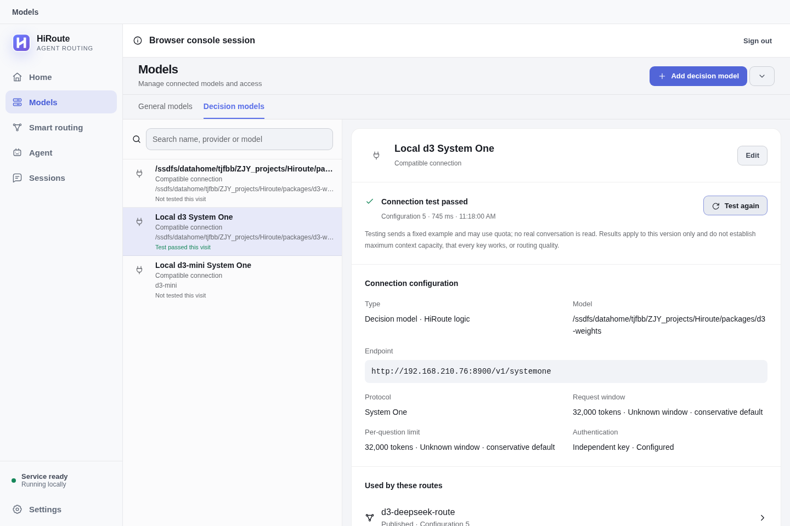

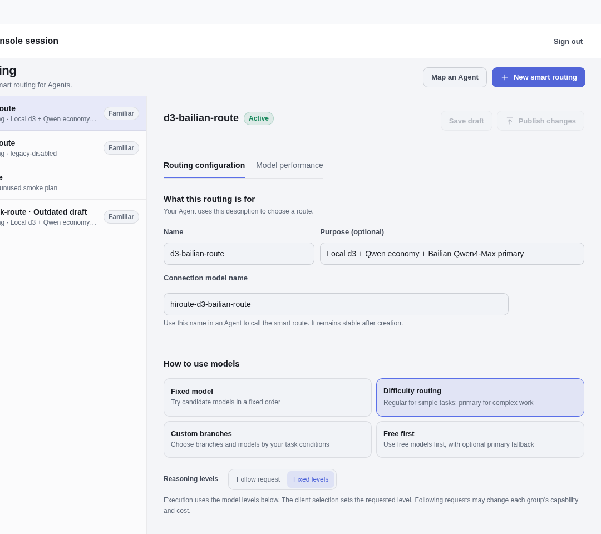

## Path 1: human-in-the-loop reject

I pointed Codex at `hiroute-d3-bailian-route` with the rate-limiter repo as the workdir. The first prompt is deliberately “small fix” language:

> Simple task: fix rate_limiter window eviction. Only change `allow()` to evict by `window_sec`.

d3 labels it a Simple task (`P(simple)≈0.98`) and Regular runs on **Qwen3.8-27B**. The economy model returns a draft with window cleanup—fine for a first pass.

Drafts sometimes look almost right on the boundary, or I swap in a worse “fix” that only keeps the last N hits and ignores `window_sec`. I do not open the console to rename models. I push back in the chat the way a human would:

> No. Acceptance failed: `test_blocks_over_limit_then_recovers` still fails after sleep. Do not raise the limit or clear everything. Evict by `window_sec`.

That line does not change the repo by itself; it becomes **input to Decision on the next turn**. HiRoute does not hard-switch a model name because someone shouted—it rescores a clear reject plus a still-failing acceptance point. d3 returns `P(simple)≈0.86`, Primary, **Bailian Qwen4-Max**. After primary rewrites eviction, pytest goes green on both tests.

The important part: **both hops sit on one observation session’s Routing timeline**—Agent turns=2, T1=Regular/`Qwen3.8-27B` (`P≈0.97`), T2=Primary/`qwen4-max`, with Between-turn model change · Qwen3.8-27B → qwen4-max. Not two single-turn sessions pasted side by side. The shot should show both Regular and Primary segments plus the between-turn change mark.

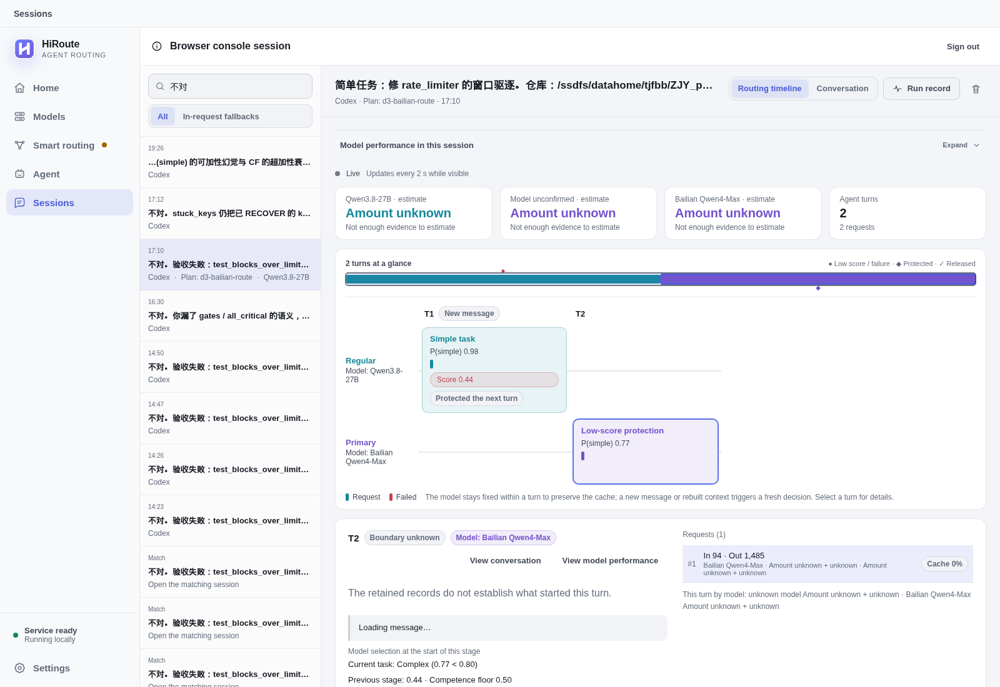

The Sessions list matches too: that 2-turn session sits beside other economy / upgrade rows.

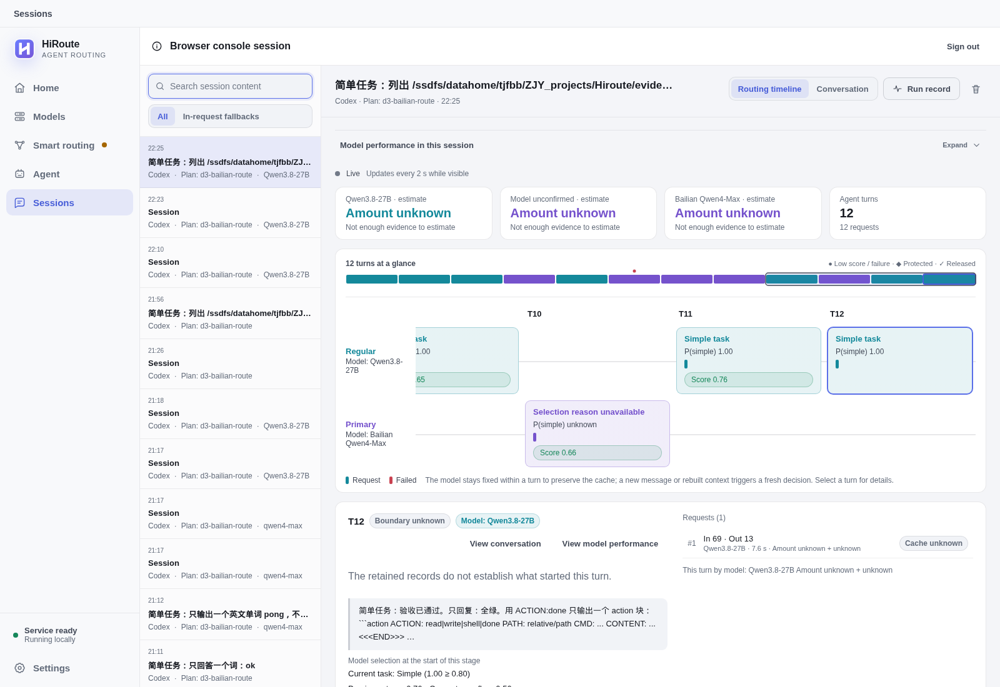

That is the HITL shape I want—humans judge pass/fail; the gateway picks the model. Decision and economy stay on-prem; Bailian primary spend starts only after I say no.

## Path 2: Agent auto-progress hits an acceptance gate

You can watch the screen during the day. At night, or in batch jobs, the more common pattern is: spell out acceptance in the task, let the Agent patch and run, and keep going until green. Handing work to an economy model only feels safe if **acceptance and human judgment both close the loop**—compile success is not semantic success, and a few shallow unit tests will not catch “just loosen the budget to silence the assert.”

So the second path does not say “your code is wrong.” It uses pipeline language.

First, task + acceptance criteria (still high `P(simple)` → Qwen, same class as path 1):

> Task: fix window eviction. Acceptance: pytest all green, especially `test_blocks_over_limit_then_recovers`. Minimal `allow()` patch.

Then a **no-new-requirements** gate failure—simulating a red test while the task is still open:

> Acceptance failed: pytest still fails. This is an acceptance-gate failure, not a new requirement. Continue until green.

As with HITL, that failure feedback goes back into Decision: no new requirements, but difficulty is re-scored because the gate is still red, so traffic escalates to Primary. Both paths share one Difficulty plan; only the signal source differs—spoken “no” versus a pipeline red light.

Both hops again sit on **one** observation session’s Routing timeline: Regular/`Qwen3.8-27B` and Primary/`Bailian Qwen4-Max`, with escalate after the acceptance red light (this capture is Agent turns=4, including Simple → Complex / Low-score protection). Not two single-turn sessions glued together; plan remains `d3-bailian-route`.

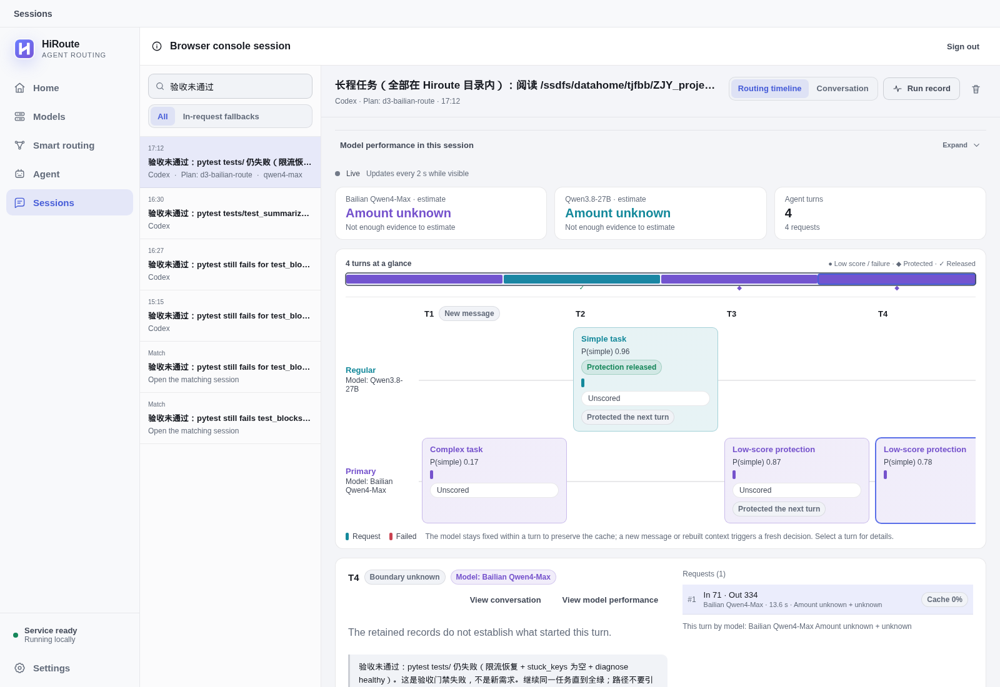

## Path 3: long-horizon real task (vllm-sr Decision helper, until green)

The limiter is good for photographing escalate hops. I also wanted a longer job that still looks like day-to-day coding **and keeps d3 in charge of model choice**. The workspace moves to local `demo-vllm-sr-decision`: a small System One Decision wiring helper with several core files broken on purpose—

- `decision_parse.py` — wrong field when parsing Decision probe results  
- `latency_window.py` — latency window never evicts by time, so counts stay high  
- `endpoint_health.py` — treats “not ready” as healthy  
- `log_scan.py` — unrelated WARN lines inflate failure counts  
- `diagnose.py` — health / route expectations disagree when summarizing the above  

Acceptance is two gates, both required: `pytest tests/` all green (**14 passed** in this run), and `python diagnose.py` reporting `healthy` / `route_ok` / `latency_ok` / `endpoints_ok` / `log_ok` all true. Fixture expectations must not change—only `.py` files may be fixed.

The cadence is deliberately **simple / complex interleaved**, so d3 rescores every turn instead of locking primary forever:

1. **Simple turns** — list files, read README, read sample logs, confirm a write landed. Exploration and checks; expect high `P(simple)` → Regular / **Qwen3.8-27B**.  
2. **Complex turns** — given the current failing pytest / diagnose, write a fully fixed `.py` this turn (no find/cat-only escapes). Root-cause work; expect low `P(simple)` → Primary / **Bailian Qwen4-Max**.  
3. **Stop rule** — finish only after both gates are green; stay on the same session while anything is red. Do not open a fresh chat that “looks fixed.”

The full green run is **one observation session, 12 Agent turns**: about eight simple checks on Qwen3 and about four complex writes on Qwen4, until pytest and diagnose both pass. Cheap “write then `ls` to confirm” turns sit in between—exactly where a long job should not burn flagship quota.

Switch evidence stays on the same Routing timeline: Simple task `P(simple)≈0.99` → Regular/`Qwen3.8-27B`; Complex task `P(simple)≈0.05–0.27` → Primary/`Bailian Qwen4-Max`. The long job is not “primary forever”—**d3 scores each turn, and Qwen3 / Qwen4 alternate**.

When reading the shots, check three places:

- **Routing timeline** — 12 turns at a glance, Regular / Primary labels and scores on one screen; simple and complex hops interleaved, not a single escalate line.  
- **Conversation** — Gateway-visible Q&A and write actions (for example a repaired `endpoint_health.py`), i.e. the complex turns doing real work.  
- **Run record** — session usage and final-model summary, to verify primary only shows up where it should.

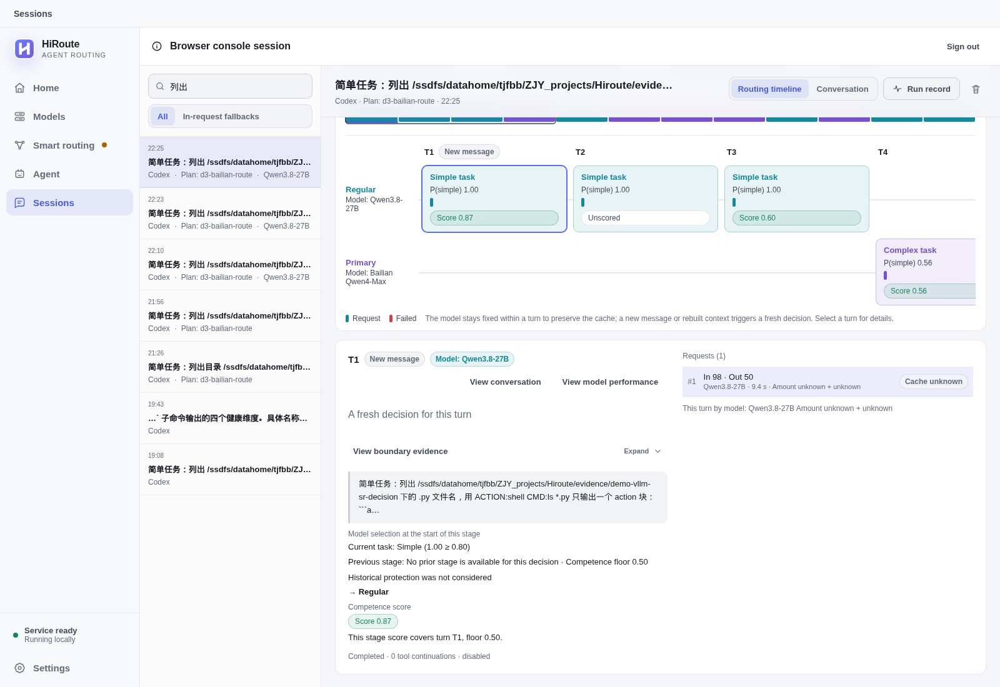


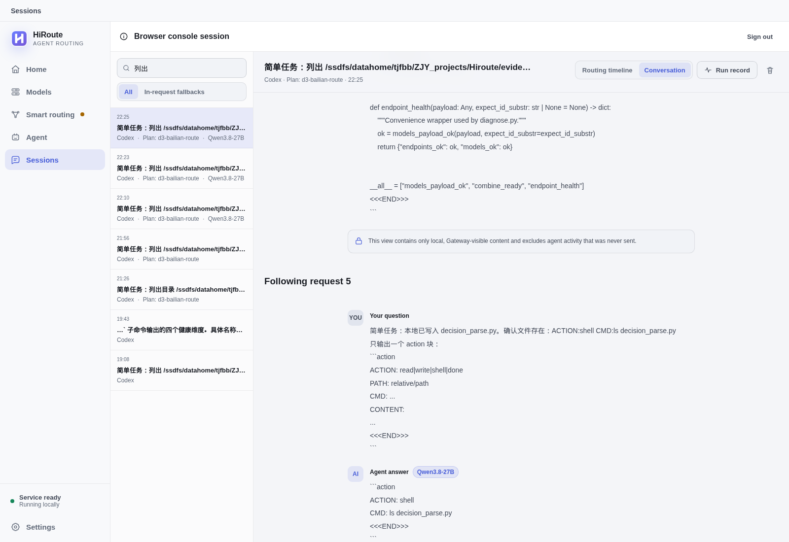

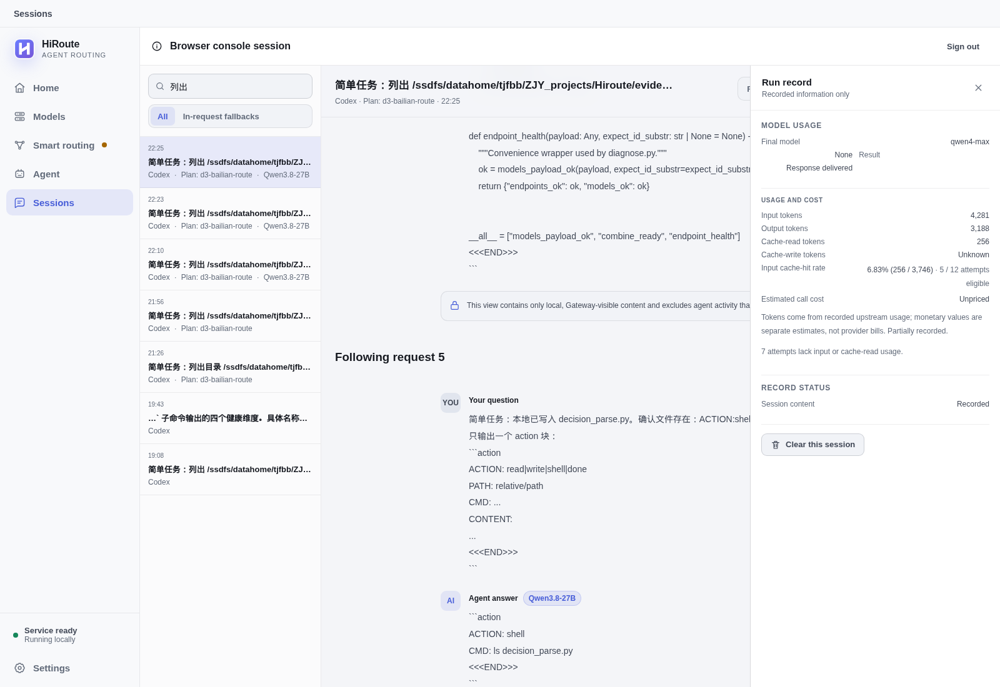

## Side-by-side

| | HITL reject | Acceptance gate | Long-horizon vllm-sr helper |
| --- | --- | --- | --- |
| First hop | Small fix → Regular / Qwen (`P≈0.97`) | Task+criteria → Regular / Qwen (`P≈0.97`) | Simple check → Regular / Qwen (`P≈0.99`) |
| Escalate / fall back | “No” → Primary | pytest fail → Primary | Complex root-cause → Primary (`P≈0.05–0.27`), then simple turns back to Regular |
| Stop condition | Escalate once after “no” | Escalate once after pytest fail | **Stop only when pytest + diagnose are green** |
| Evidence | Same timeline, turns=2 | Same timeline, turns=4 | Same timeline, 12 turns, interleaved Simple/Complex |
| Config | Same Difficulty plan | Same plan | Same plan |

On value per token, the lesson is ordinary: intelligence demand inside one task is not flat. Exploration, boundary tests, and error-chasing often do not need a flagship; root cause and design red lines do. Two-hop escalate proves “signals into Decision change the model.” **Until-green long horizon** shows the stronger claim: cheap and expensive turns keep alternating inside one job—if you lock flagship for everything, those eight `ls`/read turns burn with it. Keeping Decision and the economy model on-prem, and calling Bailian primary on demand, is the small version of “spend the strong model where it matters.”

This note is a reproducible wiring-and-escalate demo, not a monthly ledger. The claim is simple: **local d3 can stand as a HiRoute Decision; under HITL, acceptance-gate, and an until-green vllm-sr coding task, traffic switches by `P(simple)` between local Qwen3.8 and Bailian Qwen4-Max.**

---

## Appendix: wiring and dual-package retest

On the same System One suite, d3-mini (1×L40) and full d3 (2×L40) both use official `vllm serve`: System One **12/12 PASS**, HiRoute `decision services test` **8/8 PASS**. Full d3 has higher steady-state latency; the wiring is the same.

| Package | Deploy | Decision service |
| --- | --- | --- |
| [vllm-sr/d3-mini](https://huggingface.co/vllm-sr/d3-mini) | 1×L40 · `:8899` | `local-d3-mini` |
| [vllm-sr/d3](https://huggingface.co/vllm-sr/d3) | 2×L40 · `:8900` · `-tp 2` | `local-d3-full` |

```sh
vllm serve /path/to/d3 --max-model-len 32768 --tensor-parallel-size 2 --host 0.0.0.0 --port 8900
hiroute decision connections test --service local-d3-full@5 --output json
```

Setup screenshots:

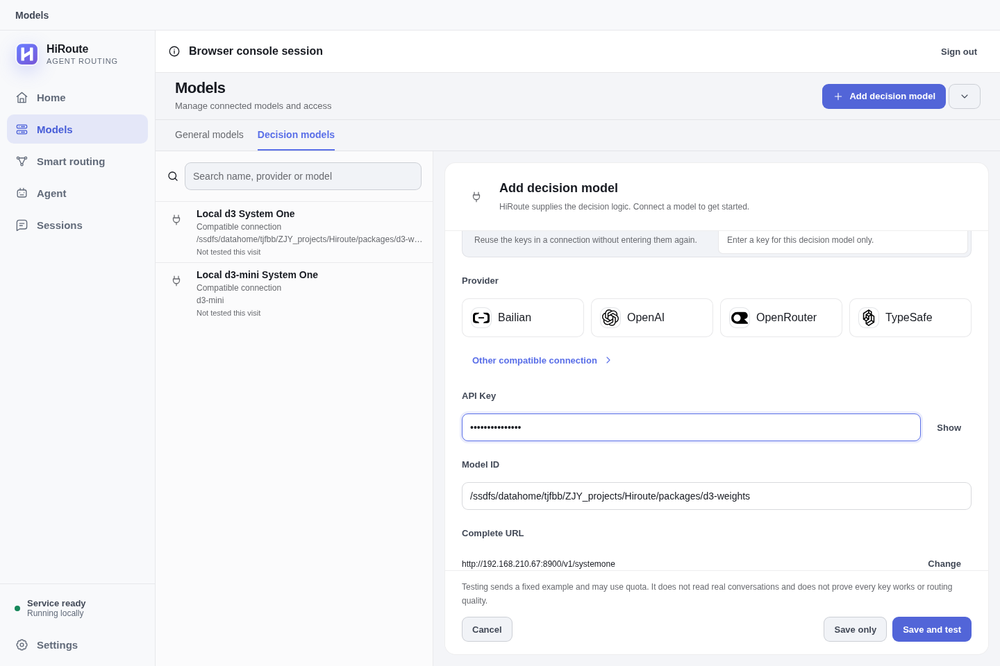

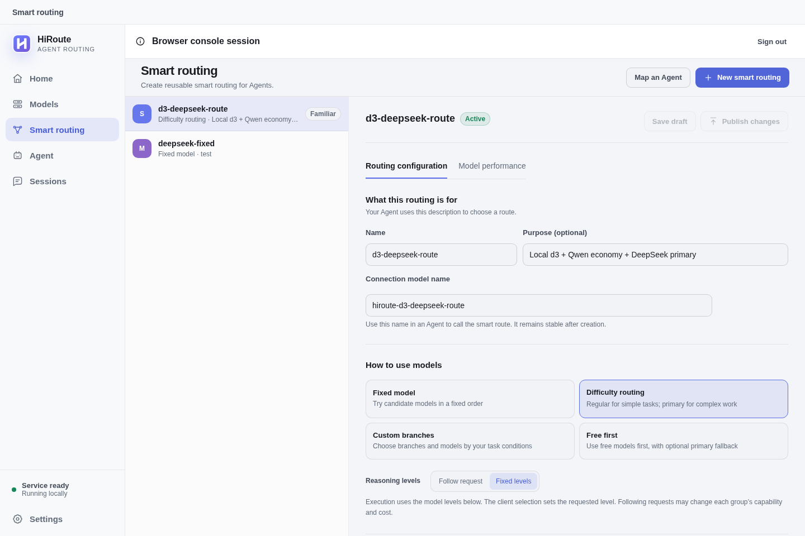

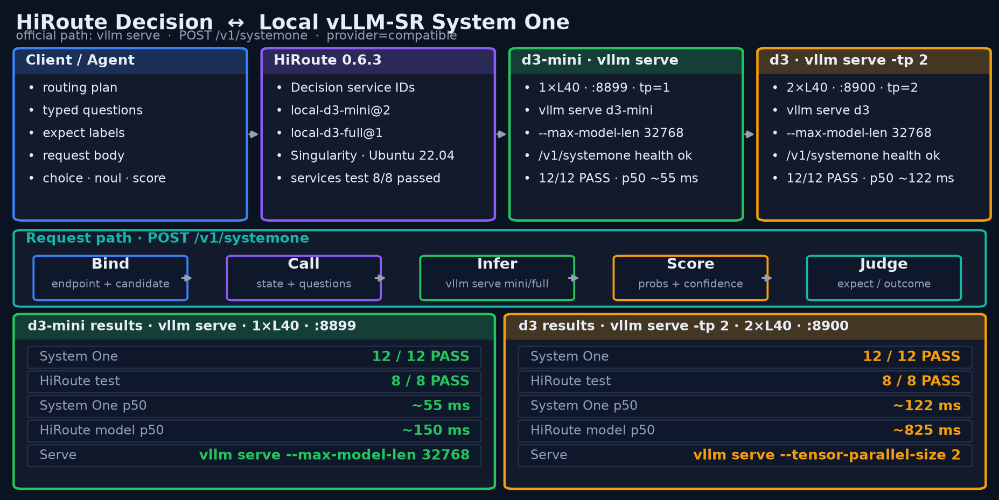

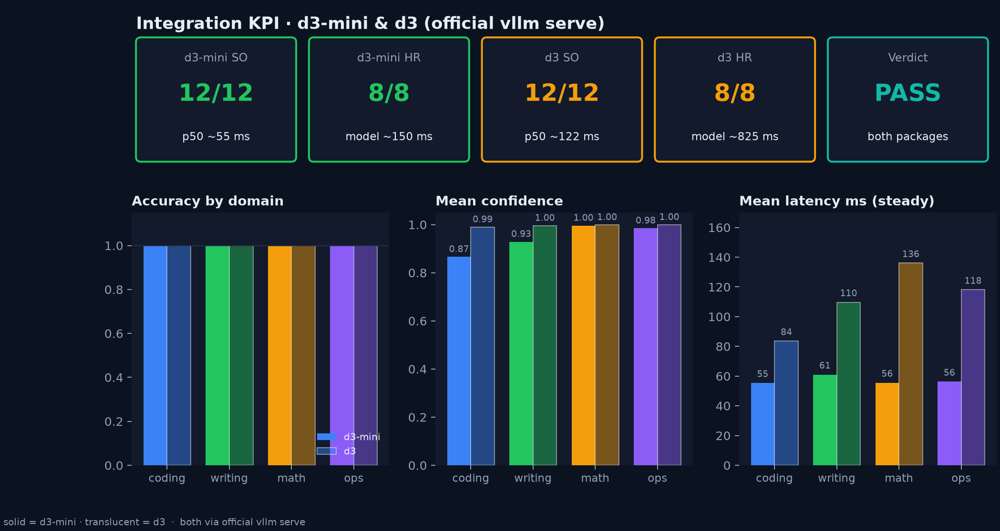

Refs: [HiRoute](https://github.com/higress-group/HiRoute) · [Local model routing](https://hiroute.ai/docs/local-model-routing/) · [vLLM-SR](https://github.com/vllm-project/semantic-router) · [d3](https://huggingface.co/vllm-sr/d3)
