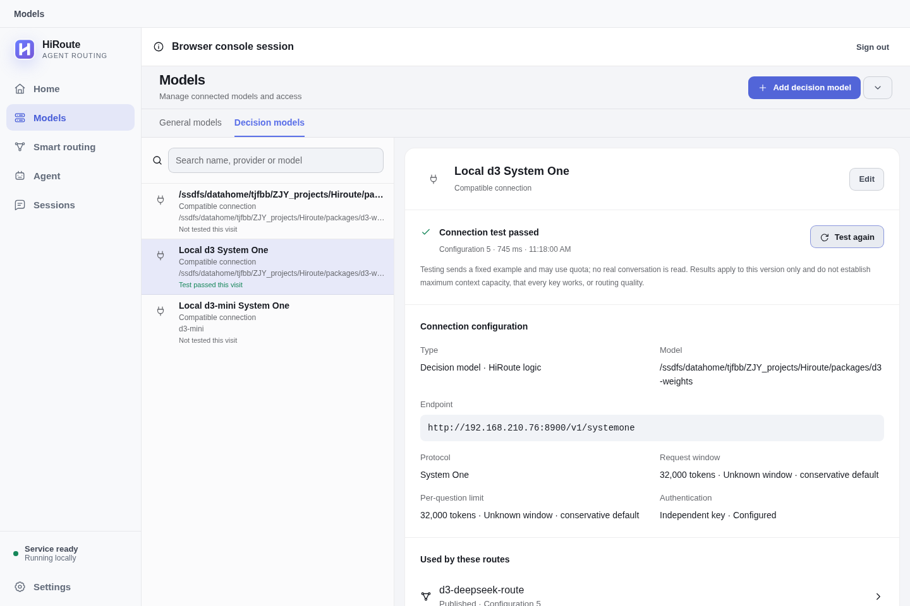
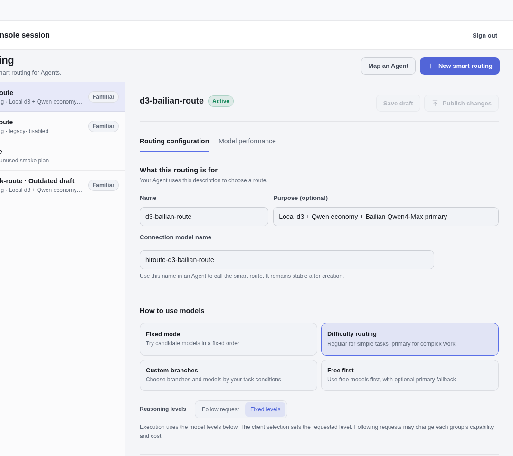
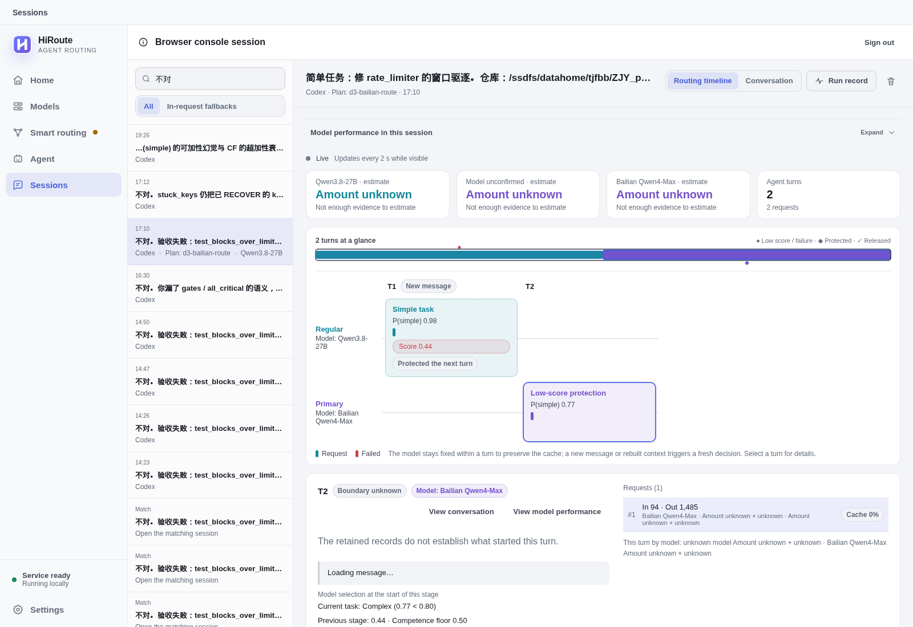
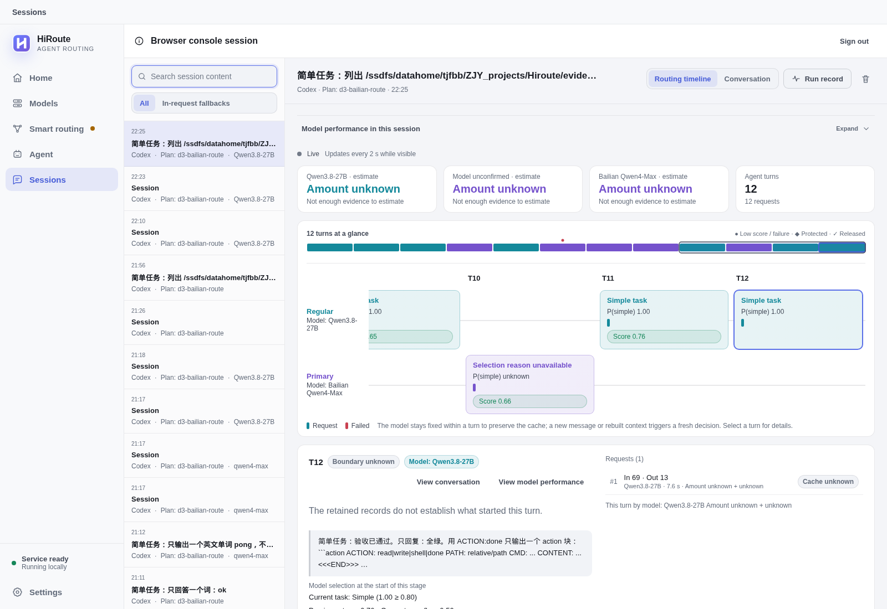
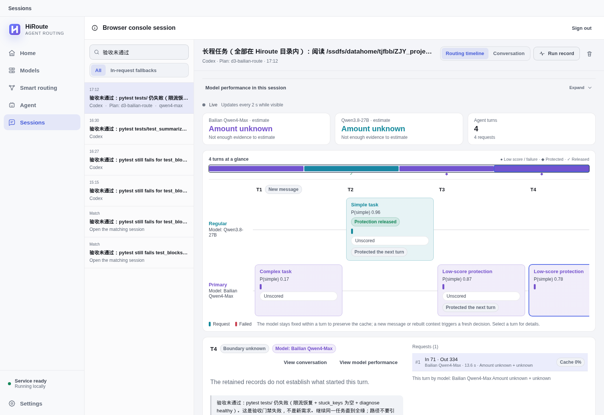
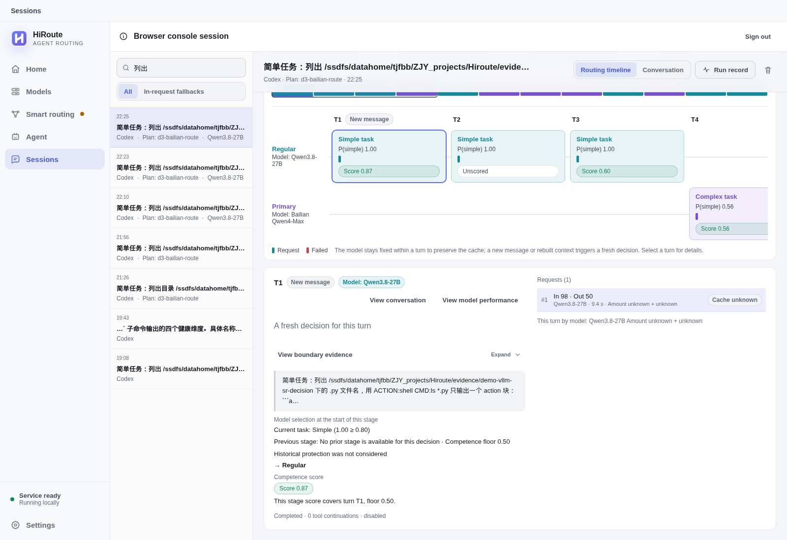
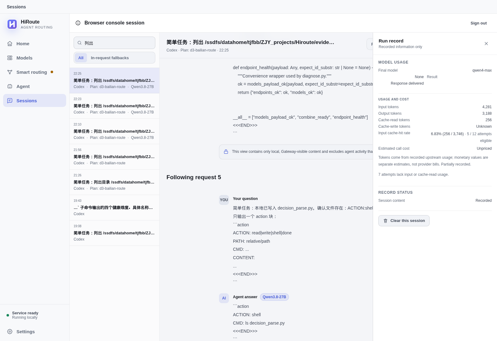
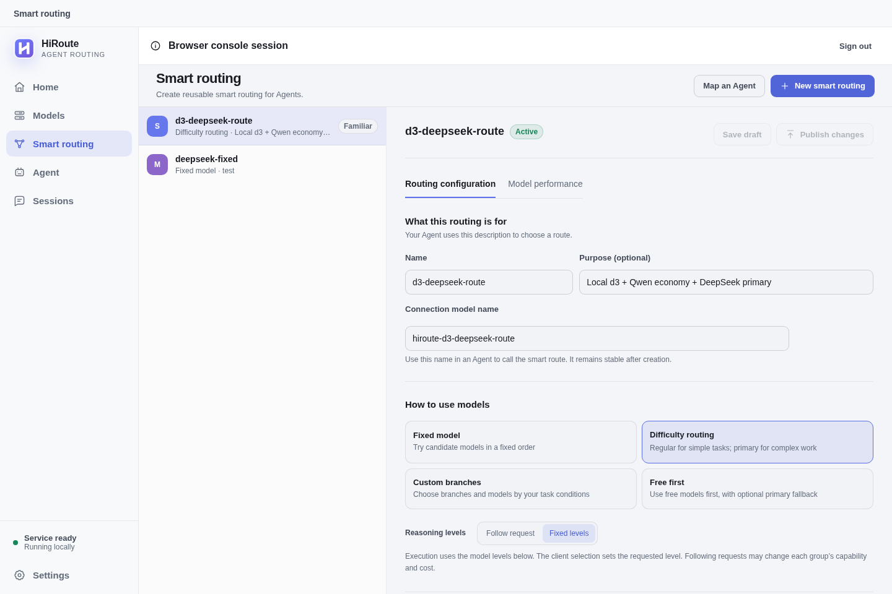
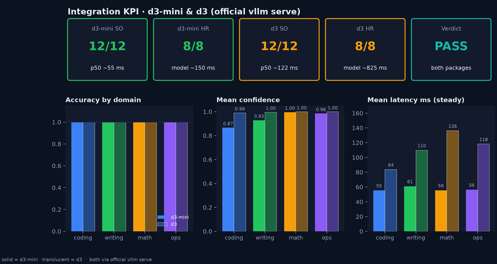

<p align="center">
  
</p>

# 本地 d3 接到 HiRoute 之后：经济模型探路，百炼 Qwen4-Max 接硬仗

作者：**zhoujinyu** \<2319109590@qq.com\>

用 Coding Agent 干活时，最贵的往往不是「写那几行核心补丁」，而是前后几十轮读代码、改测试、对报错。全程挂着旗舰模型，额度很容易烧在收尾回合上；全程只用便宜模型，又怕它把逻辑糊弄绿、根因其实没碰对。

[HiRoute](https://github.com/higress-group/HiRoute) 想解决的，就是让熟悉的 Agent（我这边是 Codex）继续干活，由本机网关按阶段选模型：常规回合走经济模型，真正吃力时再上主力。Decision 负责判难度；人的否定、测试/验收失败，都可以变成下一轮要不要升模的信号。

这篇文章不是一个月 300 亿 token 那种总账复盘，而是一次**可复现的接线实验**：把 [vLLM-SR Decision 3.0](https://huggingface.co/vllm-sr/d3) 跑在内网两张 L40 上，接到 HiRoute 当 Decision；主力换成**阿里云百炼 `qwen4-max`**。先用限流器小仓库把两条升模路径跑通，再换到与 vllm-sr 相关的开发场景，做「一直绿到停」的长程真实任务——

1. **HITL**：人盯着看，明确说「不对」，从本地 Qwen 升到百炼 Qwen4-Max。  
2. **验收门禁**：Agent 自动推进时挂在 pytest 上，同样升到 Qwen4-Max。  
3. **长程真实任务**：修本地 `demo-vllm-sr-decision`（System One 解析 / 延迟窗口 / 端点健康 / 日志扫描），同一 session 连续读写与跑测，直到 `pytest` 全绿再停。

前两条共用一条 Difficulty routing，中途不改计划，只换触发语；第三条仍走同一计划，工作区换成 vllm-sr Decision 接线助手。

## 用例：一个会「永远限流」的小 bug

仓库里有个内存限流器。正确语义很简单：超过 `window_sec` 的时间戳应被清掉，窗口滑过去之后 `allow()` 该恢复放行。我把它写成永久坏掉的版本——`allow()` 从不驱逐过期记录，一旦触达 `limit` 就一直拒绝。`pytest` 里的 `test_blocks_over_limit_then_recovers` 必挂。

它够小，Agent 几分钟能改完；又够「真」：经济模型很容易给出「看起来像修好了」的草稿，人一眼或验收一跑就能看出还不对。正好用来观察 HiRoute 会不会在该升模的时候升模。

## 路由怎么配

| 角色 | 模型 | 放哪里 |
| --- | --- | --- |
| Decision | 本地 d3 System One | `vllm serve` · 2×L40 · `:8900` · `/v1/systemone` |
| Regular（经济） | 本地 Qwen3.8-27B | 同节点 `:8910`，经本机 `:18081` 代理 |
| Primary（主力） | 百炼 **Qwen4-Max** | 本机 `:18084` shim → DashScope compatible-mode |

控制台计划名 `d3-bailian-route`，Agent 别名 `hiroute-d3-bailian-route`；Purpose 为「Local d3 + Qwen economy + Bailian Qwen4-Max primary」。Codex 仍走 `/v1/responses`，base URL 指本机 HiRoute。Difficulty routing 里，d3 每轮给出 `P(simple)`：偏高走 Regular，偏低或能力不够走 Primary；人的明确否定、验收失败，也会抬高「下一轮该不该换主力」的权重。

Decision 先测通，再钉进计划，避免 LKG 还指着旧地址：





## 场景一：人在场纠偏（HITL）

我把 Codex 指到 `hiroute-d3-bailian-route`，工作目录就是这个限流器仓库。第一句话故意写得像日常「小修」：

> 简单任务：修 rate_limiter 的窗口驱逐。只改 `allow()`：按 `window_sec` 驱逐过期时间戳。

d3 判成 Simple task，`P(simple)≈0.98`，请求落在 Regular，模型是 **Qwen3.8-27B**。经济模型很快给出带窗口清理的草稿——对「先探路」来说够用了。

真正麻烦的地方在于：草稿有时会在边界上「看起来能过、语义其实歪了」，或者我故意换成更糊弄的实现（比如只保留最近 N 条、完全忽略 `window_sec`）。这时我不去控制台改模型，只在对话里像真人一样拍桌子：

> 不对。验收失败：`test_blocks_over_limit_then_recovers` 在 sleep 窗口后仍失败。不要扩大 limit，不要全局清内存。必须按 `window_sec` 驱逐。

这句话本身不改仓库，但会作为**下一轮的输入**再进 Decision。HiRoute 不是听人喊一声就硬切模型名，而是把「明确否定 + 仍未过关的验收点」交给 d3 重新打分：`P(simple)≈0.86`，请求进 Primary，模型变成 **Bailian Qwen4-Max**。主力把驱逐逻辑写清楚之后，我再让它跑 pytest，两条用例都绿。

关键是：**这两跳落在同一条 observation session 的 Routing timeline 上**——Agent turns=2，T1=Regular/`Qwen3.8-27B`（`P≈0.97`），T2=Primary/`qwen4-max`，并标着 Between-turn model change · Qwen3.8-27B → qwen4-max。不是把两个单轮 session 拼在一起看。图上应能同时看到 Regular / Primary 两段，以及中间的换模标记。



Sessions 列表里也能对上账：同一计划下，这条 2-turn session 和周围的经济轮 / 升模轮并排可见。



对我来说，这才是 HITL 想要的形状——人只负责判断「过没过关」，选模交给网关。Decision 与经济模型留在内网；只有明确否定之后，量才打到百炼主力。

## 场景二：Agent 自动推进，卡在验收门禁

白天可以盯着屏幕；夜里或批量任务更常见的是：任务描述里写好验收标准，让 Agent 自己改、自己跑，挂了就继续，直到全绿。敢把活交给经济模型，前提是**验收和人的判断都能进闭环**——编译通过不等于语义对，几条浅单测也拦不住「把阈值调松一点糊弄过去」。

所以第二条路径我不说「你写得不对」，而是用流水线口吻：

先发任务 + 验收标准，让经济模型给最小补丁（和场景一一样，高 `P(simple)` 时仍走 Qwen）：

> 任务：修复窗口驱逐。验收标准：`pytest` 全绿，尤其 `test_blocks_over_limit_then_recovers`。请给 `allow()` 最小补丁。

然后发一条**不含新需求**的门禁失败——模拟 Agent 跑测挂了、但任务还没结束：

> 验收未通过：pytest still fails。这是验收门禁失败，不是新需求。继续同一任务直到验收全绿。

和 HITL 一样，这条失败反馈也会再进 Decision：没有新需求，难度却因「仍未过关」被重新评估，于是升到 Primary。两条路径共用 Difficulty 计划，差别只在信号从哪来——嘴里的「不对」，还是流水线里的红灯。

这两跳同样落在**同一条** observation session 的 Routing timeline 上：可见 Regular/`Qwen3.8-27B` 与 Primary/`Bailian Qwen4-Max`，以及验收红灯后的升模（图中为 Agent turns=4，含 Simple → Complex / Low-score protection）。不是两段单轮拼图，计划仍是 `d3-bailian-route`。



## 场景三：长程真实任务（vllm-sr Decision 接线助手，绿到停）

限流器适合把升模路径拍清楚；我还想看**更接近日常开发、且仍由 d3 指导换模**的长程活。工作区改到本地的 `demo-vllm-sr-decision`：一套围绕 System One Decision 接线的小助手，里面故意写坏了若干核心文件——

- `decision_parse.py`：解析 Decision 探针结果时取错字段  
- `latency_window.py`：延迟窗口不按时间驱逐，计数永远偏大  
- `endpoint_health.py`：端点健康判断把「未就绪」也当成就绪  
- `log_scan.py`：日志扫描把无关 WARN 算进失败统计  
- `diagnose.py`：汇总上述结果时，健康判定与路由期望对不齐  

验收写死两道门，缺一不可：`pytest tests/` 全绿（本轮复现是 **14 passed**），以及 `python diagnose.py` 报出 `healthy` / `route_ok` / `latency_ok` / `endpoints_ok` / `log_ok` 全为 true。fixtures 的期望值不许改，只能修 `.py`。

任务节奏刻意做成「简单 / 复杂交错」，好让 d3 每轮重新打分，而不是一上来就锁死主力：

1. **简单轮**：列文件、读 README、读样本日志、确认某文件已写入——探路与核对，预期高 `P(simple)` → Regular / **Qwen3.8-27B**。  
2. **复杂轮**：带着当前失败 pytest / diagnose，要求本轮写出已修复的完整 `.py`（禁止只 find/cat）——根因修复，预期低 `P(simple)` → Primary / **Bailian Qwen4-Max**。  
3. **停条件**：两道门都绿之后，才允许收工；中途红灯就继续同一 session，不新开一条「看起来像修好了」的对话。

这次完整跑通是 **同一 observation session、12 个 Agent turns**：约 8 轮简单确认走 Qwen3，约 4 轮复杂写入走 Qwen4，最终 pytest 与 diagnose 同时过关。中间会穿插「写完再 ls 确认」这类便宜回合——正是长程里最该省旗舰的地方。

关键证据仍在同一条 Routing timeline 上：Simple task `P(simple)≈0.99` → Regular/`Qwen3.8-27B`；Complex task `P(simple)≈0.05–0.27` → Primary/`Bailian Qwen4-Max`。长程不是全程挂旗舰，而是 **d3 按轮给出 P(simple)，Qwen3 / Qwen4 来回切**。

读图时可以对照三处：

- **Routing timeline**：12 turns at a glance，Regular / Primary 标签与分数同屏；能看到简单轮与复杂轮交错，而不是一条直线升模。  
- **Conversation**：Gateway 可见的问答与写文件动作（例如修好的 `endpoint_health.py` 全文），对应「复杂轮在干活」。  
- **Run record**：会话用量与最终模型汇总，用来核对「主力只出现在该出现的轮次」。






## 两条短路径 + 长程对照

| | HITL 纠偏 | 验收门禁卡点 | 长程 vllm-sr 接线助手 |
| --- | --- | --- | --- |
| 第一跳 | 小修 → Regular / Qwen（`P≈0.97`） | 任务+验收 → Regular / Qwen（`P≈0.97`） | 简单确认 → Regular / Qwen（`P≈0.99`） |
| 升模/回落 | 「不对」后升 Primary | pytest 挂后升 Primary | 复杂根因 → Primary（`P≈0.05–0.27`），再穿插简单轮回 Regular |
| 停条件 | 人说「不对」后升模一跳 | pytest 挂后升模一跳 | **pytest + diagnose 全绿才停** |
| 证据 | 同一 timeline，turns=2 | 同一 timeline，turns=4 | 同一 timeline，12 turns，Simple/Complex 交错 |
| 配置 | 同一 Difficulty 计划 | 同一计划 | 同一计划 |

想提升「智价比」，我自己的体会很朴素：智力需求在一个任务里不是匀速的。探路、补边界、对报错，很多回合其实不需要旗舰；真正吃力的是根因和设计红线。两跳升模能证明「信号进 Decision 会换模」；**长程绿到停**更能说明：同一条活里，便宜轮与贵轮会反复交替——若全程锁旗舰，那八轮 ls/读文件也会一起烧额度。HiRoute 把 Decision 和经济模型留在内网，百炼主力按需调用，小实验里已经能看到「该省省、该上上」。

这篇是接线与升模路径的可复现演示，不是月度用量总账。想说明的是：**本地 d3 能作为 HiRoute Decision 站住；在 HITL、验收卡点，以及绿到停的 vllm-sr 长程开发任务里，都会按 `P(simple)` 在本地 Qwen3.8 与百炼 Qwen4-Max 之间切换。**

---

## 附录：接线与双包复测

同一套 System One 用例上，d3-mini（1×L40）与完整 d3（2×L40）都用官方 `vllm serve`：System One **12/12 PASS**，HiRoute `decision services test` **8/8 PASS**。完整版稳态延迟更高，接入方式相同。

| 包 | 部署 | Decision 服务 |
| --- | --- | --- |
| [vllm-sr/d3-mini](https://huggingface.co/vllm-sr/d3-mini) | 1×L40 · `:8899` | `local-d3-mini` |
| [vllm-sr/d3](https://huggingface.co/vllm-sr/d3) | 2×L40 · `:8900` · `-tp 2` | `local-d3-full` |

```sh
vllm serve /path/to/d3 --max-model-len 32768 --tensor-parallel-size 2 --host 0.0.0.0 --port 8900
hiroute decision connections test --service local-d3-full@5 --output json
```

配置过程截图：







参考：[HiRoute](https://github.com/higress-group/HiRoute) · [Local model routing](https://hiroute.ai/zh/docs/local-model-routing/) · [vLLM-SR](https://github.com/vllm-project/semantic-router) · [d3](https://huggingface.co/vllm-sr/d3)
