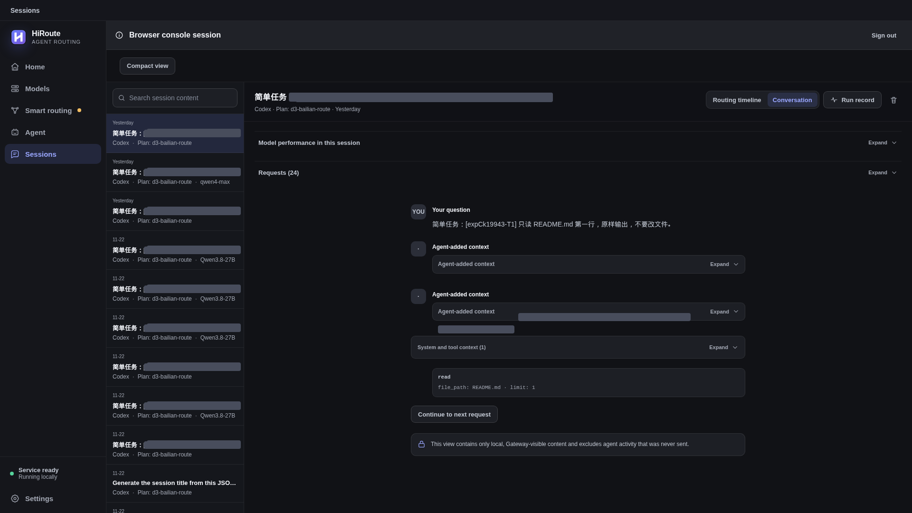
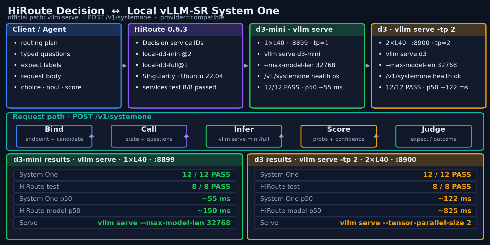
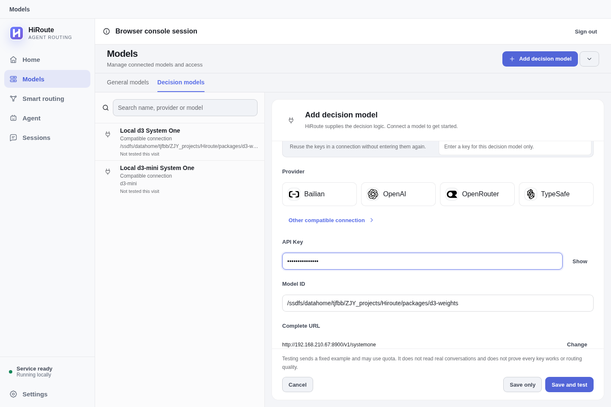

# 日常留在本地，难了再上云：本地 Qwen3.8-27B 与 d3 决策模型，搭配百炼 Qwen4-Max 的一次实测

作者：**周瑾瑜（zhoujinyu）** \<2319109590@qq.com\>，同济大学硕士研究生，开源项目 vLLM Semantic Router 核心 Maintainer

这篇文章记录的是一个本地与云端模型搭配的实测 Demo：我把 vLLM Semantic Router 的 d3 决策模型接入了 HiRoute。HiRoute 是架在 Coding Agent 和模型之间的一个网关，接上 d3 之后，它每一轮都会判断一次：这一轮的活是留给本地的 Qwen3.8-27B，还是交给云端的 Qwen4-Max。

下面这张截图是其中一次会话，一共十二轮：七轮跑在本地模型上（模型部署在我们内网的一台 GPU 节点上），另外五轮跑在阿里云百炼的 Qwen4-Max 上。每一步让它做什么、哪步简单哪步难，都是我事先排好的；但每一轮具体用哪个模型，我没有指定过，都是路由自己选的。


*顶上那条色带就是整个会话，一格一轮，青色的跑在本地模型上，紫色的跑在云端。下面的卡片是前四轮。`P(simple)` 是决策模型给出的“这一轮算简单”的概率。*

想做这个实验，是因为 Coding Agent 干的活大部分其实不难。很多轮只是在列文件、读 README，或者确认一下刚写的文件在不在，这类事情交给自己机器上的 27B 模型就够了，也没必要出内网。难的只是少数几轮，比如定位 bug 的根因、把修复写对写牢，这几轮才值得交给云端的前沿模型。所以我想试的搭法是：**日常工作和路由决策都留在本地，只有这一轮够难、或者上一阶段没做好的时候，才升级到云端的主力模型。**

这里面容易被忽略的是“决策”这一步。每一轮都得有个模型来判断该交给谁，如果负责判断的本身就是 API 后面的一个大模型，那每一轮的内容在决定“要不要上云”之前就已经上云了，还要多花一次往返，最后得到的结论可能只是“下一步该执行 `ls`”。这就要求决策模型也放在本地，而且要够快、够便宜，这样每一轮都问一次也不会有什么负担。

## 决策模型和网关

决策模型这一块，我用的是 [vLLM Semantic Router](https://github.com/vllm-project/semantic-router) 的方案。这个项目是一个可编程的路由器：Agent 只对接一个 API，路由器按你写的策略，在本地、私有和云端的后端之间为每次调用挑选模型，或者把几个模型组合起来用。用官方的话说，它是面向模型与算力的一层开放、可编程的决策层。它做判断靠的是专门的决策模型，目前这一代叫 [Decision 3.0](https://huggingface.co/collections/vllm-sr/decision-30)，我这次用到了其中两个：[d3](https://huggingface.co/vllm-sr/d3) 是 27B 的，[d3-mini](https://huggingface.co/vllm-sr/d3-mini) 是 4B 的，都是 Apache-2.0 开源。

决策模型不生成文本。你给它一段输入，再带上几个规定好答法的问题，比如几选一（Choice）、是或否（Yes / No）、按档打分（Score），它一次调用就把这些问题全答完，每个选项给一个概率。这套接口叫 System One，路由器内部用的就是它，应用也可以直接调 `/v1/systemone`。vLLM 已经原生支持 d3，一条 `vllm serve` 就能把它挂到这个端点上。

网关用的是 [HiRoute](https://github.com/higress-group/HiRoute)，Higress 团队开源的项目。它跑在开发者自己的机器上，夹在 Coding Agent 和模型中间，Agent 还是用原来那个（这次是 Codex，Claude Code、OpenCode 等也支持），只要把 base URL 指向 HiRoute 就行。配路由计划的时候，便宜的模型放进常规组（Regular），最强的模型放进主力组（Primary）。之后每来一条新消息，HiRoute 都会问决策模型三个问题：上一阶段做得怎么样，这一轮有多难，上一阶段的问题会不会带到这一轮，然后按你设的阈值选组。决策模型只管回答这几个问题，阈值、选组和执行都在 HiRoute 这边。后面会反复提到“阶段”，这是 HiRoute 的叫法，指一轮里完成的工作。

两个项目正好在这里对得上：HiRoute 每一轮要问的就是这类选择题和打分题，d3 干的正好就是回答这类问题。要提一句的是，这次的请求链路里没有 Semantic Router 本体，我只是拿了它的决策模型，部署在自己的节点上，再接入 HiRoute，放在决策模型的位置上。这种搭法 HiRoute 的[本地模型路由文档](https://hiroute.ai/zh/docs/local-model-routing/)其实已经写过：本地模型干日常的活，云端模型接比较难的几轮，再配一个本地的决策模型。我想做的，就是在自己的节点上把它实际跑一遍。

## 怎么接的

| 角色 | 模型 | 部署与地址 |
| --- | --- | --- |
| Decision（决策） | d3，走 System One | `vllm serve` · 2×L40 · `:8900` · `/v1/systemone` |
| Regular（常规） | Qwen3.8-27B | 同节点 `:8910`，经本机 `:18081` 代理 |
| Primary（主力） | 阿里云百炼 Qwen4-Max | 本机 `:18084` shim → DashScope compatible-mode（百炼的 OpenAI 兼容接口） |
| Agent | Codex | `/v1/responses`，base URL 指向本机 HiRoute |

先说明一下，文中说的“本地”，指的都是我们自己的内网。d3 和 Qwen3.8-27B 部署在同一台 GPU 节点上，HiRoute 和 Codex 也在内网里，走内网地址访问这两个模型。HiRoute 用的是 0.6.3，跑在 Singularity 容器里（Ubuntu 22.04），文中的截图都是从它的浏览器控制台里截的。路由计划叫 `d3-bailian-route`，在 Codex 看来它只是一个名叫 `hiroute-d3-bailian-route` 的模型，背后有几个模型、什么时候切，Codex 都不知道。


*控制台里的这条计划。Agent 能看到的只有 Connection model name。*

路由方式选的是“按难度分流”（Difficulty routing）。信任度用默认的“熟悉”（Familiar），对应的简单概率阈值是 0.80；胜任下限也没动，还是默认的 0.50。这两个数后面每次实验都会出现，先说清楚它们是干什么用的。d3 给出的简单概率 `P(simple)` 达到 0.80，这一轮才会交给常规组；另外，如果 d3 给上一阶段打的胜任分低于 0.50，而且那个问题还跟眼下这一轮有关，那这一轮就算看起来很简单，也会交给主力组。后面这条规则，HiRoute 叫它低分保护（Low-score protection）。

实际操作时有个地方要留意：决策连接每保存一次就会多出一个版本，而已经发布的计划会一直用发布时选定的那个版本。稳妥的做法是先把连接测通，再到计划里选中这个版本并发布，不然计划调的还是旧地址。

再说硬件。这套东西跑在一台 GPU 节点上，不是笔记本能跑的配置。d3 名义上是 27B，实际是 26.09B 参数，按 BF16 存下来大约 52 GB，一张 48 GB 的 L40 放不下，于是加了 `--tensor-parallel-size 2`，让它跨两张卡跑。它是基于 Qwen3.8-27B 做的，但权重是独立的一套，也就是说，这次的决策模型和干活的模型一样大，还独占了两张卡。单次调用的开销很小，但这么大的模型要一直常驻在显存里，成本并不低。d3-mini（4.54B 参数）在一张 L40 上通过了同样的端点检查和连接检查（见附录），机器小一些的话它更合适，不过我还没用它跑过路由会话。

## 第一次：我说“不对”

第一个测试仓库里是一个很小的内存限流器，我故意把它改坏了：`allow()` 从不清理超过 `window_sec` 的时间戳，这样某个 key 一旦触到 `limit` 就会一直被拒，`test_blocks_over_limit_then_recovers` 这条用例也就必挂。选它是因为它够小，几分钟就能修完，同时又很容易修歪：补丁看起来没什么问题，实际上却根本没按窗口驱逐。

第一条消息，我故意写得像一件日常的杂活（引用时略去了内部路径）：

> 简单任务：修 rate_limiter 的窗口驱逐。只改 `allow()`：按 `window_sec` 驱逐过期时间戳。

d3 给这条消息的 `P(simple)` 是 0.98，这一轮就跑在了本地的 Qwen3.8-27B 上，它很快交回一份带窗口清理的草稿。这个场景我跑过好几遍，有时草稿在边界条件上出问题，有时是我故意换上一个更敷衍的实现（只保留最近 N 条，完全不看 `window_sec`），确保失败一定出现。不管哪种情况，我都没去控制台手动切模型，只是像平时一样，在对话里直接说问题：

> 不对。验收失败：`test_blocks_over_limit_then_recovers` 在 sleep 窗口后仍失败。不要扩大 limit，不要全局清内存。必须按 `window_sec` 驱逐。

这句话不会改仓库里的任何东西，它只是下一轮的输入，和其他消息一样要先过一遍决策。这一次 d3 的两个回答都指向主力组：往回看，它给上一阶段打的胜任分是 0.44，低于 0.50 的下限；看当前这一轮，它给的 `P(simple)` 是 0.77，也没到 0.80。两条里随便哪一条都够把这一轮交给主力组，它最后跑在了 Qwen4-Max 上，时间线上标的原因是低分保护。


*同一个会话里的两轮（T1 是第一轮，T2 是第二轮）。T2 的详情面板把两条理由都列了出来：0.77 没到 0.80，上一阶段的 0.44 低于下限 0.50。*

之后 Qwen4-Max 把驱逐逻辑重写了一遍。后面跑的 pytest 不在这张两轮的截图里，结果是两条用例都过了。回头看整个过程，我从头到尾没下过“换更强的模型”这种指令，只是像平时一样在对话里指出哪里不对。这句反馈是 d3 在我们自己的节点上处理的，它给上一阶段打出 0.44 分之后，请求才发往云端模型。

## 第二次：验收门禁一直不过

Agent 自己跑任务的时候，旁边没人会对它说“不对”，它能拿到的反馈只有验收门禁，也就是测试还没过。所以第二次我想看的是：一条不带任何新需求、只是报告“验收没过”的消息发进来，路由会怎么处理。先交代一下，这一次我并没有真的放一个无人值守的 Agent 去跑，门禁结果是我自己发的，只是措辞照着流水线汇报的口吻来写。

截图里这个会话一共四轮，用的还是同一条计划。第一轮的消息自称“长程任务”，先让模型通读一个目录，d3 给的 `P(simple)` 只有 0.17，直接交给了 Qwen4-Max。第二轮比较简单，`P(simple)` 是 0.96，交给了本地的 Qwen。要注意的是第三轮：它的 `P(simple)` 是 0.87，已经过了 0.80，只看难度的话应该留在本地模型上，但时间线上标的是低分保护，这一轮交给了 Qwen4-Max。第四轮就是下面这条门禁消息，`P(simple)` 是 0.78，还在低分保护下，继续留在 Qwen4-Max 上。

> 验收未通过：pytest tests/ 仍失败（限流恢复 + stuck_keys 为空 + diagnose healthy）。这是验收门禁失败，不是新需求。继续同一任务直到全绿……


*这个会话的四轮。T3 的 `P(simple)` 是 0.87，仍然跑在 Qwen4-Max 上。*

这张截图能说明的东西有限，有两点要讲清楚。第一，各阶段的评分都显示 Unscored，触发低分保护的那个分数在图上看不到。第二，从本地模型切到 Qwen4-Max 是第三轮的事，而第三轮的消息没截到。这样一来，这张图能证明的只是：门禁消息在第四轮进来时，被留在了更强的模型上；它证明不了“光靠这条门禁消息，就把任务推到了主力组”。

不过它确实截到了低分保护在起作用：一轮看起来简单的活，因为前面发生的事，被交给了更强的模型。要是把一个任务整夜丢给本地模型去跑，我希望有这条规则兜底，只是这次实验还没验证到那一步。

## 第三次：十二轮，直到两道验收都通过

限流器的例子适合看清单次切换，但我还想看一段更接近日常开发的过程。第三次我换到了 `demo-vllm-sr-decision`，这是一组围绕 System One 决策接入写的辅助脚本，有解析探测结果、延迟窗口、端点健康和日志扫描几块，其中五个文件被我故意写坏了：

- `decision_parse.py`：解析决策探测结果时取错了字段
- `latency_window.py`：延迟窗口不按时间驱逐，计数永远偏大
- `endpoint_health.py`：把“未就绪”也算成就绪
- `log_scan.py`：把无关的 WARN 也算进失败统计
- `diagnose.py`：汇总上面几项时，健康判定和路由期望对不上

验收有两道门，要同时过：一是 `pytest tests/` 全绿（这一次是 14 passed），二是 `python diagnose.py` 报出的 `healthy`、`route_ok`、`latency_ok`、`endpoints_ok`、`log_ok` 全部为 true。fixtures 里的期望值不许动，只能改 `.py` 文件。

我是一条消息推一步。每条消息只要一个动作（read、write、shell 或 done），模型回一个 action 块，动作由我这边执行，下一条消息再把结果告诉它，比如“本地已写入 decision_parse.py。确认文件存在”。这样每一步都是单独的一轮、一次请求，也都会重新做一次路由决策。简单步骤和难步骤是我故意穿插着排的：先列文件、读样本日志，然后发一条类似“这是当前的失败输出，这一轮把修好的文件完整写出来，不许只 find/cat”的消息，接着再确认文件确实写进去了。停下来的条件只有一个：两道门都过，而且全程必须在同一个会话里，不能另开一个“看起来已经修好了”的新对话。

有一点要交代清楚：简单步骤的消息都是以“简单任务：”开头的，连要执行的命令也写在里面，截图里看得到。所以这些轮次上的 1.00，是决策模型最容易答对的情况，说明不了它在没有提示时也能认出简单的活。

这次会话就是文章开头那一个。第一到第三轮是列文件和读文件，`P(simple)` 都是 1.00，留在本地的 Qwen 上；第四轮第一次动手修，`P(simple)` 是 0.56，交给了 Qwen4-Max。之后就一直在两个模型之间来回切：第五轮在本地，第六到第八轮在云端，第九轮在本地，第十轮在云端，第十一、十二轮又回到本地。第十二轮是收尾，我在消息里告诉它两道验收都过了，让它回一个 `done`。


*控制台里记的 T1 选择依据：简单概率 1.00，过了 0.80，前面又没有可以回看的阶段，所以走常规组。T4 的简单概率是 0.56，是第一个交给 Qwen4-Max 的轮次。*


*同一个会话的结尾部分，左侧是这条计划下的其他会话。T10 没有记录选择原因，T11 和 T12 跑在本地的 Qwen 上。*

我最先看的是升级之后它会不会再切回来，结果是会的。难的一轮过去，下一轮简单的活又回到了本地模型，第五、九、十一轮都是这样。要是路由只会升、不会降，那从第四轮开始，整个会话就会一直挂在 Qwen4-Max 上。

不过，这次会话里不是每一次升级都能在图上找到依据。第十轮没有记下选择原因，`P(simple)` 显示的是 unknown，这一轮跑在主力组上，记录里没说为什么。按 HiRoute 的文档，复杂度结果不可用时会走主力组，和这里的表现对得上，但光凭这条记录我确认不了。另外，色带上第六轮带了一个“低分 / 失败”的红点，而第六到第八轮的卡片我没截图。这样算下来，交给主力组的五轮里，图上能看到依据的只有第四轮。



*每一轮大致长这样：前面是一份重写好的 `endpoint_health.py` 的结尾，后面是一条只有一行的确认请求，由本地模型回答。*


*这次会话的运行记录，用量数据不完整，也没有计价。*

运行记录也不完整：十二次调用里有七次缺少输入或缓存读取用量，费用一栏显示的是 Unpriced。这篇文章里没有给成本数字，原因就在这里。

## 三次放在一起看

| | 第一次：我说“不对” | 第二次：门禁一直不过 | 第三次：直到两道验收都通过 |
| --- | --- | --- | --- |
| 会话轮数 | 2 | 4 | 12 |
| 跑在本地 Qwen3.8-27B | T1，`P(simple)` 0.98 | T2，0.96 | 7 轮；截图里能看到的都是 1.00 |
| 跑在 Qwen4-Max | T2 | T1、T3、T4 | 5 轮：T4、T6 到 T8、T10 |
| 图上能看到的依据 | 上一阶段 0.44 < 0.50，且 0.77 < 0.80 | T1：0.17；T3（0.87）、T4（0.78）：低分保护 | T4：0.56；T6 到 T8：卡片没有截图；T10：没有记录 |
| 我发的是什么 | 对话里的一句“不对” | 第四轮：一条不带新需求的门禁失败 | 按脚本穿插的简单步骤和难步骤 |

## 这几次实验的局限

下结论之前，先把这几次实验说明不了的地方列一下。

- 任务都很小，而且是按脚本一步一步推的。步骤是我写的，简单的步骤自己就标着“简单任务：”，前两次实验里的失败有一部分是我人为造出来的，第三次里 7 比 5 这个比例也是脚本决定的。这几次实验能说明的是路由会对这些信号做出反应，不能当成对 d3 判断质量或两个 Qwen 模型的评测。
- 没有和“全程本地”或“全程云端”做成本和耗时的对比，因为运行记录不完整，也没有计价。
- 硬件只有这一套，决策模型是一个占着两张 L40 的 26B 模型。d3-mini 在一张 L40 上通过了同样的两项检查（见附录），但这三次会话都没用它做路由，这也是我接下来最想试的。
- 这些分数只是 d3 按这条计划的判断标准给出的回答，没人拿标准答案核对过。

## 哪些留在本地，哪些去了云端

明确了这些局限，再来看这几次实验的结果。日常的活确实不用出内网：十二轮的那次会话里，有七轮是列文件、读文件和做确认，都是我们节点上的 27B 模型干完的。路由决策同样不用出内网。HiRoute 每来一条新消息判断一次，按文档的说法，同一轮里的工具调用会沿用这次判断的结果（这几次实验每轮只有一次请求，没有用到这一点）。d3 一次调用就给出概率，不生成文本。在这两张 L40 上，直连端点时一次 System One 调用的中位延迟大约是 122 ms，走 HiRoute 自带的决策测试时，model 一项的中位延迟大约是 825 ms；d3-mini 只用一张卡，这两个数分别是大约 55 ms 和 150 ms。也就是说，在这套硬件上，每条新消息花在决策上的时间不到一秒。

会出内网的，是分到主力组的那几轮请求，Agent 在这些请求里带了多少上下文，就会出去多少。如果 Agent 每次都重发历史，前面那些本地轮次的内容也会跟着出去，所以不能把这套搭法当成给简单轮次围了一道隐私边界。我这几次实验里的消息都很短，而且各自独立（第一次实验里发给 Qwen4-Max 的那次请求只有 94 个输入 token），也就量不出实际会带出去多少上下文。能确定留在本地的，是每一轮的决策调用，以及从头到尾都没升级过的会话。

还有一点，升级的两个触发条件最好分开看，因为它们管的不是一回事。`P(simple)` 是事前的预判，看的是按这条计划的标准，这一轮的活算不算简单，并不代表某个模型一定能把这一轮做对。胜任分是事后的回看，看的是上一阶段做得好不好。第二次实验的第三轮正好是两者不一致的例子：`P(simple)` 是 0.87，但这一轮还是交给了主力组。如果路由只看预判，一个已经做得吃力的模型还会不断接到“看起来简单”的活。

这套搭法并不绑定文中这几个具体的模型。d3 只管回答问题，0.80 和 0.50 是 HiRoute 里的设置，Codex 从头到尾只看到一个模型名，所以从设计上说，本地模型、云端模型和阈值都可以单独换，其余部分不用动。当然这只是设计层面的说法，我实际跑过的只有文中这一种组合。

我最初只是想确认 d3 能不能给 HiRoute 当决策模型，从结果看是可以的：十二轮的那次会话里，七轮留在了我们自己的节点上，五轮交给了 Qwen4-Max，结束时两道验收都过了。这次实验规模很小，脚本也是我自己写的，更适合当成一个跑通了的演示来看，算不上评测。不过我还是愿意沿着这套搭法继续做下去，也就是把干活的模型和决策模型都放在自己的机器上，只在需要的那几轮用云端模型。

## 从哪里上手


两个项目都是 Apache-2.0 开源的，想自己动手试试，可以从下面这些入口开始。

- **HiRoute**：[GitHub](https://github.com/higress-group/HiRoute) · [hiroute.ai](https://hiroute.ai/zh/) · [本地模型路由文档](https://hiroute.ai/zh/docs/local-model-routing/)。它有 macOS、Windows 和 Omarchy 的桌面应用，Linux 上是 Web UI 和 CLI，我这次用的就是 Linux 这套。接入步骤是：把本地模型按“自定义 API”接进来，把决策模型按“其他兼容接入”添加，填上带 `/v1/systemone` 的完整地址，然后新建一条按难度分流的路由，再把 Agent 指过去。
- **vLLM Semantic Router 与 Decision 3.0**：[GitHub](https://github.com/vllm-project/semantic-router) · [vllm-sr.ai](https://vllm-sr.ai) · [博客](https://vllm-sr.ai/blog/) · [d3](https://huggingface.co/vllm-sr/d3) · [d3-mini](https://huggingface.co/vllm-sr/d3-mini)。`vllm serve` 和 System One 的用法都写在 d3 的模型卡里；写这篇文章的时候，vLLM 对 d3 的支持还在 nightly 构建里。如果你想用的是整个路由器，不只是它的决策模型，可以从官方文档看起。

---

## 附录：两个模型的复测与接入配置

两个模型我都是用官方的 `vllm serve` 部署的，各自跑了同样的两项检查：先拿 12 条 System One 用例直连端点测一遍，再跑 HiRoute 自带的决策测试。

| 模型 | 部署 | Decision 服务 | System One 用例 | HiRoute `decision services test` | System One p50 | HiRoute model p50 |
| --- | --- | --- | --- | --- | --- | --- |
| [vllm-sr/d3-mini](https://huggingface.co/vllm-sr/d3-mini) | 1×L40 · `:8899` | `local-d3-mini` | **12/12 PASS** | **8/8 PASS** | ~55 ms | ~150 ms |
| [vllm-sr/d3](https://huggingface.co/vllm-sr/d3) | 2×L40 · `:8900` · `-tp 2` | `local-d3-full` | **12/12 PASS** | **8/8 PASS** | ~122 ms | ~825 ms |

这 12 条用例覆盖 coding、writing、math、ops 四类，两个模型全部答对。d3 的平均置信度更高一些（四类都在 0.99 到 1.00 之间，d3-mini 是 0.87 到 1.00），但单次调用也更慢。表格最后两列用的是下面两张图里的叫法：System One p50 是直连端点时一次 System One 调用的中位延迟，HiRoute model p50 是 HiRoute 的测试报出来的 model 中位延迟。两个模型的接入方式完全一样，上面三次会话用的都是完整的 d3。下面是 d3 对应的两条命令，其中 `@5` 是这条连接在我这边保存后的版本号，你那边的数字会不一样。

```sh
vllm serve /path/to/d3 --max-model-len 32768 --tensor-parallel-size 2 --host 0.0.0.0 --port 8900
hiroute decision connections test --service local-d3-full@5 --output json
```

显存方面，模型卡给出的峰值是 d3 大约 62 到 65 GiB、d3-mini 大约 15 到 23 GiB，具体看用哪种方式部署。这些数字是在 AMD Instinct MI325X 上测的，里面没有 `vllm serve` 的数据；而 `vllm serve` 默认会预留每张卡 92% 的显存，要和别的模型共用一张卡的话，得把 `--gpu-memory-utilization` 调低。如果机器放不下完整的 d3 再加一个干活的模型，可以先拿 d3-mini 评估一下。

另外给照着 d3 模型卡操作的读者提个醒：模型卡里 `vllm serve` 的验证是在 AMD（ROCm）上做的，并且写明 CUDA 的安装方式当时还没在 NVIDIA GPU 上跑过。这次实验可以算 NVIDIA 这边的一个数据点：d3 用两张 L40，d3-mini 用一张 L40，都是 `vllm serve` 部署，System One 用例都是 12/12。




最后是控制台里的几张配置截图。其中有两张是最初调试时截的，当时用的是另一条更早的计划 `d3-deepseek-route`，主力模型是 DeepSeek；文中的每一次会话都跑在 `d3-bailian-route` 上，主力模型是 Qwen4-Max。



*把 d3 添加为决策模型：选择“其他兼容接入”，填写 Model ID 和完整的 System One 地址。*


*System One 协议下的连接测试通过。这个测试只发送一条固定样例，不代表判断质量。底部列出的路由是那条更早的计划。*


*选择“按难度分流”，这张图截的是那条更早的计划。*
