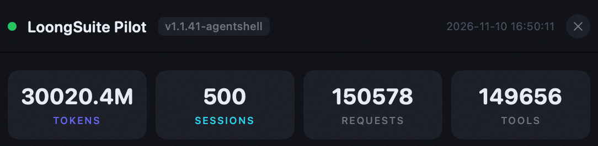
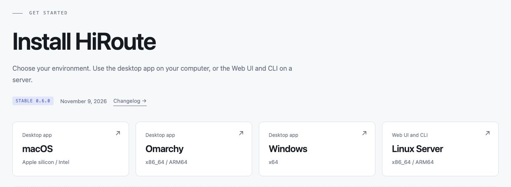
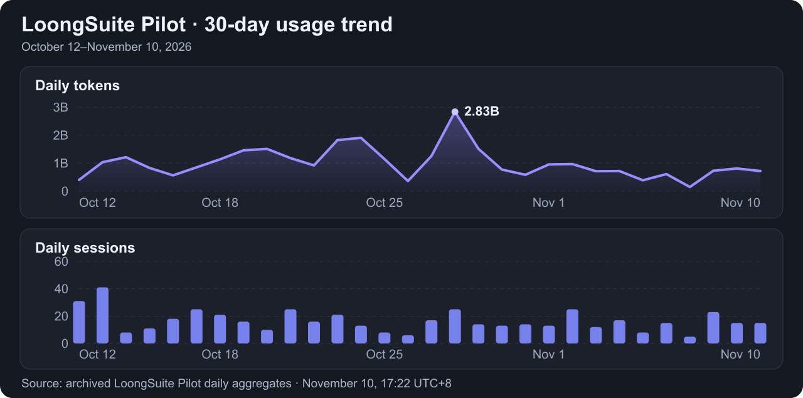
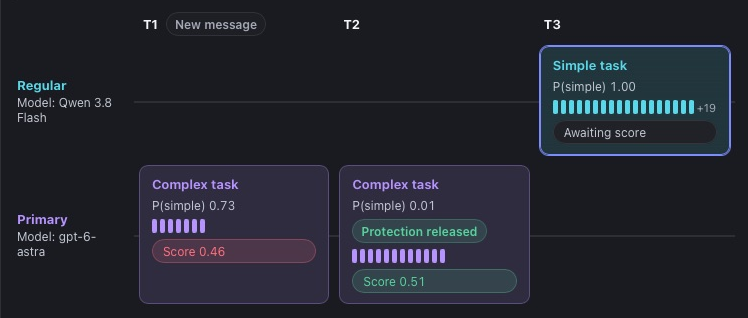
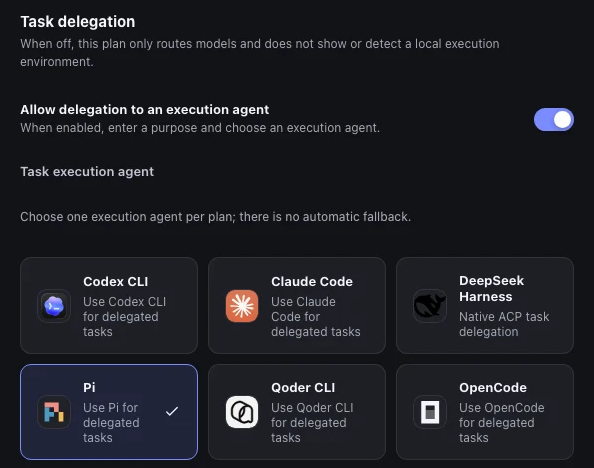
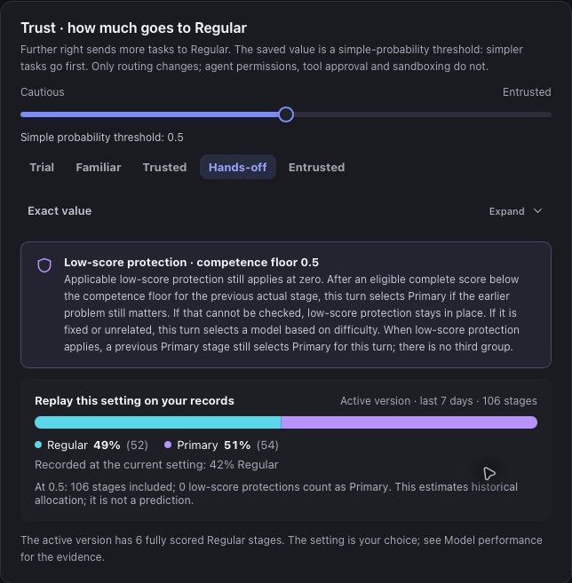
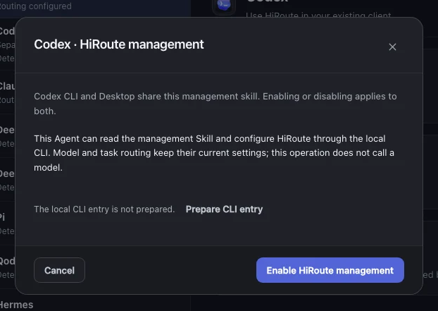

# Save Your Best Model for the Hard Parts: 30 Billion Tokens, 310K Lines of Rust, and What I Learned About Token Efficiency

A few days ago, while tidying up my local dev setup, I opened LoongSuite Pilot and glanced at my 30-day usage counter: **30,020.4M tokens — roughly 30 billion**. Right next to it sat three other numbers: 500 sessions, 150,578 model requests, and 149,656 tool calls.



*LoongSuite Pilot's 30-day counter, captured on November 10, 2026, at 16:50 UTC+8.*

If your mental model of AI coding is still "ask a question, paste a snippet," 30 billion tokens in a month sounds absurd. Once your daily workflow shifts to long-horizon Coding Agents, though, the consumption profile changes completely. Hand an Agent a real bug or feature, and it will read source files, trace call graphs, edit implementations, run builds and test suites, inspect failures, and iterate. My sessions averaged about 300 model requests each. Each round can carry much of the accumulated context, and roughly 98% of the recorded token volume came from prompt-cache reads over long engineering sessions.

Across that window, I was juggling three tracks at once: maintaining the open-source **Higress AI Gateway** community, working on Alibaba Cloud AI Gateway, and building a new cross-platform Rust project that I started in September — [**HiRoute**](https://github.com/higress-group/HiRoute), an open-source local AI gateway that sits right next to Coding Agents on a developer's machine. The 30 billion tokens span all three tracks. I used **one Codex Pro 20× subscription** for my primary model and separately connected economical models for routine stages.

Back in September, HiRoute was still taking shape and couldn't carry my daily workflow yet. Pushing multiple tracks in parallel, I kept burning through my weekly quota by Wednesday or Thursday. The frustrating part wasn't getting stuck on a bug — it was looking back and realizing where the quota had gone. Huge chunks of frontier capacity had been spent on routine turns: scaffolding regression tests, grepping call sites, fixing trivial compiler complaints. Then, right when I hit a gnarly architectural change where a frontier model would genuinely accelerate the work, I had to start rationing what was left of the week's allowance.

That was the exact problem we set out to solve with HiRoute: bringing our team's enterprise AI gateway experience down to localhost, sitting between Agents like Codex and the models and harnesses underneath, to maximize **intelligence per token**.

By "intelligence per token," I don't mean chasing the cheapest model at all costs. In real software engineering, a cheap model that subtly breaks invariants costs far more in rework tokens and human review time than it saves. What you actually want is **spending expensive frontier reasoning strictly on the decisions that determine the outcome, letting fast, economical models carry the routine follow-through, and never compromising the final acceptance bar.**

In October, once HiRoute's core pipeline was up and running, I switched my local setup over and started **building HiRoute with HiRoute**. Over that month, the repository grew by roughly 311,000 net lines of Rust (including tests, comments, and blanks) across 145 mainline commits, shipping three desktop apps (macOS, Windows, Omarchy) plus a Linux Server Web UI — and that single Codex subscription stopped feeling tight.



*HiRoute's English download page for macOS, Omarchy, Windows, and Linux Server.*

Here are four practical lessons from a month of running that loop in production code.

---

## 1. Inside a Single Engineering Task, Reasoning Demand Is Never Uniform

The most expensive habit in Agent-assisted coding is locking your session onto the heaviest frontier model from the first prompt all the way to `git push`.

When you run engineering sessions every single day — peaking near 3 billion tokens on busy days — it becomes obvious why quotas evaporate. Look closely at any real debugging session, and you will see that **cognitive difficulty varies wildly from one stage of a task to the next**.



*Daily tokens and sessions from Pilot's archived 17:22 export for October 12 to November 10, 2026.*

Take a typical gateway bug fix: you read logs and code to reproduce the issue, isolate the root cause, weigh design trade-offs, land the core patch, and then spend dozens of turns filling out regression matrices across entry protocols, running `go test` or `cargo test`, fixing minor test-wiring typos, and updating docs.

During root-cause isolation and design trade-offs, weaker models routinely reach for band-aids; you really do want a frontier model like Astra in the driver's seat. Once the core patch is settled, however, the remaining "read test fixture → add edge cases → run suite → fix test compile error" loop often accounts for the majority of requests and token volume while requiring far less reasoning depth. Keeping a frontier model on that tail is like asking a principal architect to stay up all night hand-typing boilerplate test tables.

Switching models manually mid-task is painful: you have to babysit every turn, decide when to swap, and decide when to swap back — assuming your Coding Agent even exposes the economical model you want in its picker. Instead, I stay inside my usual Codex Desktop window and let HiRoute handle the split underneath: economical models from other sources go into the **Regular** group, while Astra from my Codex subscription stays in the **Primary** group. **I define the division of labor up front, and HiRoute selects the model per stage inside the same continuous session.**

To measure the trade-off objectively rather than relying on gut feel, we ran a controlled reproduction on a real concurrency bug from the Higress community ([Issue #5310](https://github.com/higress-group/higress/issues/5310)).

The bug sat in the Claude / Vertex streaming response converter: single-request tests passed cleanly, but under interleaved concurrent streams, a shared provider state object caused usage metrics and message IDs to bleed across requests. Community contributor `zhihao-yuan` had already fixed it in [PR #5311](https://github.com/higress-group/higress/pull/5311). We checked out the pre-fix baseline, gave the Agent only the symptom description, and asked it to reproduce, fix, and add regression tests in a single continuous session — followed by an independent acceptance check firing 14 interleaved live gateway streams.

We ran three setups, three runs each. The medians tell a very clear story:

| **Strategy** | **Runs passed** | **Delivery time** | **API-equiv. cost** |
| --- | --- | --- | --- |
| Economical only (Qwen 3.8 Flash) | 1/3 | 51m 34s (sole passing run) | — |
| **HiRoute stage routing (Astra + Qwen 3.8 Flash)** | **3/3** | **32m 25s** | **$2.65** |
| Primary only (Astra) | 3/3 | 17m 46s | $6.45 |

- **Cheap per token is not token efficiency:** Running Qwen 3.8 Flash end-to-end cost pennies per call, but two of the three runs failed to deliver a valid patch within the 45-minute Agent budget. A 1/3 pass rate is unusable in serious engineering.
- **All-Primary is fastest, at a steep burn:** Astra went 3/3 in a median of 17m 46s, at an API-equivalent median of $6.45.
- **Stage-based relay hits the sweet spot:** HiRoute also went 3/3 on independent acceptance, took about fifteen minutes longer, and brought the API-equivalent cost (decision overhead included) down to $2.65 — **roughly 59% lower**.

Inspecting the routing timeline of one of those runs (`N31`, 56 requests total) makes the mechanics concrete. On the first two stages — reproduction and concurrent state-ownership repair — HiRoute estimated simple-task probabilities of `0.73` and `0.01`, both below the `0.80` threshold, and sent all 19 requests to Astra. Once the core patch was locked in and stage three became "fill out regression tests against the settled design," the simple-task probability hit `1.00`. HiRoute switched to Qwen 3.8 Flash for the remaining 37 requests without altering a single byte of the core patch.



*The original N31 run in HiRoute's English routing timeline.*

At the frozen API rates, **Qwen handled 86% of N31's recorded token volume and accounted for about 5% of its estimated cost**. The session's API-equivalent cost was $2.48. Applying Astra's rates to the same 56 requests and recorded usage would put the estimate at $12.14.

*The table summarizes three runs per setup on a single defect. The N31 figures compare API-equivalent costs on one recorded run.*

That is the first lever: **keep a single continuous context, switch models by stage at the gateway layer, and stop burning frontier capacity on low-difficulty tail turns.**

---

## 2. Economical Models Only Work When Verification and Human Judgment Close the Loop

Whenever I talk about mixing models with other engineers, the first pushback is always the same: *"What if the cheaper model writes plausible-looking code that subtly misses the point, and you spend twice as long debugging it?"*

That concern is completely valid. Routing based solely on up-front difficulty prediction will eventually get stuck in a ditch. To make stage routing safe, we built **competence scoring and low-score protection** into HiRoute, paired with two engineering rules in my daily workflow: one for unattended overnight runs, and one for core design work where I stay in the loop.

### Well-scoped tasks: let hard verification gates stand night watch

"It compiles and unit tests pass" is far too weak a gate for economical models. To force failures into the open before handoff, we built up **5,000+ Rust tests, 60+ UI scenario scripts, and 14 end-to-end Computer Use verification flows** inside the HiRoute repo.

The rule is strict: for any Desktop or Web UI change, passing `cargo test` is not enough — the Agent must launch Computer Use and click through the live window like a real user. If it adds a session filter, unit tests are green, and clicking the filter renders an empty list, the Computer Use check fails on the spot.

Those test and verification outputs flow straight through HiRoute. When the built-in decision model evaluates the completed stage and sees that the Regular model failed verification — scoring below the competence floor on an issue that still affects the work ahead — HiRoute triggers **low-score protection** at the gateway layer. Instead of letting the Regular model flail on the next turn, it escalates back to the Primary model to diagnose the root cause and clear the gate, returning routine follow-up turns to the Regular group afterward. That automatic safety net is why I feel comfortable handing off well-scoped tasks before going to sleep.

### Core architecture: stay in the loop and let one sentence trigger escalation

On the flip side, when a change touches tricky architectural invariants, no automated test suite replaces human taste. Even there, I often let the Regular model take the first swing at reproduction while I watch the session live.

In late October I worked on memory use in HiRoute's gateway ([PR #225](https://github.com/higress-group/HiRoute/pull/225)). HiRoute runs in the background on a developer's machine, so our tests set a strict limit on how much memory the gateway can retain per request. When a request contained several megabytes of conversation history and the `model` field came near the end of the JSON, the old selector kept an extra copy of the raw prefix in memory and scanned it repeatedly. Stress tests with large requests tripped the memory assertion.

The economical model quickly wrote a test with 3 MiB of conversation history that consistently hit the limit. When it moved on to the fix, it made the test pass by raising the cap in the code. The test went green, and the gateway could now retain more memory than we'd agreed to allow. I replied, *“Keep the memory cap. The root cause is the extra copy of the raw prefix and the repeated scans.”*

In HiRoute, **explicit pushback and corrections from the developer carry a lot of weight in the competence score**. The decision model picked up my feedback and sent the next turn to the Primary model to redesign the request path. The new code starts a request-owned Replay writer as soon as authentication succeeds and locates `model` incrementally while keeping the parser state bounded. The original memory limit stayed in place. We passed 928 related tests and verified long-history forwarding across all three ingress protocols.

Both workflows point to the same principle: **in AI coding practice, the depth of your verification harness sets the ceiling on your token efficiency.** Once test failures and human course-corrections automatically translate into model escalation, trial-and-error risk stays bounded.

---

## 3. Look Beyond Per-Token Price: Tame the "Hidden Token Tax" of Harnesses

After sorting out model selection, I ran into a second, quieter quota killer: **how Agent execution environments (harnesses) coordinate work.**

For a while, fanning a task out across a swarm of parallel sub-agents was all the rage. In a codebase of several hundred thousand lines, though, naive multi-agent fan-out carries a steep hidden token tax:

- Frontier models have gotten remarkably good at holding global invariants across a long context. Splitting mainline work across sub-agents forces each child session to re-read the same architectural context from scratch.
- Worse is the coordination and polling overhead. I previously opened an issue in the Codex repo discussing [parent-agent waiting overhead (Issue #41875)](https://github.com/openai/codex/issues/41875): in setups where a child task is still running, waking the parent model repeatedly just to see "still running" re-processes hundreds of thousands of cached tokens on the primary model while producing zero new information.

Getting burned by that led me to split HiRoute into two layers — **model routing** and **task routing** — governed by a simple rule: **keep the mainline whole; delegate only clean branches.**



*HiRoute's task delegation panel with Pi selected. DeepSeek Harness is another available execution agent.*

- **Keep the mainline whole:** Cross-cutting changes stay inside a single Codex session from start to finish, preserving its accumulated mental model of the repo while model routing swaps models underneath by stage.
- **Delegate clean branches:** Self-contained side quests with crisp inputs and outputs — mapping callers of a legacy module, gathering external docs, or pinpointing the first failure in a multi-thousand-line CI log — get handed off through HiRoute's task routing to **Pi paired with an economical model**. Pi's harness is lightweight, so all the noisy file-browsing and command retries stay isolated in the worker. Crucially, the local HiRoute CLI waits silently in the background until the worker finishes and returns a single one-page summary with file paths — never waking the parent model to poll.

The same mechanism makes testing new **model × harness** pairings painless. When I want to see how a **DeepSeek model performs inside DeepSeek Harness (DSH)** — since models often shine in their native harness — I don't have to uproot my primary workspace. I define a task route, delegate one well-bounded module, and inspect the combined main-session plus worker usage in HiRoute afterward to see whether the pairing actually paid off.

---

## 4. Good Routing Grows With Your Repo: Post-Task Review and History Replay

High token efficiency isn't something you configure once on day one and forget; it compounds as you learn your codebase's failure modes. Two small habits made my routing sharper week over week.

**First, spend two minutes reviewing the switch ledger after big tasks.**

After finishing a meaty task like the Higress concurrency fix, I have my Agent run two local CLI commands:

```bash
hiroute sessions list --view switches
hiroute value show
```

Every model switch, the reason behind it, and how requests split between Primary and Regular are recorded locally. Spotting patterns like *"regression tests against an approved design consistently pass on the Regular group, while cross-protocol streaming state always needs Primary"* lets me fold project-specific guidance right back into the routing criteria. Every hard bug makes the next one cheaper.

**Second, replay against your own history before turning the dial.**

Near the end of a weekly cycle when quota gets tight, I naturally want to hand more work to economical models; when testing a brand-new model, I want to keep it on a short leash. Guessing numeric thresholds blindly is nerve-wracking, which is why we built **history replay** into HiRoute's **Trust** slider (`Trial`, `Familiar`, `Trusted`, `Hands-off`, `Entrusted`).

When I drag the slider to `Hands-off` (a simple-probability threshold of `0.5`), HiRoute immediately replays that setting against the 106 real stages I ran over the past 7 days — showing me that roughly 49% of stages would go to the Regular model while low-score protection (`0.5` competence floor) remains active. Seeing the blast radius on my own recent work before running a live session takes the guesswork out of tuning.



*The HiRoute Trust panel replaying the same 106 historical stages at Hands-off.*

---

## 5. The Best Tooling Stays Out of Your Way

Putting these four pieces together is ultimately why we open-sourced HiRoute.

Our team has spent a long time building intelligent routing in Alibaba Cloud AI Gateway for production traffic. [Alibaba Cloud AI Gateway documentation](https://www.alibabacloud.com/help/en/api-gateway/ai-gateway/user-guide/configure-smart-routing) Open-sourcing HiRoute brings that same scheduling discipline to the developer's own machine, right next to the Agents we live in all day.

To make sure the gateway doesn't become configuration chores of its own, HiRoute's Desktop UI / Web UI and local CLI share the exact same state and execution records, and ship with a built-in **HiRoute management Skill**. You don't have to memorize CLI flags or leave Codex, Claude Code, or your preferred editor. Once the management Skill is enabled, you can tell your Agent in plain language which subscriptions and economical models you have connected, what counts as routine work in your repo, and what requires your primary model — and let the Agent wire up and verify the route for you.



*The Codex management Skill dialog in HiRoute.*

And you don't need to be burning 30 billion tokens a month for this to matter:

- **If your daily volume is modest**, reserving your primary model strictly for hard stages stretches smaller quotas much further — a standard-tier subscription can comfortably cover workloads that previously felt like they required upgrading to top-tier Pro.
- **As new models and harnesses ship every week**, you no longer face an all-or-nothing migration. Slot a new model into your Regular group on `Trial` trust, or hand a new harness a few isolated side branches, and let your own test suite and execution records tell you when it's ready for more.

---

## Closing Thoughts

Looking back at 30 billion tokens and 310,000 lines of Rust, the biggest change in my **AI coding practice** was deciding where a stronger model would change the outcome. Automated tests, live UI verification, and human judgment on architectural decisions gave me a way to make that choice and check whether it worked.

Models will keep getting stronger and context windows will keep growing, but the basic engineering instinct of putting your sharpest tools on the hardest problems isn't going anywhere. If you've ever watched a weekly quota vanish on routine chores, or wanted a safer way to trial cost-effective models on real code, pick a task with an automated test suite and give HiRoute a spin. We'd love to hear what works — and where it breaks — in your own repositories.

- **GitHub Repository**: [https://github.com/higress-group/HiRoute](https://github.com/higress-group/HiRoute)
- **Downloads & Documentation**: [https://hiroute.ai/en/](https://hiroute.ai/en/)
