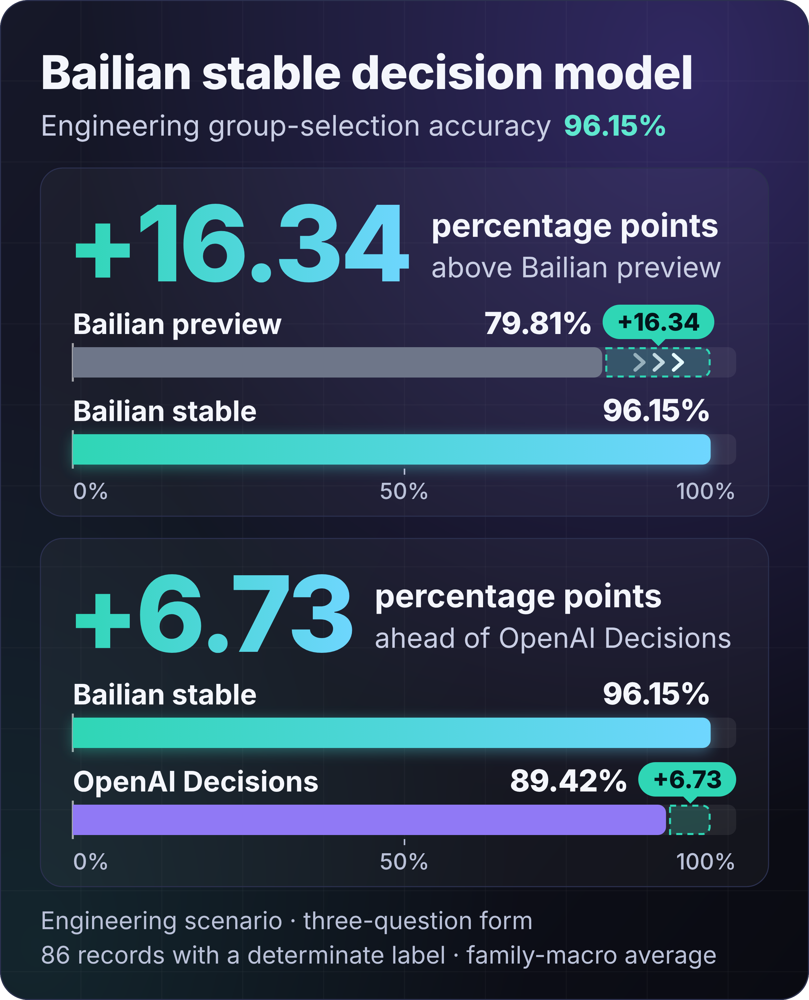
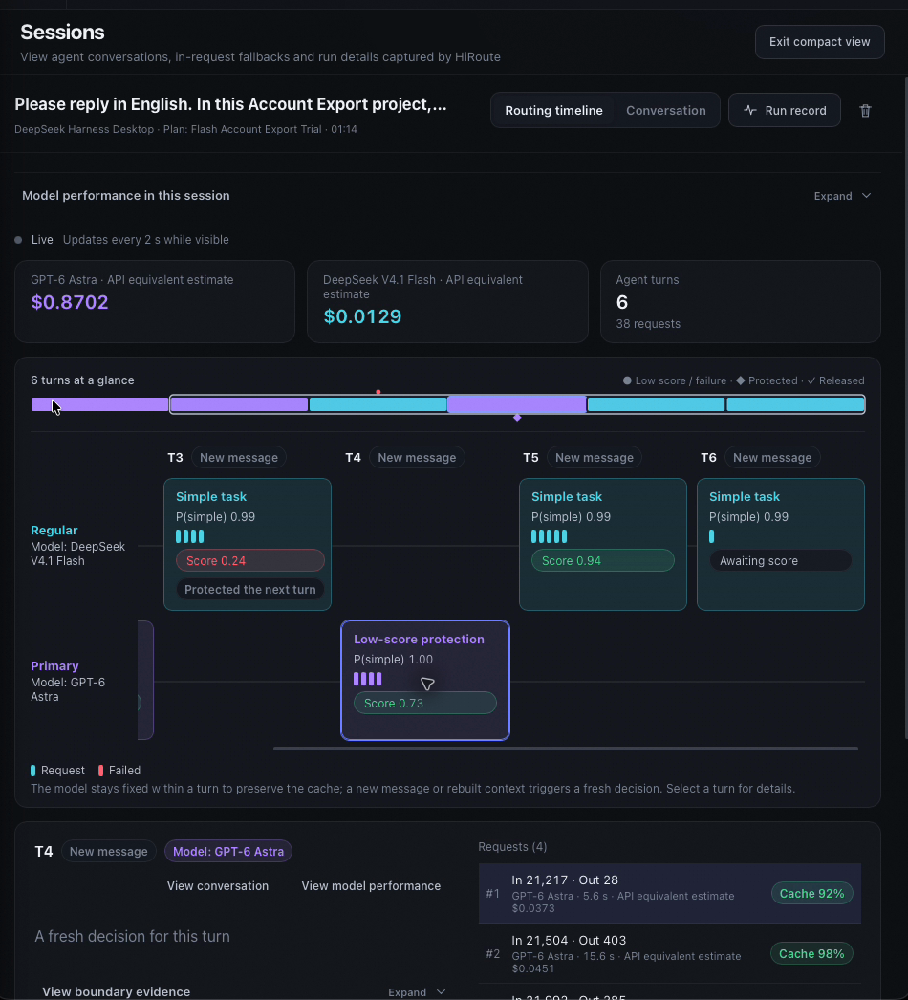
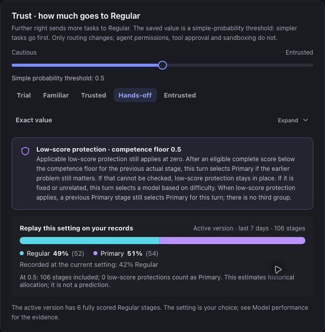
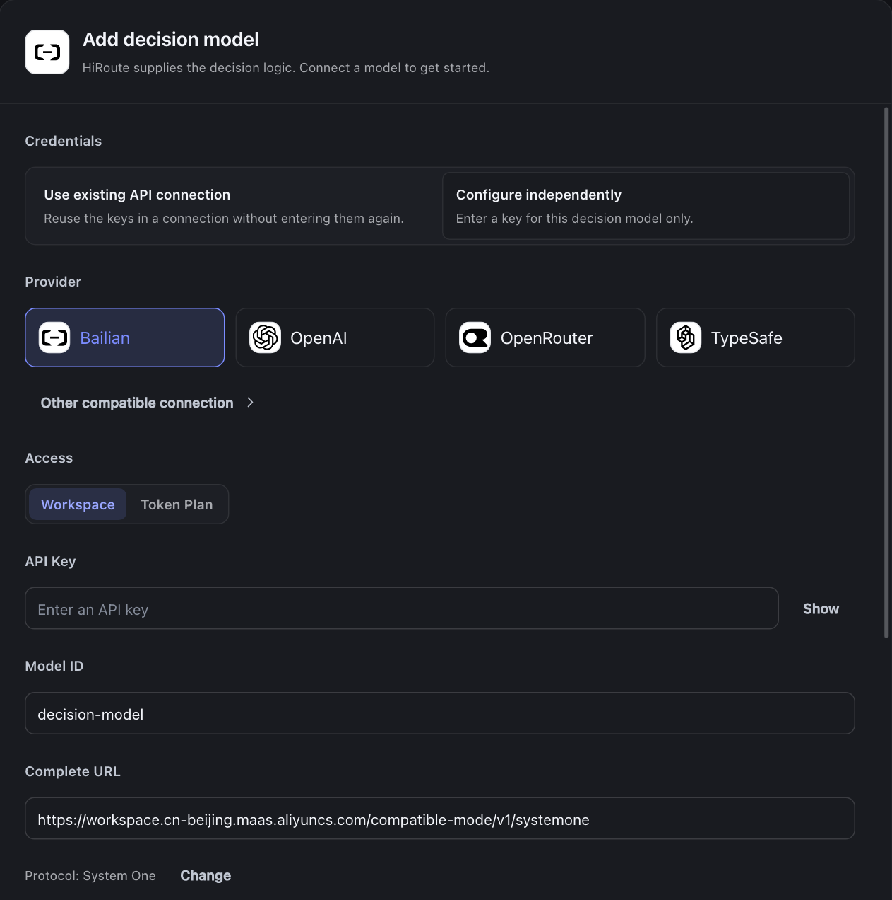

# Bailian Releases Its Official Decision Model, and HiRoute Beats OpenAI Decisions in Testing

Alibaba Cloud Bailian (Model Studio) has released an official, stable decision model, with the model ID `decision-model`. HiRoute adds it to Bailian workspace decision connections in this change. Before merging, we compared it with the earlier `decision-model-preview` under identical conditions, on a public set of bilingual engineering checkpoints. On the engineering panel, group-selection accuracy rose from 79.81% to 96.15%, and also surpassed OpenAI Decisions at 89.42% on the same records.



*Engineering scenario, three-question form, 86 records with a determinate label. Stable is 16.34 percentage points above the preview and 6.73 percentage points ahead of OpenAI Decisions.*

The fuller results first:

- **Engineering group-selection accuracy is 96.15%, against 79.81% for the preview.** The requests sent to the two versions differ only in the model ID, and both are scored with the same labels and the same evaluator.
- **On the same engineering records it surpasses OpenAI Decisions at 89.42%, and matches Jev 1.14 at 96.15%.**
- **The input window grows from 65,536 to 268,288 tokens**, so longer inputs can still reach the decision model.
- **The whole comparison replays offline.** One command recomputes every result, with no key and no network access.

These numbers measure whether a decision model selects the right model group under a declared policy. To read them properly, it helps to know how HiRoute makes model decisions. So this article has two parts. Part one is a fairly complete tour of HiRoute's decision and routing mechanism, and of why it is built this way. Part two covers the test: how it was run, what came out, and which conclusions it does and does not support. This article covers the engineering scenario only.

## Part 1: How HiRoute decides which model takes a turn

### Two kinds of models, two jobs

[HiRoute](https://github.com/higress-group/HiRoute) is an open-source routing engine that runs on your own machine, between your Agent and your models. You keep using Codex, Claude Code, Qoder and the other Agents you know, and point their model endpoint at HiRoute. Which model actually handles each turn is decided by HiRoute, following the routing plan you published.

In a Difficulty routing plan, models form two groups. The **Regular** group holds cheaper models for explicit, bounded work. The **Primary** group holds your strongest models for complex tasks, or for taking over when the previous stage fell short.

The judging is done by a different kind of model, a **decision model**. The split between the two is clear:

- **Execution models** answer the user, call tools and complete the task.
- **Decision models** generate no text and execute nothing. They only answer questions with a constrained form, such as picking one option or scoring on levels, and return a probability for each option.

Bailian, Jev on OpenRouter, and TypeSafe share one request shape, `model + state + questions → answers`, an interface called System One. OpenAI Decisions uses a different wire format, but it is asked the same questions and its answers are used by the same rules.

### Three questions for every new message

Each time the user sends a new message, HiRoute asks the decision model three independent questions in a single request:


| Question | Answer form | What HiRoute gets |
| --- | --- | --- |
| How did the last step go? | A score on three anchors, 0 / 0.5 / 1 | A competence score, which also feeds model performance reports |
| How hard is this step? | A probability for each of two levels, simple and complex | The simple probability |
| Will the last step's problem carry into this one? | A probability for each of two options, applicable and not established | The earlier problem relevance |

Why not just ask which model should take this step? Because that single answer hides four judgments: how hard this step is, how the last step went, whether its problem was resolved, and what the policy says. A slip on any one of them produces the wrong answer, and afterwards you cannot tell which one slipped. Once split, each question judges one thing, its criteria live in its own instructions, and the three are answered separately within the same call. They are not allowed to refer to each other.

The three questions also look in different directions. The first looks back and rates work that already happened. The second sizes up the present, judging only how much reasoning and uncertainty the current task involves. The third connects the two: it asks whether a known, unresolved problem still applies to the work at hand, not whether the next step will succeed.

Both ways of asking, selecting a group directly and answering three questions, were tested in part two. The difference is clear.

### The decision model answers; HiRoute applies the rule

A decision model returns probabilities and scores, not a model name. The rule that turns answers into a selection lives in HiRoute, and it is [a few fixed steps](https://github.com/higress-group/HiRoute/blob/main/crates/gateway/src/core_runtime/classification/group_policy.rs):

```text
simple probability unavailable                    -> Primary
simple probability < threshold (default 0.8)      -> Primary
otherwise                                         -> Regular

if the previous stage has a complete, attributable score
below the competence floor (default 0.5):
    earlier problem relevance < 0.5               -> release protection, keep the selection above
    otherwise (including unavailable relevance)   -> Primary: this is low-score protection
```

The rule is short and predictable: a turn goes to Regular only when it is simple enough and no applicable low score stands against it.

### Low-score protection: applied on solid evidence, released when the problem is gone

Low-score protection is the part of the mechanism closest to experience: if the last step went badly, the next one goes to Primary first, even when it looks simple. It is useful and easy to overuse, so HiRoute puts several gates in front of it. A score can trigger protection only when all of these hold:

- it was returned by this very decision, and it rates the previous stage that actually executed;
- its evidence is complete, not a partial view left over after context trimming;
- it shares the task category, the published plan revision and the scoring rubric with the current turn.

A missing score, a score with partial evidence, or a score from another task category cannot trigger protection. Unrated does not mean zero, and an old low score does not keep firing in later turns.

Protection is not one-way either. Every new message gets a fresh decision, and a Primary turn does not lock the turns that follow. When the third answer says the problem was resolved or does not concern the work at hand, protection is released and difficulty decides again.



*In this recorded Account Export example session, Flash scored 0.24 on turn 3. Select turn 4 to see why GPT-6 Astra took over: low-score protection applied even though the simple probability was 1.00. Astra scored 0.73, and turn 5 returned to Flash.*

### When something goes wrong

A decision model is an external service. It can time out, return an unusable answer, or receive input too long for its window. HiRoute has a defined outcome for each case:

| Situation | What HiRoute does |
| --- | --- |
| The difficulty result is unavailable while the other judgments are valid | Uses Primary and records the failed difficulty judgment |
| The whole decision fails: timeout, rejected input, invalid output or unavailable service | A Difficulty routing plan falls back to local heuristic rules and records the fallback reason |
| The current input and the required questions do not fit the decision model's window | Makes no decision call and falls back locally; the request to the execution model is still forwarded in full |
| The earlier problem relevance is unavailable | Conservatively keeps low-score protection |
| A model in the selected group is unavailable | Tries the next one in your order. When every Regular candidate is unavailable it can relay to Primary; when Primary is exhausted the request fails, and it never drops back to Regular |
| The response has already started streaming to the client | Never silently switches to another model inside the same response |

Wherever a piece of the judgment itself is missing (difficulty unavailable, relevance unavailable), the outcome leans toward quality: one extra Primary turn is the cheaper mistake. Also, a failed candidate call means unavailable, not incompetent. It never produces a zero score that would distort later decisions.

### Trading cost against quality

In the route editor, drag the **Trust** slider to the right to lower the simple-probability threshold. More stages can then go to Regular. You can also enter an exact value. Low-score protection applies at every setting, and you can adjust the threshold without rewriting the decision questions.

As you move the slider, **Replay this setting on your records** uses judgments recorded for the active version over the last seven days to show how many stages would go to Regular and how many to Primary at the new threshold. Replay makes no new model calls. If you expect a similar mix of tasks, use those shares to estimate how much work each group will handle before you publish the change.



*At the current setting, 42% of the recorded stages actually went to Regular. With the slider at Hands-off (0.5), replaying the same 106 stages would send 52 to Regular (49%) and 54 to Primary (51%).*

Beyond the threshold, a few design choices affect cost directly:

- **Decide only when a decision is due.** A new user message triggers a new decision. When the Agent keeps working after tool calls within the same turn, it normally keeps the selection already made for that turn.
- **Keep the model when you can.** When a fresh decision selects the same group, HiRoute prefers the model from the previous turn, which preserves context and reuses the prompt cache. For what switching does to caching and total task cost, see [this analysis](https://hiroute.ai/en/news/routing-cache-cost/).
- **Tune from your own records.** The session routing timeline shows each turn's simple probability, the threshold at that time, the selected group and reason, and the score the stage received later. HiRoute does not rewrite your plan because of one low score.
- **The decision itself must be cheap.** Every new message adds one decision call, so that overhead has to stay small. Part two reports the actual usage in this test.

### Why this design holds up

Looking back, the mechanism rests on a few plain choices:

1. **One vague question becomes three that can each be checked.** Every answer has a defined meaning, and a mistake can be traced to the question that caused it.
2. **Judgment and policy are separate.** The decision model supplies judgments; thresholds, group selection and execution stay in HiRoute. You can adjust the policy without touching prompts, and change the decision model without touching the policy. That is exactly what made this comparison possible: the questions and the rule stay fixed, and only the model answering them changes, across both Bailian versions, Jev and OpenAI Decisions.
3. **Escalation needs grounds, and so does stepping back down.** Low-score protection has to pass gates on evidence completeness and attribution, and it is released once the problem no longer applies, so a session cannot ratchet up and stay there.
4. **A missing judgment leans toward quality.** Save where saving is safe, and do not gamble task quality on a guess.
5. **Every selection leaves a record that can be reviewed and replayed.** Routing is not a black box, and trust can follow your own evidence.
6. **The mechanism itself is open to inspection.** We wrote it up as a [paper](../experiments/system-one-routing-paper/README.md), with datasets, raw responses and offline replay tools in the repository. The test below reuses one of its checkpoint sets.

## Part 2: Bailian's stable decision model on engineering checkpoints

### What this change adds

In HiRoute versions that include this change, a new independently configured Bailian decision connection opens with Workspace selected and the stable `decision-model` filled in. Beijing and Singapore workspace URLs use `/compatible-mode/v1/systemone`, and HiRoute resolves the context window automatically from model metadata: 268,288 tokens for stable and 65,536 for the preview. You can still select the preview in a workspace. Token Plan defaults to the preview, and saved connections retain their model.

### How the test was run

The benchmark comes from the paper's [decision-interface transfer study](../experiments/system-one-routing-paper/supplements/decision-interface-transfer/README.md). It publishes all of its synthetic task contexts, original labels, question definitions, historical responses and the evaluator. The full study has 152 records in Chinese and English pairs. This article looks at its engineering panel: 104 records from 26 workflow families, 86 of them with a determinate group label.

Each record is a routing checkpoint: a conversation that already happened, plus a pending new request, with a label for the group that should be selected at that point. Here is one from the dataset (record `IG001_a`):

> The user asked for an account CSV export whose download must exclude suspended accounts. The assistant replied that the download was ready. The user reported back: with the filter checked, suspended account 47 is still in the file.
>
> New request: add the `region` column right after `account_id` using the existing CSV field registry, then regenerate the same active-only download.

The new request is routine on its own. But the core requirement of the previous step was not met, and the new request regenerates that very file. So the label is Primary: this is precisely the case low-score protection is meant to catch.

Each record is asked in two forms:

- **Direct selection**: hand the decision model the complete routing policy and let it answer which group to select.
- **Three questions**: answer current difficulty, previous-stage score and whether the problem still applies, then let the fixed rule combine them.

To keep the stable-versus-preview comparison clean, the experiment controls these conditions:

- **Same requests.** Both versions use the study's archived Jev request body with only the `model` field changed. The replay script checks the SHA-256 of every request.
- **Same labels and evaluator.** The original labels and the frozen original evaluator are used, with no prompt, threshold or scoring change made for Bailian. The rule selects Primary when the simple probability is below 0.5, or when the previous-stage score is below 1 and the probability that the problem still applies is at least 0.5, and Regular otherwise. The score here is on the provider's raw 0 to 2 scale; in the product HiRoute divides it by 2, which corresponds to the 0.5 competence floor.
- **Interleaved calls.** A fixed shuffle (seed 20261127) interleaves the two versions and the two forms, with at most 4 concurrent requests, a fresh TLS connection per call and no retries.
- **Every call completed.** On 27 November 2026, a Beijing workspace returned a valid answer for all 304 calls to the stable model and all 304 calls to the preview (152 records, two forms each).
- **Comparison points on the same records.** The Jev 1.14 responses were collected on 28 October and the OpenAI Decisions (`gpt-6-luna`) responses on 29 October. They are the study's archived historical responses and were not rerun.

Accuracy is a macro average over workflow families: every family has equal weight, so a family with more records does not count for more.

### Results

Full engineering panel, family-macro final group accuracy. The parentheses show correct records over records with a determinate label:

| Decision model | Direct selection | Three questions |
| --- | ---: | ---: |
| Bailian stable `decision-model` | 75.00% (63/86) | **96.15% (82/86)** |
| Bailian preview `decision-model-preview` | 50.00% (45/86) | 79.81% (68/86) |
| OpenAI Decisions (`gpt-6-luna`) | 48.08% (43/86) | 89.42% (76/86) |
| Jev 1.14 | 69.23% (60/86) | 96.15% (82/86) |

A few observations:

- **Stable is a clear step up from the preview.** With three questions it goes from 79.81% to 96.15%, and from 68 to 82 correct records. With direct selection it also rises, from 50.00% to 75.00%, so both forms point the same way.
- **It surpasses OpenAI Decisions on the same records.** With three questions the scores are 96.15% against 89.42% (82/86 against 76/86), and with direct selection 75.00% against 48.08%.
- **It matches Jev 1.14 on these records.** Stable and Jev 1.14 both reach 82/86.
- **All 4 of the stable model's errors are missed protection**, meaning it selected Regular where Primary was required. It never escalated work that belonged with Regular.
- **All four decision models in the table score higher with three questions.** That is consistent with the split described in part one: the same model, with the same context, selects better when asked this way.

Back to record `IG001_a`, to show what the answers look like. These are the three answers in the archived responses, to three decimals:

| | Simple probability | Previous-stage score (0 to 2) | Probability the problem still applies | Selection |
| --- | ---: | ---: | ---: | --- |
| Stable, Chinese record | 0.990 | 0.009 | 0.990 | Primary, correct |
| Stable, English record | 0.995 | 0.012 | 0.995 | Primary, correct |
| Preview, Chinese record | 0.640 | 0.580 | 0.480 | Regular, wrong |
| Preview, English record | 0.750 | 0.730 | 0.540 | Primary, correct |

Together the three answers make one selection: the new request is simple, the previous-stage score is below 1, the problem still applies, so Primary is selected. On the Chinese record the preview returned 0.480 for applicability, just under 0.5, so protection was released and it selected Regular. On the English version of the same record it returned 0.540 and selected correctly. This is a single record, shown to illustrate how three answers combine into one selection. For the overall picture, rely on the table above.

### A second view

The study also has a subset that was reviewed after the fact. The review excluded records with disputed labels: 6 engineering records were removed, leaving 98, of which 80 have a determinate label. The exclusion list is identical for every model and both forms, and it was inherited before any Bailian call was made.

| Decision model | Direct selection | Three questions |
| --- | ---: | ---: |
| Bailian stable | 72.12% (57/80) | 94.23% (76/80) |
| Bailian preview | 51.92% (41/80) | 77.88% (62/80) |
| OpenAI Decisions | 50.00% (39/80) | 91.35% (72/80) |
| Jev 1.14 | 67.31% (54/80) | 96.15% (76/80) |

The improvement over the preview holds in this view too. Compared with OpenAI Decisions, three-question accuracy is 94.23% against 91.35% (76/80 against 72/80), and direct selection is 72.12% against 50.00%, so the stable model remains ahead on both forms. Compared with Jev 1.14, stable has the same number of correct records (76/80), but its family-macro accuracy is 94.23%, slightly below Jev 1.14's 96.15% (families weigh equally, so which families the errors fall in changes the figure). The careful reading is that on engineering checkpoints the stable model surpasses OpenAI Decisions and has reached the same tier as Jev 1.14, not that it has passed Jev 1.14.

### What the larger input window means

The stable model's input window is 268,288 tokens; the preview's is 65,536. For HiRoute, window size affects two things.

First, fewer fallbacks. As described above, when the current input and the required questions do not fit the decision window, HiRoute makes no decision call and falls back locally. A Gateway [regression test](https://github.com/higress-group/HiRoute/blob/main/crates/gateway/src/core_runtime/classification/adaptive_request_tests.rs) pins the difference: the same message carrying an 80,000-character text encodes completely into the decision request under the stable window, and is rejected for budget under the preview window.

Second, more complete history. A decision request keeps the current input and the questions first, and history gets the remaining space. A larger window makes it more likely that the previous stage's execution record is kept whole, and only a complete score can trigger low-score protection.

We also sent one long-input probe straight to Bailian's stable endpoint: 80,000 repetitions of a single Chinese character, counted as 80,080 input tokens, and the endpoint returned a normal answer. So input above the preview limit is indeed accepted by the stable model.

### Cost and latency

Every new message adds one decision call, so usage is worth a look. These figures cover the whole experiment (all records, both forms):

- The 304 formal calls to the stable model come to an estimated CNY 0.203471 at Beijing's published rate of CNY 0.30 per million input tokens.
- Including two separate endpoint probes (the long input above, and one image input), the stable model received 306 calls and 759,445 input tokens, an estimated CNY 0.227834.
- The preview is under a published limited-time free offer in Beijing.
- Client-observed median latency for the stable model: 318 ms for direct selection and 369 ms for three questions.

The cost is an estimate from the published rate and the input usage returned by the API. It is not an invoice and includes no account-specific discount. Bailian's responses reported input usage only. The historical comparison latencies were measured on different dates and under different network and transport conditions, so we make no cross-model latency comparison here.

### Replay it yourself

Every response is archived in the repository. From the repository root, with Python 3.9 or newer:

```sh
python3 experiments/results/bailian-decision-20261127/compare.py
```

No credentials and no network access are needed. The script does the following, in order:

- verifies the file manifest of the historical transfer study and the SHA-256 of the two compressed ledgers added here;
- checks the hash of all 608 Bailian requests, confirming that each one is the original frozen state and question definitions plus the corresponding model ID;
- parses all 1,520 formal responses again with the original evaluator (608 from Bailian, 912 historical) and recomputes the full results, along with usage and latency. Those 912 historical responses include the Jev 1.14 and OpenAI Decisions baselines shown in this article, plus other archived baseline responses from the study.

Every number in the two accuracy tables above is printed directly by this script. According to the verification notes in [PR #534](https://github.com/higress-group/HiRoute/pull/534), a reviewer has also independently replayed all 1,520 responses. The full write-up is in the [experiment README](../experiments/results/bailian-decision-20261127/README.md).

### What these numbers do not show

- **They measure policy conformance, not task completion.** Accuracy answers whether the right model group was selected under the declared policy. Whether the execution model then finished the task, and how much money was actually saved, are outside this experiment.
- **The contexts are public synthetic checkpoints, not production traffic.**
- **The study threshold differs from the product default.** The frozen evaluator uses 0.5 as the simple-probability threshold; a new HiRoute plan defaults to 0.8.
- **One observation per condition.** Each model, form and record was called once, with no repeated sampling.
- **The comparison points are historical responses from a month earlier.** Jev and OpenAI Decisions were not rerun. The OpenAI results come from the study's research adapter and do not represent HiRoute's built-in OpenAI connection.
- **The model IDs are provider aliases observed on the collection date.** These results describe what the endpoint returned on 27 November 2026.
- **Only one Beijing workspace was tested live.** The Singapore region and other accounts were not. Whether your account has access depends on your own saved connection and an actual request.
- **The window was not tested to its limit.** The long-input probe reached 80,080 input tokens; the documented 268,288-token boundary was not exercised. Both probes called the Bailian API directly, not through HiRoute, so they do not establish capacity through HiRoute.
- **Images do not take part in routing decisions yet.** The stable API accepts image input, but HiRoute's routing adapter currently sends text and marks images in the conversation as unavailable.
- **The reviewed subset is post-hoc.** It was reviewed after model outputs were visible and is not a new blind evaluation.
- **This article covers the engineering panel only.** The study also has a mathematical dependency-state panel, where the stable model still trails Jev, so the conclusions above do not carry over to it. The full tables are in the experiment README.

## How to use the stable model

1. Open Models → Decision models and select Add decision model.
2. Under Credentials, choose Configure independently and pick Bailian. The access type defaults to Workspace. You can also choose Use existing API connection to reuse a saved Bailian key.
3. Confirm that the model ID is `decision-model`, then enter the complete URL of your Beijing or Singapore workspace, ending in `/compatible-mode/v1/systemone`.
4. Select Save and test. Then select this connection revision in a Difficulty routing plan and publish it.



*HiRoute's Add decision model form with an example Beijing workspace URL and an empty API key field. When setting up your own connection, copy the complete URL from your Bailian workspace.*

From the CLI, `--provider bailian-workspace` defaults to the stable model for a new connection, with `--endpoint` for the complete URL. See [HiRoute CLI](https://hiroute.ai/en/docs/cli/) for details and [Use smart model routing](https://hiroute.ai/en/docs/model-routing/) for the illustrated steps.

Two reminders. A passing connection test only shows that this connection works; it says nothing about judgment quality, which you should watch in the session routing timeline and in Model performance. And a published route keeps the connection revision it was published with, so after switching to the stable model you need to select the new revision and publish again.

## Closing

The decision model is the easiest part of smart routing to overlook. It never writes a line of code, yet every turn's assignment relies on its judgment. The better it judges, the more work the Regular group can safely take, and the more your Primary model is kept for the places that need it. With this showing on engineering checkpoints, Bailian's stable decision model gives developers on Bailian one more option they can select directly.

All the data and scripts behind this comparison are in the repository. If your replay produces different results, or you see different behavior in your own tasks, please open an issue on [GitHub](https://github.com/higress-group/HiRoute) and tell us.

[Download HiRoute](https://hiroute.ai/en/download/) · [Documentation](https://hiroute.ai/en/docs/) · [GitHub](https://github.com/higress-group/HiRoute)
