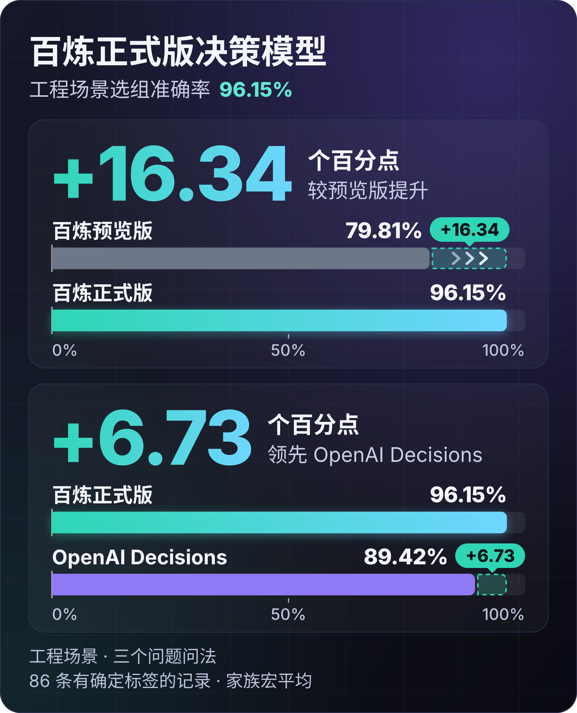
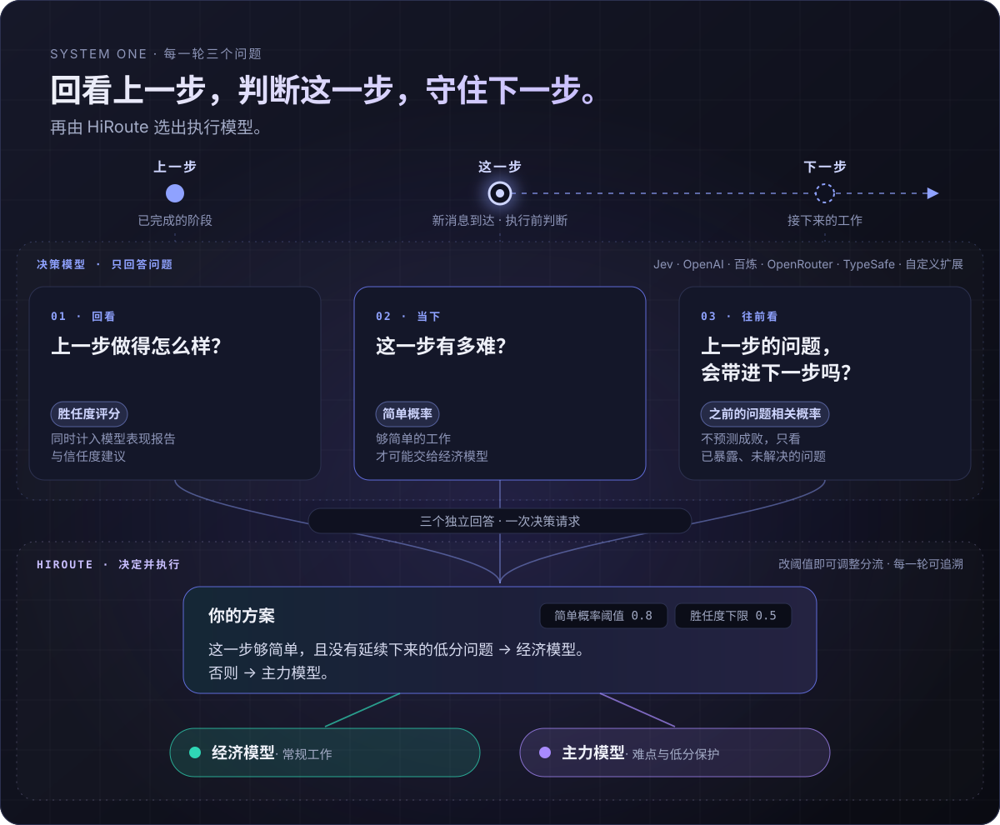
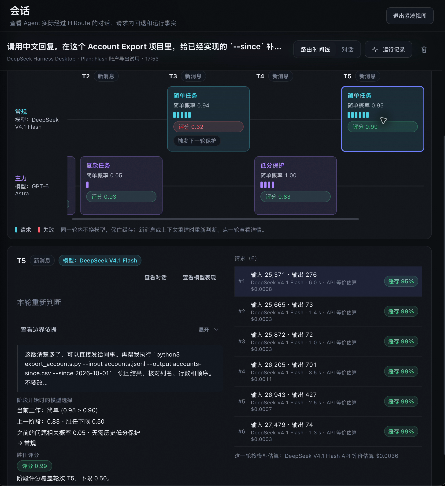
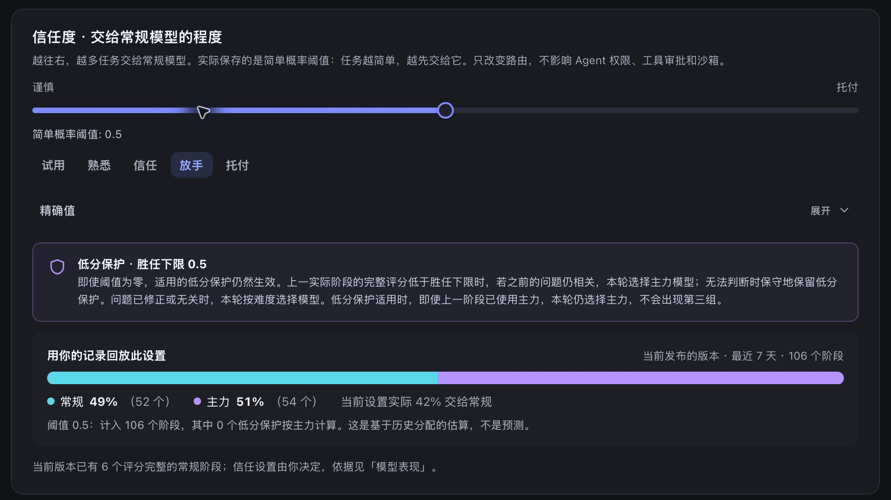
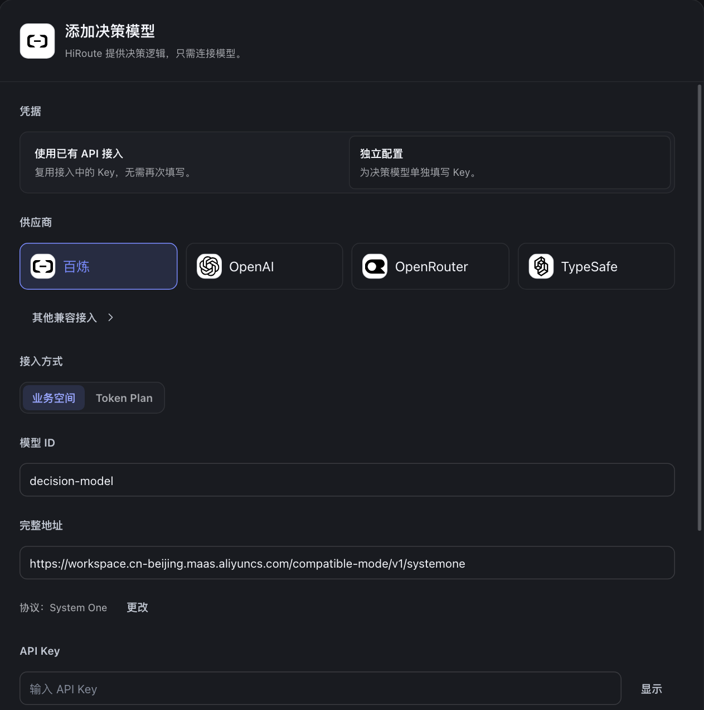

# 百炼推出正式版决策模型，HiRoute 实测超越 OpenAI Decisions

阿里云百炼推出了决策模型正式版（稳定版，模型 ID 为 `decision-model`）。HiRoute 把它加进了百炼业务空间的决策模型连接。合入之前，我们用一组公开的中英文工程检查点，把它和此前的预览版 `decision-model-preview` 放在完全相同的条件下比了一次。在工程场景里，选组准确率从 79.81% 提升到 96.15%，也超过了同一组记录上 OpenAI Decisions 的 89.42%。



*工程场景，三个问题问法，86 条有确定标签的记录。正式版较预览版提升 16.34 个百分点，领先 OpenAI Decisions 6.73 个百分点。*

先说更完整的结果：

- **工程场景的选组准确率是 96.15%，预览版是 79.81%。** 两个版本收到的请求只有模型 ID 不同，使用同一份标签和同一个评估器。
- **在同一组工程记录上超过 OpenAI Decisions 的 89.42%，并与 Jev 1.14 的 96.15% 持平。**
- **输入窗口从 65,536 token 扩大到 268,288 token**，更长的输入也能交给决策模型判断。
- **整套对比可以离线重放**：不需要 Key，也不需要联网，一条命令就能重新算出全部结果。

这些数字衡量的是“决策模型有没有按声明的策略选对模型组”。要看懂它，得先知道 HiRoute 是怎么做模型决策的。所以本文分成两部分：第一部分完整介绍 HiRoute 的决策与路由机制，以及这样设计的理由；第二部分讲这次实测怎么做、结果如何、哪些结论能下、哪些不能。本文只讨论工程场景。

## 一、HiRoute 怎么决定这一轮用哪个模型

### 两类模型，各做各的事

[HiRoute](https://github.com/higress-group/HiRoute) 是一个开源、运行在本机的智能路由引擎，位于 Agent 和模型之间。你继续用 Codex、Claude Code、Qoder 这些熟悉的 Agent，只是把模型入口指向 HiRoute；每一轮实际交给哪个模型，由 HiRoute 按你发布的路由计划决定。

在“按难度分流”的计划里，模型分成两组：**常规组**放更经济的模型，处理要求明确、范围有限的工作；**主力组**放最强的模型，处理复杂任务，或者在上一阶段没做好时接手。

做判断的是另一类模型，叫**决策模型**。它和执行模型的分工很清楚：

- **执行模型**回答用户、调用工具、完成任务。
- **决策模型**不生成文本，也不执行任务。它只回答限定了形式的问题，比如多选一、按档位打分，并且给出每个选项的概率。

百炼、OpenRouter 上的 Jev 和 TypeSafe 使用同一种请求形状：`model + state + questions → answers`，这套接口叫 System One。OpenAI Decisions 的线上格式不同，但问的是同一组问题，答案也按同一套规则使用。

### 每条新消息，问三个问题

每当用户发来一条新消息，HiRoute 就在一次请求里向决策模型提出三个彼此独立的问题：



| 问题 | 回答形式 | HiRoute 得到什么 |
| --- | --- | --- |
| 上一步做得怎么样？ | 按 0 / 0.5 / 1 三个锚点打分 | 胜任分，同时计入模型表现报告 |
| 这一步有多难？ | 简单、复杂两档各自的概率 | 简单概率 |
| 上一步的问题会带进这一步吗？ | “仍然适用”和“未成立”两个选项的概率 | 之前的问题相关概率 |

为什么不直接问“这一步该用哪个模型”？因为那一个答案里其实压着四件事：这一步有多难，上一步做得怎么样，问题解决了没有，策略又是怎么规定的。任何一项想偏了，结论就跟着错，而且事后看不出错在哪一项。拆开以后，每个问题只判断一件事，标准写在问题自己的说明里，三个问题在同一次调用中各自作答，不允许互相引用。

这三个问题也各有侧重。第一个是事后的回看，评价已经发生的工作；第二个是事前的预判，只看当前任务需要多少推理、有多少不确定性；第三个把前两者连起来：它问的是一个已知、未解决的问题是否还和眼前的工作有关，而不是预测下一步能不能成功。

直接选组和三个问题这两种问法，在第二部分的实测里都测了，差别很明显。

### 决策模型只回答问题，选组规则在 HiRoute 手里

决策模型返回的是概率和分数，不是模型名。把答案变成选择的规则在 HiRoute 这边，是[固定的几步](https://github.com/higress-group/HiRoute/blob/main/crates/gateway/src/core_runtime/classification/group_policy.rs)：

```text
简单概率拿不到                      → 主力组
简单概率 < 阈值（新计划默认 0.8）     → 主力组
否则                                → 常规组

如果上一阶段有一份完整、可归属的评分，且低于胜任下限（默认 0.5）：
    之前的问题相关概率 < 0.5         → 解除保护，保持上面的选择
    否则（包括这个概率拿不到）        → 主力组，这就是“低分保护”
```

规则很短，也很好预期：只有这一轮足够简单，并且没有适用的低分时，才交给常规组。

### 低分保护：证据站得住才生效，问题过去了就解除

低分保护是这套机制里最接近“经验”的部分：上一步没做好，下一步哪怕看起来简单，也先交给主力。它很有用，也很容易被滥用，所以 HiRoute 给它设了几道门。用来触发保护的评分必须同时满足：

- 是本次决策新返回的，评价的是上一个实际执行的阶段；
- 证据完整，没有因为上下文裁剪而只看到一部分；
- 和本轮属于同一个任务类别、同一个已发布的计划版本、同一套评分标准。

缺失的评分、只有部分证据的评分、跨任务类别的评分都不会触发保护。未评分不等于零分，旧的低分也不会在后面的轮次里反复生效。

保护也不是单向的。每条新消息都重新决策，上一轮用了主力不会锁定后面的轮次。如果第三个问题的答案表明问题已经解决，或者和眼前的工作无关，保护就解除，重新按难度选择。



*这是 Account Export 示例项目的一次真实会话。第 3 轮 Flash 得分 0.32，下一轮由 GPT-6 Astra 接手并得分 0.83。选中第 5 轮，可以看到返回 Flash 的依据：简单概率 0.95，之前的问题相关概率 0.05。*

### 出了意外怎么兜底

决策模型是一个外部服务：它会超时，会返回不合格的答案，输入也可能长到放不进它的窗口。HiRoute 对每一种情况都有明确的去向：

| 情况 | HiRoute 的做法 |
| --- | --- |
| 难度结果拿不到，其他判断有效 | 使用主力组，并记录难度判断失败 |
| 整次决策失败：超时、输入被拒、输出无效或服务不可用 | 按难度分流的计划退回本地启发式规则，并记下回退原因 |
| 当前输入和必需的问题放不进决策模型的窗口 | 不调用决策模型，直接本地回退；发给执行模型的请求照常完整转发 |
| 之前的问题相关概率拿不到 | 保守地保留低分保护 |
| 选中组里的某个模型不可用 | 按你排的顺序尝试下一个。常规组都不可用时可以接力到主力组；主力组也不可用则请求失败，不会降回常规组 |
| 已经开始向客户端输出回答 | 不会在同一个回答里悄悄换成另一个模型 |

其中凡是判断本身缺了一块的地方（难度拿不到、相关概率拿不到），都偏向质量一侧：宁可多用一次主力。另外，候选模型调用失败只是“不可用”，不等于“不胜任”，不会因此生成一个零分去影响后面的判断。

### 成本和质量怎么取舍

在路由编辑器里，把**信任度**滑块向右拖，简单概率阈值就会降低，更多阶段可以交给常规组。也可以直接填精确值。各档位都保留低分保护，调整阈值无需改写决策问题。

拖动滑块时，下面的“用你的记录回放此设置”会用当前发布版本最近 7 天记录的判断，算出按新阈值会有多少阶段分给常规组、多少分给主力组。回放无需再次调用模型。如果接下来的任务和这批样本相似，就可以用这个配比预估两组模型各要承担多少工作，再决定是否发布新设置。



*图中，当前设置下实际有 42% 的阶段交给了常规组。把滑块调到“放手”（0.5）再回放同一批 106 个阶段，52 个会分到常规组（49%），54 个会分到主力组（51%）。*

除了阈值，还有几处设计直接影响成本：

- **只在该判断的时候判断。** 新的用户消息才触发新的决策。同一轮里 Agent 调用工具后继续工作，通常沿用本轮已经做出的选择。
- **能不换模型就不换。** 重新判断后如果还是同一组，HiRoute 优先沿用上一轮的模型，这样可以延续上下文、复用提示词缓存。切换对缓存和整单成本的影响，可以看[这篇分析](https://hiroute.ai/zh/news/routing-cache-cost/)。
- **用自己的记录调。** 会话的路由时间线会显示每一轮的简单概率、当时的阈值、选中的组和原因，以及这一阶段后来得到的评分。HiRoute 不会因为一次低分就自动改写你的计划。
- **决策本身要足够便宜。** 每条新消息都多一次决策调用，这笔开销必须小到不成负担。第二部分会给出这次实测的实际用量。

### 这样设计为什么站得住

回头看，这套机制的合理性来自几个朴素的选择：

1. **把一个模糊的大问题拆成三个能单独检验的小问题。** 每个答案都有明确的含义，错了也能定位到是哪一问。
2. **判断和策略分开。** 决策模型只提供判断，阈值、选组和执行留在 HiRoute。这样调整策略不用动提示词，换决策模型也不用动策略。这次能把百炼的两个版本、Jev 和 OpenAI Decisions 放在一起比，靠的正是这一点：问题和规则不变，只换回答问题的模型。
3. **升级有依据，回落也有依据。** 低分保护要过证据完整和归属一致的几道门，问题不再相关就解除，不会一路升上去下不来。
4. **判断缺了一块时偏向质量。** 该省的时候省，拿不准的时候不拿任务质量冒险。
5. **每个选择都留下记录，可以回看和回放。** 路由不是黑盒，信任度可以按自己的证据调。
6. **机制本身可以公开检验。** 我们把它写成了[论文](../experiments/system-one-routing-paper/README.md)，数据集、原始应答和离线重放工具都在仓库里。下面这次实测沿用的就是其中的一组检查点。

## 二、百炼决策模型正式版：工程场景实测

### 这次接入了什么

在包含这次改动的 HiRoute 版本里，百炼业务空间的决策模型连接可以在模型 ID 中选择正式版 `decision-model`。北京和新加坡的工作空间地址使用 `/compatible-mode/v1/systemone`，HiRoute 会按模型元信息自动确定上下文窗口：正式版是 268,288 token，预览版是 65,536 token。业务空间和 Token Plan 的预设默认仍然是预览版，正式版需要手动选择。

### 实验怎么做的

基准来自论文配套的[决策接口迁移研究](../experiments/system-one-routing-paper/supplements/decision-interface-transfer/README.md)。它公开了全部合成的任务上下文、原始标签、问题定义、历史应答和评估器。完整研究有 152 条中英文成对的记录，本文关注其中的工程面板：104 条记录，来自 26 个工作流家族，其中 86 条有确定的选组标签。

每条记录是一个路由检查点：一段已经发生的对话，加上一条待处理的新请求，标签标明这时应该选哪个组。举一个数据集里的例子（记录 `IG001_a`）：

> 用户要求交付账户 CSV 导出，下载文件必须排除已停用账户。助手回复说文件已生成。用户反馈：勾选筛选后下载，已停用的账户 47 仍在其中。
>
> 新请求：通过现有的 CSV 字段注册表，在 `account_id` 后面增加 `region` 列，然后重新生成同一个仅含活跃账户的下载文件。

新请求本身是一件常规的小事，但上一步的核心要求没有做到，而且新请求还要重新生成同一份文件。所以标签是主力组：这正是低分保护要接住的情况。

每条记录用两种问法各问一次：

- **直接选组**：把完整的路由策略交给决策模型，让它直接回答该选哪个组。
- **三个问题**：分别回答当前难度、上一阶段评分和问题是否仍然适用，再由固定规则组合出选择。

为了让正式版和预览版的对比干净，实验控制了这些条件：

- **请求相同。** 两个版本都使用研究存档的 Jev 请求体，只改 `model` 一个字段。重放脚本会逐条核对请求的 SHA-256。
- **标签和评估器相同。** 使用原始标签和冻结的原始评估器，没有为百炼调整提示词、阈值或评分方式。评估规则是：简单概率低于 0.5 时选主力组；或者上一阶段评分低于 1 且问题仍然适用的概率不低于 0.5 时选主力组；其余选常规组。这里的评分是供应商原始的 0 到 2 量表，HiRoute 在产品里会把它除以 2，对应 0.5 的胜任下限。
- **调用交错进行。** 用固定种子（20261127）打乱顺序，让两个版本、两种问法交错调用，最多 4 个并发，每次调用新建 TLS 连接，不重试。
- **全部完成。** 2026 年 11 月 27 日，北京地域的工作空间对正式版的 304 次调用和预览版的 304 次调用全部返回了有效答案（152 条记录，每条两种问法）。
- **对照来自同一组记录。** Jev 1.14 的应答采集于 10 月 28 日，OpenAI Decisions（`gpt-6-luna`）的应答采集于 10 月 29 日，都是研究里存档的历史应答，这次没有重跑。

准确率按工作流家族做宏平均：每个家族权重相同，不会因为某个家族记录多就占更大比重。

### 结果

工程面板全部记录，家族宏平均的最终选组准确率。括号里是答对的条数和有确定标签的条数：

| 决策模型 | 直接选组 | 三个问题 |
| --- | ---: | ---: |
| 百炼正式版 `decision-model` | 75.00%（63/86） | **96.15%（82/86）** |
| 百炼预览版 `decision-model-preview` | 50.00%（45/86） | 79.81%（68/86） |
| OpenAI Decisions（`gpt-6-luna`） | 48.08%（43/86） | 89.42%（76/86） |
| Jev 1.14 | 69.23%（60/86） | 96.15%（82/86） |

几点观察：

- **正式版比预览版有明显提升。** 三个问题的问法下，从 79.81% 到 96.15%，答对的记录从 68 条增加到 82 条。直接选组的问法下也从 50.00% 提高到 75.00%，两种问法方向一致。
- **在同一组记录上超过 OpenAI Decisions。** 三个问题的问法下是 96.15% 对 89.42%（82/86 对 76/86），直接选组是 75.00% 对 48.08%。
- **在这组记录上与 Jev 1.14 持平。** 正式版和 Jev 1.14 都是 82/86。
- **正式版的 4 条错误全部是漏掉保护**，也就是该交给主力组的时候选了常规组。它没有一次把本该留给常规组的工作错误地升级到主力组。
- **表中的四个决策模型都是三个问题的问法更高。** 这和第一部分讲的拆分思路是一致的：同一个模型、同样的上下文，换一种问法，选组就更准。

回到前面那条 `IG001_a` 记录，看看答案长什么样。下面是存档应答里三个问题的输出，保留三位小数：

| | 简单概率 | 上一阶段评分（0 到 2） | 问题仍然适用的概率 | 选组 |
| --- | ---: | ---: | ---: | --- |
| 正式版，中文记录 | 0.990 | 0.009 | 0.990 | 主力组，正确 |
| 正式版，英文记录 | 0.995 | 0.012 | 0.995 | 主力组，正确 |
| 预览版，中文记录 | 0.640 | 0.580 | 0.480 | 常规组，错误 |
| 预览版，英文记录 | 0.750 | 0.730 | 0.540 | 主力组，正确 |

三个答案组合起来就是一次选择：新请求简单，上一步评分低于 1，问题仍然适用，所以选主力组。预览版在中文记录上给出的适用概率是 0.480，落在 0.5 以下，保护被解除，选成了常规组；同一条记录的英文版是 0.540，就选对了。这只是一条记录，用来说明三个答案怎么组合成一次选择，整体情况以上面的表为准。

### 换一个口径再看

研究里还有一个事后复核的子集：复核时排除了标签有争议的记录，工程面板排除 6 条，保留 98 条，其中 80 条有确定标签。排除清单对所有模型、两种问法都一样，并且是在调用百炼之前就沿用下来的。

| 决策模型 | 直接选组 | 三个问题 |
| --- | ---: | ---: |
| 百炼正式版 | 72.12%（57/80） | 94.23%（76/80） |
| 百炼预览版 | 51.92%（41/80） | 77.88%（62/80） |
| OpenAI Decisions | 50.00%（39/80） | 91.35%（72/80） |
| Jev 1.14 | 67.31%（54/80） | 96.15%（76/80） |

正式版相对预览版的提升在这个口径下同样成立。和 OpenAI Decisions 相比，三个问题是 94.23% 对 91.35%（76/80 对 72/80），直接选组是 72.12% 对 50.00%，仍然更高。和 Jev 1.14 相比，正式版答对的条数相同（76/80），但按家族宏平均是 94.23%，略低于 Jev 1.14 的 96.15%（每个家族权重相同，错在哪些家族会影响这个数）。所以更稳妥的说法是：在工程场景里，正式版已经超过 OpenAI Decisions，并达到和 Jev 1.14 同一档的水平，而不是超过了 Jev 1.14。

### 更大的输入窗口意味着什么

正式版的输入窗口是 268,288 token，预览版是 65,536 token。对 HiRoute 来说，窗口大小影响两件事。

第一，更少的回退。前面说过，当前输入和必需的问题放不进决策窗口时，HiRoute 不会调用决策模型，而是本地回退。Gateway 的[回归测试](https://github.com/higress-group/HiRoute/blob/main/crates/gateway/src/core_runtime/classification/adaptive_request_tests.rs)固定了这个差别：同一条带有 8 万字符文本的消息，在正式版的窗口下可以完整编码进决策请求，在预览版的窗口下会因为预算不足被拒绝。

第二，更完整的历史。决策请求优先保留当前输入和问题，剩余空间才留给历史。窗口越大，上一阶段的执行记录越可能完整保留，而只有完整的评分才能触发低分保护。

我们还直接向百炼的正式版接口发了一次长输入探测：80,000 个重复汉字，计 80,080 个输入 token，接口正常返回了答案。这说明超过预览版上限的输入确实能被正式版接受。

### 费用和延迟

每条新消息都要多一次决策调用，所以用量值得看一眼。下面是整个实验（全部记录、两种问法）的数字：

- 正式版的 304 次正式调用，按北京地域每百万输入 token 0.30 元的公开价格估算，合计 0.203471 元。
- 加上两次单独的接口探测（上面的长输入，以及一次图片输入），正式版一共调用 306 次，用了 759,445 个输入 token，估算 0.227834 元。
- 预览版在北京地域处于公开的限时免费期。
- 客户端观测到的延迟中位数：正式版直接选组 318 毫秒，三个问题 369 毫秒。

费用是按公开价格和接口返回的输入用量估算的，不是账单，也没有计入任何账号折扣。百炼的应答只返回了输入用量。历史对照的延迟是在不同日期、不同网络和传输条件下测得的，所以这里不做跨模型的延迟比较。

### 自己重放一遍

所有应答都存档在仓库里。在仓库根目录用 Python 3.9 或更新的版本运行：

```sh
python3 experiments/results/bailian-decision-20261127/compare.py
```

不需要任何凭据，也不需要联网。脚本会依次做这些事：

- 校验历史迁移研究的文件清单，以及这次新增的两份压缩账本的 SHA-256；
- 逐条核对 608 条百炼请求的哈希，确认每个请求都由原始冻结的 state 和问题定义加上对应的模型 ID 构成；
- 用原始评估器重新解析全部 1,520 条正式应答（百炼 608 条，历史对照 912 条），重新算出完整结果，以及用量和延迟。这 912 条里包含本文展示的 Jev 1.14 和 OpenAI Decisions，以及研究存档的其他基线应答。

上面两张准确率表里的每一个数字，都是这个脚本直接打印出来的。按照 [PR #534](https://github.com/higress-group/HiRoute/pull/534) 的验证记录，评审者已经独立重放了全部 1,520 条应答。完整的实验说明见[实验 README](../experiments/results/bailian-decision-20261127/README.md)。

### 这组数据不能说明什么

- **它衡量的是策略符合度，不是任务完成率。** 准确率回答的是“有没有按声明的策略选对模型组”。执行模型最终有没有把任务做好、实际省了多少钱，都不在这次实验的范围内。
- **上下文是公开的合成检查点，不是生产流量。**
- **研究阈值不同于产品默认值。** 冻结评估器用 0.5 作为简单概率阈值，HiRoute 新计划的默认值是 0.8。
- **每个条件只有一次观测。** 每个模型、每种问法、每条记录各调用一次，没有重复采样。
- **对照是一个月前的历史应答。** Jev 和 OpenAI Decisions 这次没有重跑。其中 OpenAI 的结果来自研究里的适配器，不代表 HiRoute 内置 OpenAI 连接的表现。
- **模型 ID 是采集当天观察到的供应商别名。** 这些结果对应的是 2026 年 11 月 27 日接口返回的表现。
- **只实测了北京地域的一个工作空间。** 新加坡地域和其他账号没有做线上测试。账号是否有权限，要以你自己保存的连接和一次实际调用为准。
- **窗口上限没有测到头。** 长输入探测到了 80,080 个输入 token，文档写明的 268,288 token 边界没有实测。两次探测都是直接调用百炼接口，不经过 HiRoute，不能说明经由 HiRoute 的实际容量。
- **图片暂不参与路由判断。** 正式版接口支持图片输入，但 HiRoute 的路由适配器目前只发送文本，对话里的图片会被标记为不可用。
- **复核子集是事后复核。** 它是在看到模型输出之后做的，不是一次新的盲测。
- **本文只覆盖工程面板。** 研究里还有一个数学依赖状态面板，正式版在那里和 Jev 仍有差距，上面的结论不能外推过去。完整表格在实验 README 里。

## 怎么用上正式版

1. 打开“模型 → 决策模型”，选择“添加决策模型”。
2. 在“凭据”里选择“独立配置”，供应商选百炼，接入方式选“业务空间”；也可以选“使用已有 API 接入”，复用已经保存的百炼 Key。
3. 在模型 ID 中选择或填写 `decision-model`，再填写北京或新加坡工作空间的完整地址，以 `/compatible-mode/v1/systemone` 结尾。
4. 选择“保存并测试”。然后在按难度分流的路由计划里选中这个连接版本，发布后生效。



*HiRoute 的“添加决策模型”界面。图中填写了北京业务空间的示例地址，API Key 留空。配置自己的连接时，请从百炼工作空间复制完整地址。*

用 CLI 的话，对应的参数是 `--provider bailian-workspace --model decision-model`，再用 `--endpoint` 填写完整地址，详见 [HiRoute CLI](https://hiroute.ai/zh/docs/cli/)。图文步骤见[使用智能模型路由](https://hiroute.ai/zh/docs/model-routing/)。

有两点提醒。连接测试通过只说明这次连接可用，不代表判断效果，实际效果请在会话的路由时间线和模型表现里观察。另外，已发布的路由会继续使用原来选定的连接版本，换成正式版之后要重新选择并发布。

## 写在最后

决策模型是智能路由里最容易被忽略的一环：它不写一行代码，但每一轮的工作交给谁，都要用到它的判断。它判断得越准，常规组就能放心接下越多的活，主力模型也越能留给真正需要它的地方。百炼决策模型正式版在工程场景里的这次表现，让使用百炼的开发者多了一个可以直接选用的选择。

这次对比的所有数据和脚本都在仓库里。如果你重放出了不一样的结果，或者在自己的任务里观察到不同的表现，欢迎到 [GitHub](https://github.com/higress-group/HiRoute) 提 Issue 告诉我们。

[下载 HiRoute](https://hiroute.ai/zh/download/) · [使用文档](https://hiroute.ai/zh/docs/) · [GitHub](https://github.com/higress-group/HiRoute)
